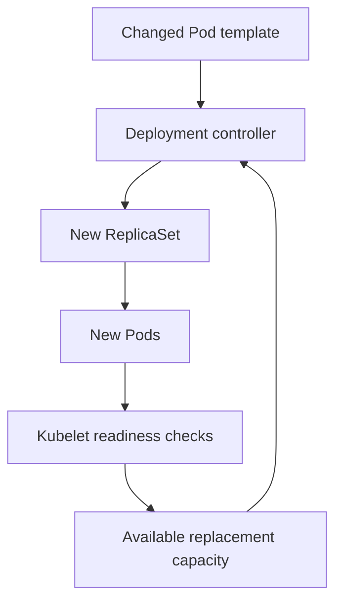

# Rolling Updates And Health Gates

A new `probe` version starts but cannot answer its readiness check. Kubernetes keeps the process running while the Deployment waits for usable replacement capacity. Reading this situation correctly prevents a failed rollout from being mistaken for a missing update.

## Learning objectives

- Identify Deployment template changes and revisions.
- Explain how readiness gates replacement capacity.
- Evaluate rollback compatibility and external state.

## Before you start

The playground for this module runs a `probe` Deployment with two replicas in the `starfleet` namespace. A Pod is the Kubernetes unit for running one or more containers, and a namespace groups namespaced objects. A Deployment is the object that describes the desired replicas of an application and how to replace them. The commands in this chapter run against that playground.

## Responsible components and behavior

Version two of `scout` replaces version one. A Deployment rolling update gradually changes replicas from the old Pod template to the new one. During the transition, old and new replicas can coexist. The application and its data interfaces must tolerate that overlap.

Three components cooperate. The Deployment controller, which runs inside the kube-controller-manager, watches Deployments and creates ReplicaSets. A ReplicaSet is the controller-owned object that keeps a fixed number of Pods running for one Pod template. The kubelet, the agent on each node, starts the containers and runs the readiness check for every Pod.

The rollout strategy can limit how many replicas are unavailable and how many extra replicas are created. Extra replicas need node capacity, so a rollout can stall when the cluster cannot host the temporary increase. A valid update does not remove scheduling or dependency requirements.

## Watch a rollout happen

Start with the objects the playground created. The Deployment owns one ReplicaSet for each Pod template it has used.

<!-- astrona:playground:renew -->

```sh
export KUBECONFIG="$(astrona kubeconfig ats-024-playground-010-01)"
kubectl -n starfleet get deployment probe
kubectl -n starfleet get replicasets -l app=probe
```

The `READY` column of the Deployment shows ready replicas against desired replicas. The ReplicaSet list shows one ReplicaSet with two Pods. Its name ends with a hash of the Pod template, which is how the Deployment controller tells templates apart.

Now change the template. Setting a container environment variable changes the Pod template, so the Deployment controller creates a second ReplicaSet:

```sh
kubectl -n starfleet set env deployment/probe VERSION=v2
kubectl -n starfleet rollout status deployment/probe --timeout=120s
kubectl -n starfleet get replicasets -l app=probe
```

The `rollout status` command watches the Deployment status until every replica is updated and available. It exits with status zero on success and nonzero when the wait ends in a failure or a timeout. After the rollout the old ReplicaSet still exists with zero replicas. The Deployment keeps it so that an earlier template can be restored.

## How readiness gates progress

Readiness influences whether a new Pod can join ordinary Service traffic. A process that starts but fails readiness does not provide usable replacement capacity. The kubelet runs the readiness probe, reports the result in the Pod `Ready` condition, and the Deployment controller counts only ready Pods toward availability.

A progress deadline can identify a rollout that is not progressing, but a Deployment does not automatically guarantee a correct rollback simply because progress has failed. The Deployment reports the condition and keeps the old ReplicaSet serving. A person or a pipeline must decide what to do next.

Liveness and startup checks answer different questions from readiness. A liveness probe restarts a container that is stuck. A startup probe delays the other probes while a slow application starts. A release can remain Running while failing readiness, or repeatedly restart because a startup setting is wrong. Examine the probe's configured condition and its action before treating all health-check failures alike.

## Failure cases to recognize

Three failures look similar from outside because the old Pods keep serving. An image that cannot be pulled leaves new Pods in `ErrImagePull` or `ImagePullBackOff`. A readiness path that returns an error leaves new Pods `Running` but not `Ready`. A Pod that requests more CPU or memory than any node can give stays `Pending`.

Each failure shows in a different place. Use the Pod list for the phase and the `READY` column, and `kubectl describe pod` for the events:

```sh
kubectl -n starfleet get pods -l app=probe
kubectl -n starfleet describe deployment probe
```

The `describe deployment` output lists the conditions `Available` and `Progressing` and the old and new ReplicaSet names. The old ReplicaSet scaled down only as far as the new Pods became ready.

## Version compatibility during overlap

Old and new replicas can serve requests concurrently. They may share a database, queue or external API. A schema change that version two requires but version one cannot tolerate makes gradual overlap unsafe unless the migration is designed for compatibility. Expanding a schema before switching consumers and removing obsolete behavior later is one way teams manage that risk.

Rollback restores a previous Pod template through the supported rollout history. It may repair an application image regression, but configuration outside that template and irreversible data changes can remain. A backwards-incompatible schema change can make the earlier image unsafe to run. The recovery plan must identify those dependencies before rollback is needed.

A safe decision uses the desired version, the actual running artifact identities, replica availability and representative requests. Controller progress is necessary evidence for a rollout, but user-facing error rates and critical application behavior determine whether the release is suitable to keep. A controller can complete its update while the application produces wrong calculations.



The controller increases replacement capacity only as the reported readiness and strategy permit.

You can now connect template intent with replica ownership and health gates. The next question is how many extra and unavailable replicas the strategy allows at each step.

## Common pitfalls

> [!WARNING]
> A completed rollout is not proof of business correctness. A rollback does not reverse external configuration, data migrations or side effects. A Pod that is `Running` is not necessarily `Ready`, and only ready Pods count as replacement capacity.
