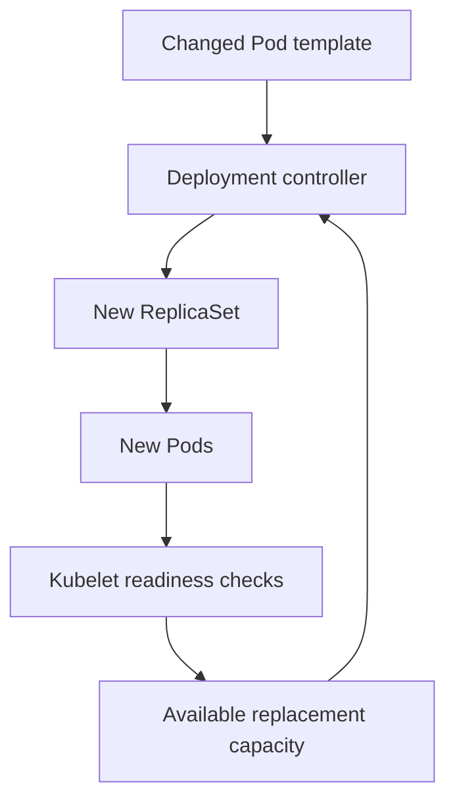

# Rolling Updates And Health Gates

A new `probe` version starts but cannot answer its readiness check. Kubernetes keeps the process running while the Deployment waits for usable replacement capacity. Reading this situation correctly prevents a failed rollout from being mistaken for a missing update.

## Learning objectives

- Identify Deployment template changes and revisions.
- Calculate rolling-update limits.
- Explain health and capacity effects on progress.

## Before you start

This chapter is standalone reading material; no running cluster or installed tools are required. A Pod is the Kubernetes unit for running one or more containers, and a namespace groups namespaced objects. Treat the worked configurations as teaching examples rather than recorded observations from a provisioned environment.

## Responsible components and behavior

Version two of `scout` replaces version one. A Deployment rolling update gradually changes replicas from the old Pod template to the new one. During the transition, old and new replicas can coexist. The application and its data interfaces must tolerate that overlap.

The rollout strategy can limit how many replicas are unavailable and how many extra replicas are created. Extra replicas need node capacity, so a rollout can stall when the cluster cannot host the temporary increase. A valid update does not remove scheduling or dependency requirements.

Readiness influences whether a new Pod can join ordinary Service traffic. A process that starts but fails readiness does not provide usable replacement capacity. A progress deadline can identify a rollout that is not progressing, but a Deployment does not automatically guarantee a correct rollback simply because progress has failed.

Liveness and startup checks answer different questions from readiness. A release can remain Running while failing readiness, or repeatedly restart because a startup setting is wrong. Examine the probe's configured condition and its action before treating all health-check failures alike.

Rollback restores a previous Pod template through the supported rollout history. It may repair an application image regression, but configuration outside that template and irreversible data changes can remain. A backwards-incompatible schema change can make the earlier image unsafe to run.

A safe decision uses desired version, actual running artifact identities, replica availability and representative requests. Controller progress is necessary evidence for a rollout, but user-facing error rates and critical application behavior determine whether the release is suitable to keep.

## Capacity During A Rolling Update

Assume a Deployment requests four replicas and permits one extra replica during replacement. The update can temporarily require capacity for five Pods. If all nodes are already full at four, the new Pod can remain Pending. The release problem is then temporary capacity, not necessarily a defective image.

An unavailable-replica allowance describes how much serving capacity can be absent during progress. A surge allowance describes how much additional population can be created. Their interaction affects both availability and resource consumption. Relative percentage settings require interpretation against the desired replica count rather than assuming the same number of extra Pods for every application.

Ready status is one of the gates for usable replacement capacity. A minimum ready duration, where configured, can require stability before availability is counted. This reduces immediate promotion of a process that briefly passes its check and then fails, but it still does not exercise every application operation.

## Version Compatibility During Overlap

Old and new replicas can serve requests concurrently. They may share a database, queue or external API. A schema change that version two requires but version one cannot tolerate makes gradual overlap unsafe unless the migration is designed for compatibility. Expanding a schema before switching consumers and removing obsolete behavior later is one way teams manage that risk.

A rollout history captures Pod template revisions, not a complete record of every external configuration or data effect. An older image can be available for reversal while the current database no longer supports it. The recovery plan must identify those dependencies before rollback is needed.

Verification should compare requested revision, observed artifact identities, availability and representative outcomes. A controller can complete its update while the application produces wrong calculations. The release gate should reflect the user's critical operations as well as Kubernetes progress.

## Work through the decision

A Deployment describes the desired application replicas. A ReplicaSet is the controller-owned object that maintains Pods for one template. When the Deployment template changes, its controller creates or reuses the corresponding ReplicaSet and adjusts the old and new replica counts. The kubelet, the node agent that manages containers, performs the readiness check for each Pod.

These responsibilities differ. The Deployment controller does not call every application endpoint itself. It acts on reported Pod readiness and its rollout strategy. The Service backend controller separately uses readiness when constructing eligible backends. A broken readiness path can therefore block replacement capacity and remove traffic eligibility without proving that the container process exited.

The controller increases replacement capacity only as the reported readiness and strategy permit.

You can now connect template intent with replica ownership and health gates. A completed replacement still needs application checks that cover the behavior users rely on.

## Common pitfalls

> [!WARNING]
> A completed rollout is not proof of business correctness. Rollback does not automatically reverse external configuration, data migrations or side effects.
