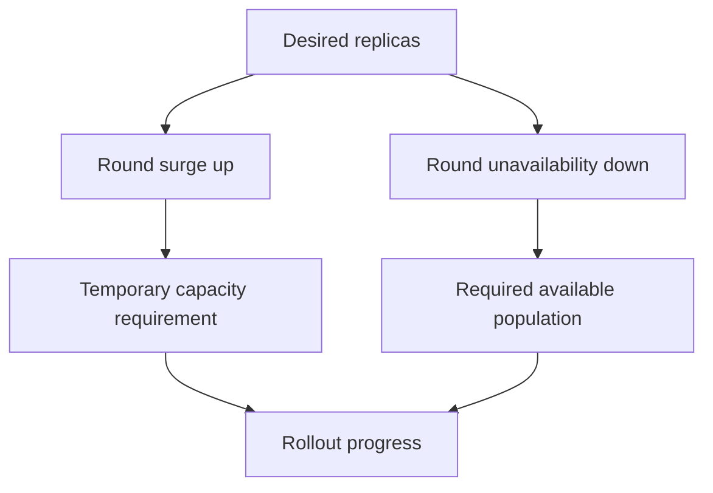

# Calculating Rollout Capacity And Diagnosing Progress

Three desired replicas and a twenty-five percent surge allowance permit one extra Pod. The same percentage for unavailability permits zero unavailable replicas. Understanding the different rounding rules explains why a small Deployment may need spare capacity before any old Pod can be removed.

## Learning objectives

- Identify which template changes create a revision.
- Calculate rolling-update limits.
- Explain health and capacity effects on progress.
- Diagnose a stalled rollout from Pod evidence.

## Before you start

The playground for this module runs a `probe` Deployment with two replicas in the `starfleet` namespace. A Pod is the Kubernetes unit for running one or more containers. The commands in this chapter read the Deployment and change its strategy.

## Responsible components and behavior

A Deployment rollout replaces Pods after its Pod template changes. Its rolling-update strategy controls how much additional capacity can be created and how much intended capacity can be unavailable during the transition. The Deployment controller applies these limits when it scales the new and old ReplicaSets. They constrain controller behavior; they do not promise that the application will serve every request correctly.

## Identify which change creates a revision

The Pod template contains fields such as container images, environment variables and template labels. Changing that template normally creates a new ReplicaSet for a Deployment rollout. Changing the top-level desired replica count is a scaling action and does not by itself describe a new application revision.

Check the difference in the playground. Scaling changes only the replica count of the current ReplicaSet:

<!-- astrona:playground:renew -->

```sh
export KUBECONFIG="$(astrona kubeconfig ats-024-playground-010-01)"
kubectl -n starfleet scale deployment/probe --replicas=3
kubectl -n starfleet get replicasets -l app=probe
```

The ReplicaSet list still shows the same ReplicaSets as before, and the current one now has three Pods. No new ReplicaSet appeared because the template did not change. Scale back to two replicas before the next step:

```sh
kubectl -n starfleet scale deployment/probe --replicas=2
```

Updating a ConfigMap without changing the Deployment template does not automatically create a new Deployment revision. Mounted configuration may propagate according to its delivery semantics, while process environment variables are fixed at container startup. A Secret or an image tag that points at changed bytes also changes without a revision. Reverting a template therefore cannot be assumed to restore every dependency or artifact used by an earlier successful release.

## Work through surge and unavailability

`maxSurge` limits extra Pods above the desired replica count during an update. `maxUnavailable` limits permitted unavailability relative to the desired count. Each can be an integer or a percentage. Percentage surge values round up, while percentage unavailability values round down. If neither field is set, both default to twenty-five percent.

For a Deployment with four desired replicas and both values set to twenty-five percent, the numerical limits are one extra Pod and one unavailable Pod. With three desired replicas, the same percentages allow one surge Pod and zero unavailable Pods. Rounding changes the result, especially for small workloads. The API rejects a strategy where both values are zero, because no step could ever be taken.

A setting of zero unavailable Pods requires replacement capacity to become available before old capacity is reduced under that budget. The cluster must be able to schedule and run the necessary surge. If resources are exhausted, the new Pod can stay Pending while the old Pods remain, and the rollout can stop making progress.

Terminating Pods can retain resources while shutdown completes, so actual resource use can temporarily exceed a simple desired-plus-surge estimate. Resource planning should consider termination behavior and implementation details instead of treating the arithmetic as an absolute memory ceiling for the namespace.

Read the configured values from the playground Deployment:

```sh
kubectl -n starfleet get deployment probe -o jsonpath='{.spec.strategy}{"\n"}'
```

The playground Deployment sets no strategy of its own, so the command shows the server defaults. Change them with a merge patch, then confirm:

```sh
kubectl -n starfleet patch deployment probe --type merge -p '{"spec":{"strategy":{"rollingUpdate":{"maxSurge":1,"maxUnavailable":0}}}}'
kubectl -n starfleet get deployment probe -o jsonpath='{.spec.strategy}{"\n"}'
```

A strategy change is not a template change, so it creates no new revision and no rollout. It applies from the next template change onward.

## Availability depends on health

A Pod that starts successfully can remain unready. Readiness checks and `minReadySeconds`, when configured, influence when a replacement contributes to Deployment availability. `minReadySeconds` is the number of seconds a new Pod must stay ready, without a container crash, before it counts as available. An incorrect check can either admit unusable capacity or prevent useful capacity from being counted.

`progressDeadlineSeconds` bounds how long a rollout can fail to make required progress before the Deployment reports a `Progressing` condition with reason `ProgressDeadlineExceeded`. The default is 600 seconds. Reporting that failure does not automatically roll back the application. The author must interpret the condition and choose an appropriate correction.

Paused rollout behavior is separate again: pausing controls progression of template updates according to Deployment semantics. It does not repair a crashing process, create missing storage or make an image available. Describe the requested outcome before selecting a lifecycle control.

## Select evidence at the correct level

A stuck update can result from an unavailable image, missing configuration, scheduling constraints or failed readiness. Compare desired replicas, updated replicas, available replicas and the new Pods' states. Events and container status can show whether failure happens before startup or after the process is running.

```sh
kubectl -n starfleet get deployment probe
kubectl -n starfleet get pods -l app=probe
kubectl -n starfleet get events --sort-by=.metadata.creationTimestamp
```

The Deployment columns `UP-TO-DATE` and `AVAILABLE` show how many replicas match the newest template and how many are available. If a new image repeatedly exits, increasing surge might create more failing attempts without improving availability. If all new Pods remain Pending because of requests that cannot fit, changing readiness probes cannot solve placement. The relevant condition determines the correction.

## Work through the decision

Work through the arithmetic before changing strategy. For three replicas, twenty-five percent is 0.75. Surge rounds up to one; unavailability rounds down to zero. Kubernetes can create a replacement, but it must count as available before reducing the old available population under that budget. If the replacement cannot schedule, changing its readiness path has no effect on that placement failure.

With ten replicas and the same percentages, surge becomes three and unavailability becomes two. The difference is not a different algorithm: the desired count changed. These calculations describe rollout constraints, rather than an exact ceiling on all resource consumption.



Both temporary capacity and available replacement capacity constrain the same rollout.

You can now calculate the controller budget and explain a stalled update using Pod evidence. The chosen correction must address the cause; a larger allowance does not repair an invalid image or a failed application check.

## Common pitfalls

> [!WARNING]
> Rollout budgets are controller limits, not guarantees of correct requests. Percentage rounding, readiness, surge capacity and external dependencies all affect progress, and a deadline condition does not automatically trigger rollback. Scaling and strategy edits create no new revision.
