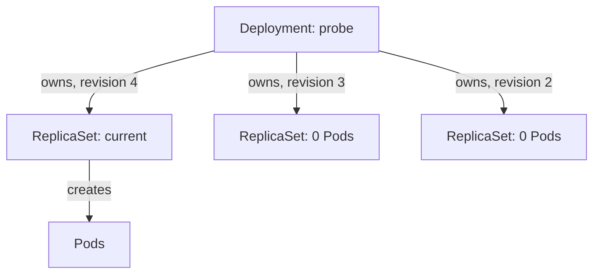

# Revision History And ReplicaSet Ownership

A release of `probe` returns wrong answers, and the team asks which versions ran before it. A Deployment can answer, because it keeps one ReplicaSet for each Pod template it has used. Knowing where those revisions live explains what `kubectl rollout history` prints and why history can run out.

## Learning objectives

- Explain that each revision is a ReplicaSet owned by the Deployment.
- Read `kubectl rollout history` and a single revision.
- Set `revisionHistoryLimit` and the change-cause annotation.

## Before you start

The playground has a `probe` Deployment in the `starfleet` namespace with two replicas. A Deployment is the object that describes the desired replicas of an application. A ReplicaSet is the object that keeps a fixed number of identical Pods running. The playground setup already changed `probe` twice, so it has three revisions.

## One revision is one ReplicaSet

Start with the evidence. List the ReplicaSets that belong to `probe`:

<!-- astrona:playground:renew -->

```sh
export KUBECONFIG="$(astrona kubeconfig ats-024-playground-010-02)"
kubectl -n starfleet get replicasets -l app=probe
```

The list shows three ReplicaSets. Only the newest one has Pods; the other two have zero desired replicas. Each name is `probe-` followed by a hash. The Deployment controller computes that hash from the Pod template and adds it as the `pod-template-hash` label on the ReplicaSet and on its Pods.

The Deployment controller, which runs in the kube-controller-manager, creates and scales these ReplicaSets. The ReplicaSet controller, a second controller in the same process, creates the Pods. The kubelet on each node starts the containers.

Ownership is stored in the object itself. Read the owner of the newest ReplicaSet:

```sh
kubectl -n starfleet get replicasets -l app=probe -o jsonpath='{range .items[*]}{.metadata.name}{" owner="}{.metadata.ownerReferences[0].kind}/{.metadata.ownerReferences[0].name}{" revision="}{.metadata.annotations.deployment\.kubernetes\.io/revision}{"\n"}{end}'
```

Every ReplicaSet names the Deployment `probe` as its owner and carries the annotation `deployment.kubernetes.io/revision`. That annotation holds the revision number. The owner reference also means that deleting the Deployment deletes its ReplicaSets and Pods through garbage collection.

## Reading the rollout history

The history command reads those annotations and lists the revisions in order:

```sh
kubectl -n starfleet rollout history deployment/probe
```

The output has two columns, `REVISION` and `CHANGE-CAUSE`. To see what one revision contained, name it:

```sh
kubectl -n starfleet rollout history deployment/probe --revision=2
```

This prints the Pod template of revision 2: labels, container image, environment variables and probes. Compare two revisions by reading both and looking for the field that differs. In the playground the difference is the value of the `VERSION` environment variable.

When a template returns to a form it had before, the Deployment controller does not create a new ReplicaSet. It finds the existing ReplicaSet with the same template hash, scales it up and gives it the next revision number. That is why a revision number can move forward while the number of ReplicaSets stays the same.

## Recording why a revision exists

The `CHANGE-CAUSE` column shows the value of the annotation `kubernetes.io/change-cause` that the Deployment had when the revision was created. A revision without the annotation shows `<none>`. The old `--record` flag filled this column automatically, but it is deprecated. Set the annotation yourself, before the change:

```sh
kubectl -n starfleet annotate deployment/probe kubernetes.io/change-cause="Set VERSION to v4 for the evening release"
kubectl -n starfleet set env deployment/probe VERSION=v4
kubectl -n starfleet rollout status deployment/probe --timeout=120s
kubectl -n starfleet rollout history deployment/probe
```

The annotation by itself changes only Deployment metadata, so it starts no rollout. The `set env` command changes the template, and the new revision copies the annotation. A new history line appears with the text you wrote. Without the text, a reader of the history sees only numbers.

## Limiting the history

Every kept ReplicaSet costs an object in the cluster store, and every revision is a possible rollback target. The field `spec.revisionHistoryLimit` sets how many old ReplicaSets with zero replicas the Deployment keeps. The default is 10. The controller deletes the oldest ones beyond the limit.

Set a limit and read it back:

```sh
kubectl -n starfleet patch deployment/probe --type merge -p '{"spec":{"revisionHistoryLimit":3}}'
kubectl -n starfleet get deployment/probe -o jsonpath='{.spec.revisionHistoryLimit}{"\n"}'
```

A value of 0 keeps no old ReplicaSets. The Deployment then cannot roll back at all, because the previous template no longer exists. A low limit is a deliberate trade of rollback depth for a smaller cluster state. The current ReplicaSet never counts against the limit.



The Deployment owns one ReplicaSet for each kept revision, and only the current one has Pods.

You can now find a revision, read its template and decide how long to keep it. What remains is the action of returning to one of them and the limits of that action.

## Common pitfalls

> [!WARNING]
> History holds Pod templates only. A `revisionHistoryLimit` of 0 removes every rollback target. A missing change-cause annotation leaves only revision numbers to read. Changing only `replicas` or an annotation on the Deployment creates no revision.
