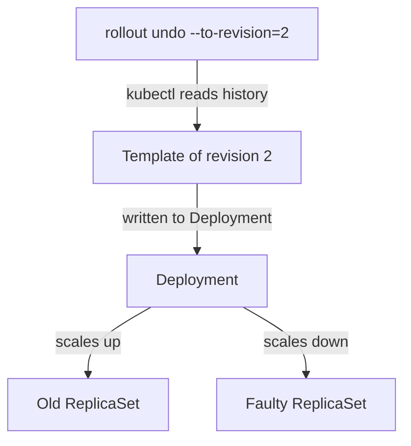

# Rolling Back, Pausing And Resuming

A bad release is running and users see errors now. The fastest repair is to return the Deployment to a Pod template that worked, and `kubectl rollout undo` does this without writing any YAML. Pausing a rollout is the related control that lets an operator make several changes and release them as one revision.

## Learning objectives

- Roll back to the previous revision and to a named revision.
- Explain what a rollback changes and what it leaves alone.
- Pause and resume a Deployment to batch changes.

## Before you start

The playground has a `probe` Deployment in the `starfleet` namespace with two replicas and several revisions. Each revision is a ReplicaSet that stores one Pod template. The `shuttle` Pod in the same namespace can send requests to the `probe` Service.

## Roll back to the previous revision

First look at the version that the Service returns, then at the history:

<!-- astrona:playground:renew -->

```sh
export KUBECONFIG="$(astrona kubeconfig ats-024-playground-010-02)"
kubectl -n starfleet exec shuttle -- wget -q -T 3 -O- http://probe/
kubectl -n starfleet rollout history deployment/probe
```

The response includes `version=` followed by the value of the `VERSION` variable in the running template. Now undo the last change:

```sh
kubectl -n starfleet rollout undo deployment/probe
kubectl -n starfleet rollout status deployment/probe --timeout=120s
kubectl -n starfleet exec shuttle -- wget -q -T 3 -O- http://probe/
```

The `undo` command is executed by the client, not by a special controller. kubectl reads the history, takes the template of the previous revision and writes it into the Deployment. From that point the Deployment controller treats it as an ordinary template change and runs a rolling update with the configured `maxSurge` and `maxUnavailable`. The old ReplicaSet is scaled up and the newer one is scaled down.

## Roll back to a named revision

Going back one step is not always enough. When revision 4 is faulty and revision 3 is also unwanted, name the target. Inspect the candidates first, then undo:

```sh
kubectl -n starfleet rollout history deployment/probe --revision=2
kubectl -n starfleet rollout undo deployment/probe --to-revision=2
kubectl -n starfleet rollout status deployment/probe --timeout=120s
kubectl -n starfleet rollout history deployment/probe
```

After the undo the history no longer lists revision 2 under that number. The ReplicaSet that held revision 2 receives the next revision number, so the newest line is the template you returned to. A rollback therefore moves forward in history: revision numbers only grow.

If you name a revision that does not exist, the command fails with a message that the revision was not found. That happens when `revisionHistoryLimit` already removed it.

## What a rollback restores

A rollback restores the Pod template: images, environment variables, probes, resource requests, volumes and template labels. It does not restore the replica count, because `spec.replicas` is not part of the template. It does not restore the strategy fields, `minReadySeconds` or the history limit. It does not restore a ConfigMap or Secret that the Pods read, and it does not undo changes already made to a database.

An image tag that was reused for new content also defeats a rollback. The old template names the same tag, so the nodes can pull the new bytes again. Using immutable tags or image digests keeps the old template meaningful.

## Pause and resume

Each template edit normally starts its own rollout and its own revision. Pausing stops the Deployment controller from rolling out new templates, so several edits can be made first. Pause, change two things, check that no rollout started, then resume:

```sh
kubectl -n starfleet rollout pause deployment/probe
kubectl -n starfleet set env deployment/probe VERSION=v5
kubectl -n starfleet set resources deployment/probe -c probe --requests=cpu=20m
kubectl -n starfleet rollout history deployment/probe
kubectl -n starfleet rollout resume deployment/probe
kubectl -n starfleet rollout status deployment/probe --timeout=120s
```

While paused, the history does not grow and no new Pods start. After `resume`, one rollout applies both edits and creates a single revision. Scaling still works while paused, because it does not need a new ReplicaSet.

A paused Deployment cannot be rolled back. The `undo` command reports that the Deployment is paused and must be resumed first. A forgotten pause is a common reason why an update seems to be ignored: the template changed, but `kubectl rollout status` keeps waiting, because the controller has not started the rollout. The field `spec.paused` shows the state.



The client copies the old template into the Deployment, and the Deployment controller performs the replacement.

You can now return to a chosen revision, batch changes and say what a rollback leaves in place. The reader should verify the user-facing result after each rollback, because a finished rollout proves only that Pods match the template.

## Common pitfalls

> [!WARNING]
> A paused Deployment ignores template changes and refuses `undo`. A rollback does not restore replicas, strategy, ConfigMaps, Secrets or data. A revision removed by `revisionHistoryLimit` cannot be a target. Confirm the version the Service returns after every rollback.
