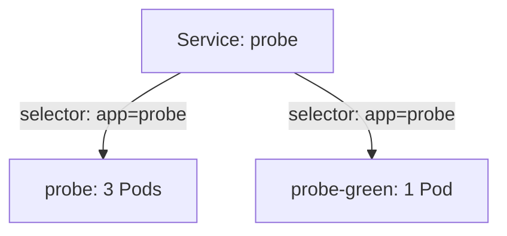

# Deployment Strategies: Recreate, Blue-Green And Canary

Version two of `probe` changes a data format that version one cannot read. Running both versions at the same time would corrupt data, so a rolling update is wrong for this release. Kubernetes offers a second built-in strategy and two common patterns that are built from ordinary objects.

## Learning objectives

- Choose RollingUpdate or Recreate and explain the outage that Recreate causes.
- Switch traffic between two Deployments by changing a Service selector.
- Run a canary with two Deployments and read the traffic share.
- Set `progressDeadlineSeconds` and `minReadySeconds`.

## Before you start

The playground has a `probe` Deployment with two replicas and a `probe` Service in `starfleet`. A Service is an object that gives a stable address to the Pods that match its label selector. The `shuttle` Pod can send requests to that Service.

## Recreate stops everything first

The Deployment field `spec.strategy.type` has two values. `RollingUpdate` is the default. `Recreate` scales the old ReplicaSet to zero, waits until its Pods have terminated, and only then creates the new Pods. Between the two steps no Pod serves requests.

Switch `probe` to Recreate and change the template:

<!-- astrona:playground:renew -->

```sh
export KUBECONFIG="$(astrona kubeconfig ats-024-playground-010-03)"
kubectl -n starfleet patch deployment/probe --type merge -p '{"spec":{"strategy":{"type":"Recreate","rollingUpdate":null}}}'
kubectl -n starfleet set env deployment/probe VERSION=v2
kubectl -n starfleet get pods -l app=probe -w
```

The watch shows the old Pods terminating before any new Pod appears. Stop it with Ctrl+C. The `rollingUpdate: null` part is required, because the API rejects `rollingUpdate` parameters on a Recreate strategy. Use Recreate when two versions must never overlap, for example when the application holds an exclusive lock on shared storage. The price is downtime for the length of the shutdown plus start-up and readiness.

## Blue-green with a Service selector

Blue-green keeps two full copies: the current version (blue) and the new version (green). A Service sends all requests to one of them. Switching means changing one selector. First save the green Deployment as `deployment-probe-green.yaml`:

```yaml
apiVersion: apps/v1
kind: Deployment
metadata:
  name: probe-green
  namespace: starfleet
spec:
  replicas: 2
  selector:
    matchLabels:
      app: probe
      track: green
  template:
    metadata:
      labels:
        app: probe
        track: green
    spec:
      containers:
      - name: probe
        image: docker.io/library/python:3.13-alpine
        command: ["python", "/app/server.py"]
        env:
        - name: VERSION
          value: v3
        ports:
        - name: http
          containerPort: 8080
        readinessProbe:
          httpGet:
            path: /ready
            port: http
          periodSeconds: 2
        volumeMounts:
        - name: app
          mountPath: /app
          readOnly: true
      volumes:
      - name: app
        configMap:
          name: probe-code
```

Apply it:

```sh
kubectl apply -f deployment-probe-green.yaml
kubectl -n starfleet rollout status deployment/probe-green --timeout=120s
```

The existing Service selects `app: probe` and `release: probe`, and the green Pods carry no `release` label, so they receive no traffic yet. Green can be tested directly by Pod address before the switch. Switch the Service to the green Pods, check the answer, and switch back if needed:

```sh
kubectl -n starfleet patch service/probe -p '{"spec":{"selector":{"app":"probe","track":"green"}}}'
kubectl -n starfleet exec shuttle -- wget -q -T 3 -O- http://probe/
```

The Service answer now shows `version=v3`. The EndpointSlice controller recalculates the backends within moments of the selector change. Blue-green gives an instant switch and an instant return, but it needs capacity for both copies, and both versions share any database.

## Canary with two Deployments

A canary sends a small share of requests to the new version. Without a service mesh, Kubernetes does this by letting one Service select the Pods of two Deployments. Give each Deployment a distinct `track` label in its selector, and give both the shared label that the Service selects. The Service spreads requests across all ready Pods, so the share follows the Pod counts: one canary Pod next to nine stable Pods receives about ten percent.

Restore the Service to the shared label and scale the Deployments to set the share:

```sh
kubectl -n starfleet patch service/probe -p '{"spec":{"selector":{"app":"probe"}}}'
kubectl -n starfleet scale deployment/probe --replicas=3
kubectl -n starfleet scale deployment/probe-green --replicas=1
```

The Service selector `app: probe` now matches both Deployments. Roughly one request in four reaches the canary. The share is approximate, because kube-proxy picks a backend per connection and does not count requests. To finish the canary, move the stable Deployment to the new template and delete the canary. To abort, scale the canary to zero.

## Deadlines and minimum ready time

Two Deployment fields make any strategy safer. `minReadySeconds` is the time a new Pod must stay ready, with no container crash, before it counts as available. `progressDeadlineSeconds` is the time the Deployment waits for progress before it sets the condition `Progressing` to `False` with reason `ProgressDeadlineExceeded`. The deadline must be larger than `minReadySeconds`.

```sh
kubectl -n starfleet patch deployment/probe --type merge -p '{"spec":{"minReadySeconds":10,"progressDeadlineSeconds":120}}'
kubectl -n starfleet rollout status deployment/probe --timeout=60s
```

When the deadline passes, `kubectl rollout status` exits with an error that the progress deadline was exceeded. Nothing is rolled back; the old ReplicaSet keeps serving, and the operator decides.



One Service selects the Pods of both Deployments, so the Pod counts set the traffic share.

You now know three ways to release the same change and what each one costs. The next topic is workloads whose Pods are not interchangeable.

## Common pitfalls

> [!WARNING]
> Recreate causes downtime by design. Two Deployments with overlapping selectors can adopt each other's Pods, so keep the `track` label in each selector. A canary share follows Pod counts, not request counts. A passed progress deadline does not roll back anything.
