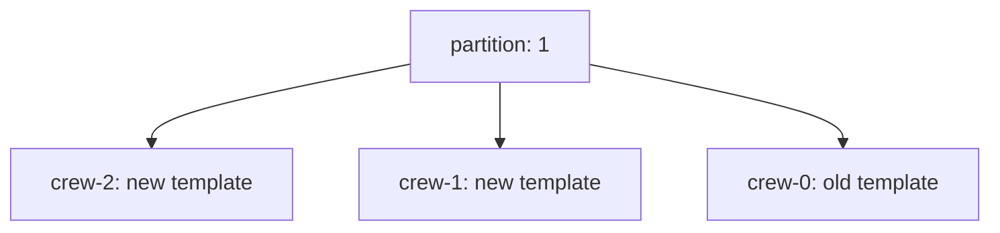

# Updating StatefulSets And DaemonSets

A database cluster of four Pods must not receive a new version on all members at once, and a node agent must run on every node during its update. StatefulSets and DaemonSets replace Pods under their own rules, which differ from a Deployment. This chapter shows those rules and the controls that stage an update.

## Learning objectives

- Explain StatefulSet update order and the `partition` field.
- Stage a StatefulSet update and then complete it.
- Compare the DaemonSet `RollingUpdate` and `OnDelete` strategies.
- Use `rollout status`, `history` and `undo` on both kinds.

## Before you start

The playground has a StatefulSet named `crew` with three Pods and a DaemonSet named `scanner`, both in `starfleet`. A StatefulSet is a controller that gives each Pod a stable name and ordinal (`crew-0`, `crew-1`, `crew-2`). A DaemonSet is a controller that runs one Pod on each eligible node. Both store revisions as ControllerRevision objects.

## StatefulSet order and partition

A StatefulSet with the `RollingUpdate` strategy updates its Pods one at a time in reverse ordinal order: `crew-2` first, then `crew-1`, then `crew-0`. It waits for each updated Pod to be Running and Ready before it moves to the next one. The field `spec.updateStrategy.rollingUpdate.partition` limits the update: only Pods with an ordinal greater than or equal to the partition receive the new template. Pods below it keep the old template, even if they are deleted and recreated. The default partition is 0.

Look at the starting state, then stage an update to the two highest ordinals:

<!-- astrona:playground:renew -->

```sh
export KUBECONFIG="$(astrona kubeconfig ats-024-playground-010-03)"
kubectl -n starfleet get statefulset crew
kubectl -n starfleet get pods -l app=crew -o jsonpath='{range .items[*]}{.metadata.name}{" "}{.spec.containers[0].image}{"\n"}{end}'
```

All three Pods use the old image. Save this patch as `statefulset-crew-partition.yaml`:

```yaml
spec:
  updateStrategy:
    type: RollingUpdate
    rollingUpdate:
      partition: 1
  template:
    spec:
      containers:
      - name: crew
        image: docker.io/library/busybox:1.37.0
```

Apply it:

```sh
kubectl -n starfleet patch statefulset crew --patch-file statefulset-crew-partition.yaml
kubectl -n starfleet rollout status statefulset/crew --timeout=120s
```

Then check the result by listing the images again. `crew-2` and `crew-1` run the new image and `crew-0` still runs the old one. The status shows `currentRevision` for the old template and `updateRevision` for the new one. This is a staged update: operators test the first updated Pods and later lower the partition to 0 to finish:

```sh
kubectl -n starfleet patch statefulset crew --type merge -p '{"spec":{"updateStrategy":{"rollingUpdate":{"partition":0}}}}'
kubectl -n starfleet rollout status statefulset/crew --timeout=120s
```

Lowering the partition starts the update of `crew-0`. A partition larger than the replica count updates nothing, which can make a template change look ignored.

## StatefulSet failure and rollback

With the default pod management policy `OrderedReady`, a bad template can block the update: the new Pod never becomes Ready, so the controller never touches the next ordinal. Reverting the template does not always repair the Pod that is already stuck, and the stuck Pod must be deleted by hand so that the controller recreates it from the good template. `kubectl rollout undo statefulset/crew` writes the previous revision back, and the history comes from ControllerRevision objects:

```sh
kubectl -n starfleet rollout history statefulset/crew
kubectl -n starfleet get controllerrevisions
```

The optional field `minReadySeconds` also applies: a Pod must stay ready for that time before the controller moves on. Persistent volume claims are not changed by an image update, so data stays with each ordinal.

## DaemonSet strategies

A DaemonSet has two strategies in `spec.updateStrategy.type`. With `RollingUpdate`, the default, the controller replaces the Pod on each node and limits the number of nodes without an available Pod with `maxUnavailable`, which defaults to 1. It can also use `maxSurge` to start the new Pod on a node before it stops the old one. The two limits cannot both be above zero. With `OnDelete`, the controller never replaces a Pod itself: it creates the new template only when someone deletes the old Pod.

Update the playground DaemonSet and watch it:

```sh
kubectl -n starfleet set image daemonset/scanner scanner=docker.io/library/busybox:1.37.0
kubectl -n starfleet rollout status daemonset/scanner --timeout=120s
kubectl -n starfleet get daemonset scanner
```

The `UP-TO-DATE` column shows how many node Pods run the newest template. With `OnDelete` the same command would end with a message that waits for manual deletion, and `kubectl delete pod` on each node Pod applies the change. That mode suits agents whose restart needs to be timed per node. The commands `rollout history` and `rollout undo` work for DaemonSets the same way as for StatefulSets.



Pods at or above the partition ordinal take the new template, and the Pods below it keep the old one.

You can now stage a StatefulSet update, finish it, and pick a DaemonSet strategy. A staged update is only useful when someone checks the updated Pods before lowering the partition.

## Common pitfalls

> [!WARNING]
> Changing the template and the partition in separate steps can update more Pods than intended. A broken StatefulSet Pod can block later ordinals and may need manual deletion after the fix. A DaemonSet with `OnDelete` never updates by itself, and `maxSurge` and `maxUnavailable` cannot both be nonzero.
