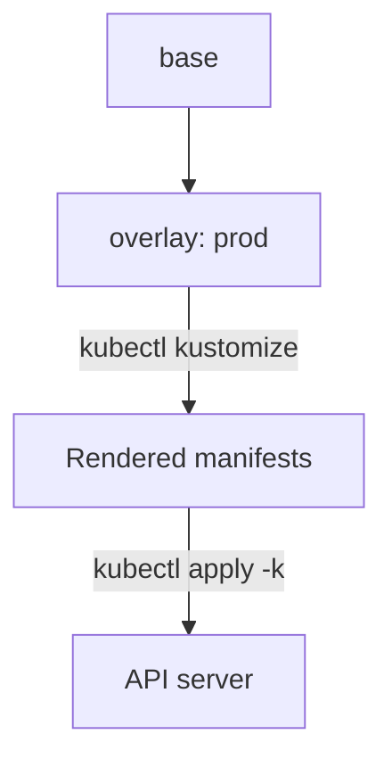

# Kustomize Bases, Overlays And Patches

The `beacon` application must run with one replica for testing and three replicas with a newer image in production. Kustomize builds both from one shared base and a small overlay for each environment, with no templating language. It is built into `kubectl`, so it needs no extra tool on an exam machine.

## Learning objectives

- Write a `kustomization.yaml` for a base and an overlay.
- Use `images`, `replicas`, `namePrefix`, `namespace` and `labels`.
- Add a patch for a change the fields cannot express.
- Preview with `kubectl kustomize` and apply with `kubectl apply -k`.

## Before you start

Kustomize is a tool that reads a directory with a file named `kustomization.yaml` and produces Kubernetes manifests. A base is a directory of plain manifests. An overlay is a directory that refers to a base and changes it. The playground has an `outpost` namespace where the example runs.

## A base and an overlay

Create the directories for the base and the production overlay:

<!-- astrona:playground:renew -->

```sh
export KUBECONFIG="$(astrona kubeconfig ats-024-playground-010-04)"
mkdir -p kustomize/base kustomize/overlays/prod
```

Save this as `kustomize/base/deployment.yaml`:

```yaml
apiVersion: apps/v1
kind: Deployment
metadata:
  name: beacon
spec:
  replicas: 1
  selector:
    matchLabels:
      app: beacon
  template:
    metadata:
      labels:
        app: beacon
    spec:
      containers:
      - name: beacon
        image: docker.io/library/busybox:1.36.1
        command: ["sh", "-c", "sleep 3600"]
```

The base names no namespace. Save this as `kustomize/base/kustomization.yaml`:

```yaml
resources:
- deployment.yaml
```

Save this as `kustomize/overlays/prod/kustomization.yaml`:

```yaml
resources:
- ../../base
namespace: outpost
namePrefix: prod-
labels:
- pairs:
    env: prod
  includeTemplates: true
images:
- name: docker.io/library/busybox
  newTag: "1.37.0"
replicas:
- name: beacon
  count: 3
```

Print the result without touching the cluster, then apply it:

```sh
kubectl kustomize kustomize/overlays/prod
kubectl apply -k kustomize/overlays/prod
kubectl -n outpost rollout status deployment/prod-beacon --timeout=120s
```

`kubectl kustomize` renders the manifests to the terminal. `apply -k` renders them in the same way and sends them to the API server. The rendered Deployment is named `prod-beacon`, lives in `outpost`, has three replicas, runs `busybox:1.37.0` and carries the label `env: prod` on its metadata and on its Pod template.

## What each field does

`resources` lists files, or other directories, to include. `namespace` sets the namespace on every namespaced object. `namePrefix` and `nameSuffix` change names and update references to them. `labels` adds labels, and `includeTemplates: true` also adds them to Pod templates; `includeSelectors` would also add them to selectors, which cannot be changed on an existing Deployment. The older field `commonLabels` does both and is deprecated.

The `images` transformer matches the image name in the base, without the tag, and sets `newName`, `newTag` or `digest`. The `replicas` transformer matches the original resource name from the base, not the prefixed name. These fields cover the most common changes without any patch.

## Patches for everything else

A patch changes a field that no transformer covers. A strategic merge patch is a partial manifest. Save this as `kustomize/overlays/prod/patch-resources.yaml`:

```yaml
apiVersion: apps/v1
kind: Deployment
metadata:
  name: beacon
spec:
  template:
    spec:
      containers:
      - name: beacon
        resources:
          requests:
            cpu: 10m
            memory: 16Mi
```

List it in the overlay by adding this block at the end of `kustomize/overlays/prod/kustomization.yaml`:

```yaml
patches:
- path: patch-resources.yaml
```

The patch names the base Deployment `beacon`, because patches apply before the prefix. A JSON 6902 patch uses an inline `patch` with `target` and operations such as `replace`, and suits list items. Run `kubectl diff -k kustomize/overlays/prod` to compare the rendered result with the live objects before applying.

## Updates and rollbacks with Kustomize

Kustomize has no release history. Applying an overlay is a normal `kubectl apply`, so a changed image tag starts an ordinary Deployment rollout and creates a revision. Rolling back is the same as for any Deployment: use `kubectl rollout undo`, or restore the previous overlay from version control and apply it again. The second way is the one that keeps the files and the cluster in agreement.

A `configMapGenerator` adds a hash of the content to the ConfigMap name and changes the reference in the Deployment. A content change then changes the Pod template and starts a rollout, which a plain ConfigMap edit does not do.



The overlay refers to the base, `kubectl` renders the combined manifests, and `apply -k` sends them to the API server.

You can now describe an environment as a small overlay and release it with one command. The other common tool adds a release record, which changes how rollback works.

## Common pitfalls

> [!WARNING]
> The `replicas` transformer uses the name from the base, not the prefixed name. Adding labels to selectors changes an immutable field on an existing Deployment. `kubectl apply -k` needs a directory with `kustomization.yaml`, not a file. Kustomize keeps no history, so rollback comes from `rollout undo` or version control.
