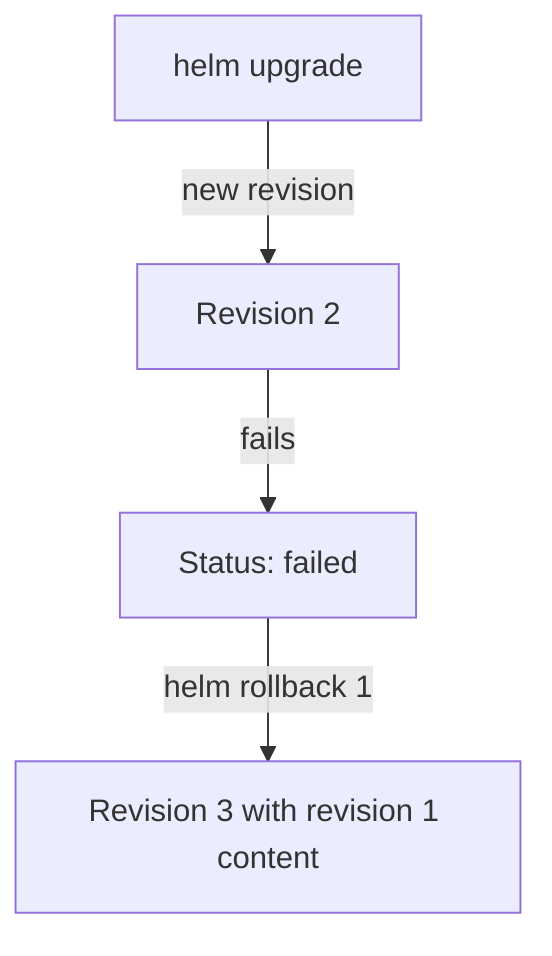

# Helm Releases: Upgrade, History And Rollback

A team installs the `beacon` application from a packaged chart and later changes its image and replica count. Helm records every install and upgrade as a numbered release revision, so it can list the history and return to an earlier revision with one command. This chapter is reading and command reference; the playground does not include Helm.

## Learning objectives

- Explain chart, release, values and revision.
- Read `helm upgrade`, `helm history`, `helm rollback` and `helm get values`.
- Compare a Helm rollback with a Deployment rollback.

## Before you start

Helm is a package manager for Kubernetes. A chart is a package of templates and default values. A release is one installed instance of a chart with a name, such as `beacon`, in a namespace. Values are the settings that fill the templates. The commands below need Helm on your own machine and a cluster to talk to.

## Install, upgrade and values

Installing a chart creates release revision 1. The `--install` flag on `upgrade` makes one command work for both the first and later releases:

```sh
helm upgrade --install beacon ./beacon-chart --namespace outpost --create-namespace --set replicaCount=2
helm upgrade beacon ./beacon-chart --namespace outpost --set replicaCount=3 --set image.tag=1.37.0 --wait --timeout 120s
```

Helm renders the templates with the merged values, sends the objects to the API server and stores the release record. The record is a Secret in the release namespace, named `sh.helm.release.v1.beacon.v2` for revision 2, with the type `helm.sh/release.v1`. The record holds the chart, the values and the rendered manifest of that revision.

The `--wait` flag makes Helm wait until the Deployments of the release are ready, up to the `--timeout`. Without it, Helm reports success once the API server accepted the objects. Values from `--set` and `-f values.yaml` are merged with the chart defaults. A new upgrade starts from the chart defaults plus the values you pass again, unless you add `--reuse-values`, which starts from the values of the last release. Mixing the two styles causes surprises, so keep values in a file under version control.

## Inspecting a release

Three commands show the state:

```sh
helm list --namespace outpost
helm status beacon --namespace outpost
helm get values beacon --namespace outpost
```

`list` shows each release with its revision number and status, such as `deployed` or `failed`. `get values` prints the user-supplied values of the current revision, and `get manifest` prints the rendered objects. Because the rendered manifest is stored, you can compare two revisions with the output of `helm get manifest --revision`.

## History and rollback

Every upgrade adds a revision. Read them and return to one:

```sh
helm history beacon --namespace outpost
helm rollback beacon 1 --namespace outpost --wait
helm history beacon --namespace outpost
```

The history lists revision number, status, chart version and a description. A rollback does not delete revisions. It creates a new revision, with the chart and values of revision 1, and marks the earlier one `superseded`. This matches a Deployment rollback, where the revision numbers also grow. Helm keeps ten revisions by default; `--history-max` on `upgrade` changes the limit.

A Helm rollback restores everything in the release: all templated objects, not only the Pod template of one Deployment. It does not restore data in volumes. Changes made by hand outside Helm can survive or conflict with the restored objects, so avoid editing release objects directly.

## Comparing revisions before a rollback

Before returning to a revision, read what it contained. The history shows the chart version and the description of each revision, and two commands show the content:

```sh
helm get values beacon --namespace outpost --revision 1
helm get manifest beacon --namespace outpost --revision 1
```

The first command prints the values that revision 1 used. The second prints the Kubernetes manifest that Helm sent for it. Save the manifests of two revisions to files and compare them with `diff` to see exactly which fields a rollback changes. Check that the image tag in the old revision still exists in the registry and that any database change since then is compatible with it.

## Release records and storage

The release records are ordinary Secrets, so the same access rules apply as for other Secrets. Reading the list of releases needs permission to read Secrets in the release namespace. Removing a release with `helm uninstall` deletes its objects and, by default, its history, so a later `helm rollback` to that name is not possible unless `--keep-history` was used. The release namespace is part of the identity: two releases named `beacon` in different namespaces are separate.

## Failed upgrades

When an upgrade fails, for example because the new Pods never become ready within the timeout, the release gets the status `failed`. The old Pods continue to run, because the Deployment rolling update does not remove them. Helm does not return to the earlier revision by itself unless you pass the automatic-rollback option, which is named `--atomic` in Helm 3 and `--rollback-on-failure` in newer Helm. Without it, run `helm rollback` yourself.



A rollback adds a new revision that carries the content of the earlier one.

You can now read a Helm release and choose between `helm rollback` for a whole release and `kubectl rollout undo` for one Deployment. When a chart is used, prefer the Helm commands, so the release record keeps matching the cluster.

## Common pitfalls

> [!WARNING]
> Running `kubectl rollout undo` on a Deployment that Helm manages leaves the Helm record unchanged, so the next upgrade can reintroduce the old template. A rollback creates a new revision and restores no data. Without `--wait`, a successful status does not mean the Pods are ready. Values from an earlier upgrade are not kept unless you repeat them or use `--reuse-values`.
