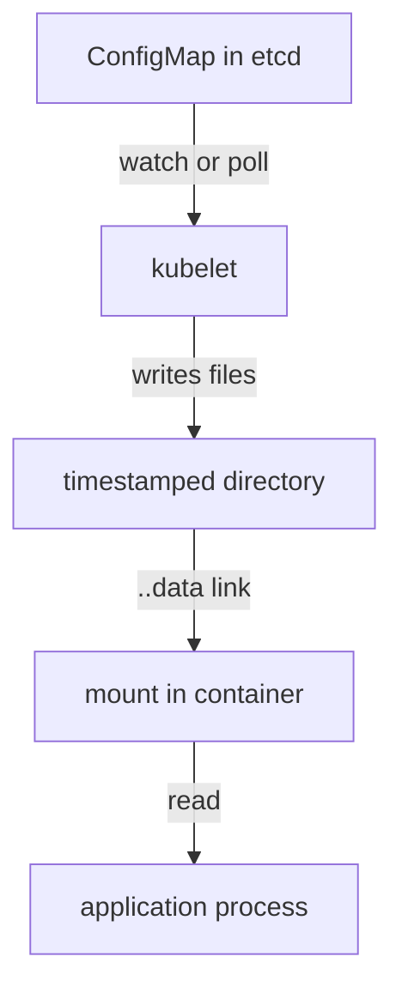

# ConfigMaps, Secrets And Configuration Delivery

A team changes a value in a ConfigMap, the command succeeds, and the application keeps behaving the old way. Nothing is broken. The object in the API changed, but the change has not reached the running process, or the process has not read it again. This part follows a value from the API object to the file the process reads, so you can tell which of those two steps failed.

## What a ConfigMap is and who delivers it

A ConfigMap is a Kubernetes object that stores non-confidential configuration as key-value pairs. Values are stored in the `data` field as text, or in the `binaryData` field as base64-encoded bytes. The total size of one ConfigMap cannot exceed 1 MiB. A Secret is the same kind of object for sensitive values, and a later part covers it in detail.

A ConfigMap does nothing by itself. The API server stores it in etcd, the cluster database. A Pod must reference it, and the kubelet, the agent that runs on each node, does the delivery. The kubelet reads the ConfigMap from the API server, writes the files into a directory on the node, and mounts that directory into the container. The container runtime only sees a normal directory.

A Pod and the ConfigMap it references must be in the same namespace. A Pod in `outpost` cannot read a ConfigMap in `starfleet`. If the ConfigMap does not exist when the Pod starts, the kubelet cannot build the volume, and the Pod stays in `ContainerCreating` with a `FailedMount` event that names the missing ConfigMap.

## Mount one ConfigMap and read it

A ConfigMap volume turns each key into a file. The key is the file name and the value is the file content. This first example mounts a ConfigMap with one key, `greeting`, into a small `busybox` Pod.

Save this as `configmap-reader-settings.yaml`:

<!-- astrona:playground:renew -->

```yaml
apiVersion: v1
kind: ConfigMap
metadata:
  name: reader-settings
  namespace: starfleet
data:
  greeting: hello
  level: info
---
apiVersion: v1
kind: Pod
metadata:
  name: settings-reader
  namespace: starfleet
spec:
  containers:
  - name: reader
    image: docker.io/library/busybox:1.37.0
    command:
    - sh
    - -c
    - while true; do cat /settings/greeting; sleep 5; done
    volumeMounts:
    - name: settings
      mountPath: /settings
      readOnly: true
  volumes:
  - name: settings
    configMap:
      name: reader-settings
```

Apply it:

```sh
kubectl apply -f configmap-reader-settings.yaml
```

Then check what the container sees:

```sh
kubectl -n starfleet wait --for=condition=Ready pod/settings-reader --timeout=120s
kubectl -n starfleet exec settings-reader -- ls /settings
kubectl -n starfleet exec settings-reader -- cat /settings/greeting
```

The listing shows two files, `greeting` and `level`, one for each key. The `cat` command prints `hello`. Every key became a file because the volume has no `items` list. A later part shows how to select single keys.

## What the kubelet writes on the node

The files are not plain files in the mount directory. The kubelet writes the data into a directory named after a timestamp, for example `..2026_11_03_10_00_00.123456789`. It then creates a symbolic link named `..data` that points to that directory. Each key name, such as `greeting`, is a symbolic link to `..data/greeting`.

```sh
kubectl -n starfleet exec settings-reader -- ls -la /settings
```

The output shows `greeting` and `level` as symbolic links, plus the `..data` link and one timestamped directory. This layout makes updates atomic. When the ConfigMap changes, the kubelet writes a new timestamped directory and then moves the `..data` link in one step. A process that reads the files never sees half of the old data and half of the new data.



The kubelet is the only component that moves data from the API object to the mounted files, and the application is the only component that decides when to read them.

## Update the ConfigMap and watch the delay

Change the value in the API and watch the file. The kubelet does not update the files at once. It checks mounted ConfigMaps on its periodic sync, and it caches objects it has read. The total delay can be about a minute or longer, so do not expect an instant change.

```sh
kubectl -n starfleet patch configmap reader-settings --type merge -p '{"data":{"greeting":"updated"}}'
kubectl -n starfleet exec settings-reader -- cat /settings/greeting
```

Run the `cat` command again every ten seconds or so. At first it still prints `hello`. After the kubelet syncs, it prints `updated`. The Pod was not restarted. The container started once, and only the mounted files changed under it.

The Pod command in this example runs `cat` in a loop, so it reads the file again each time and sees the new value. A program that reads the file once at startup would keep its old value. The mount is current, but the program is not. This is the difference between delivery and adoption.

## Key rules and limits

Keys in a ConfigMap may contain letters, digits, `-`, `_` and `.`. A key cannot be in both `data` and `binaryData`. Names must be valid DNS subdomain names. Because the key becomes a file name, a key such as `app.properties` is common for files that hold a whole configuration document.

A mounted ConfigMap volume is always read-only for the container content, even when the Pod spec does not say `readOnly: true`. Setting `readOnly: true` on the volume mount is still good practice, because it states the intent and protects against a runtime that behaves differently. Static Pods, which the kubelet starts from a manifest file, cannot reference a ConfigMap at all.

When a ConfigMap is missing, you can mark the volume `optional: true`. The Pod then starts with an empty directory instead of waiting. Use this only when the application has a safe default, because the failure is silent: the Pod is Running while the configuration is absent.

## Clean up

Remove the example Pod and ConfigMap so the next part starts clean:

```sh
kubectl -n starfleet delete pod settings-reader --wait=false
kubectl -n starfleet delete configmap reader-settings
```

You now know that the kubelet delivers ConfigMap keys as files, that updates arrive later through an atomic link swap, and that the application must read the file again to adopt them. The open question is what changes when the value is not a file but an environment variable, and how to create these objects without writing YAML by hand.

## Common pitfalls

> [!WARNING]
> A ConfigMap volume updates after a delay, not at once, and the application must read the file again. A missing ConfigMap keeps the Pod in `ContainerCreating` unless the volume is marked `optional`. The Pod and the ConfigMap must be in the same namespace.
