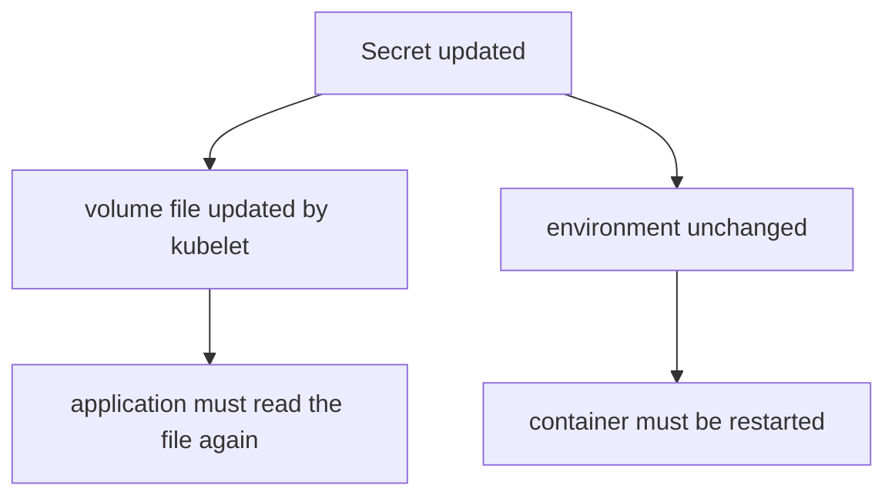

# Secret Storage, Delivery And Rotation

A database stops accepting its old password before every consumer has adopted the new one. The Secret update succeeded, yet requests fail. This part shows where a Secret is stored, how it reaches a container, and which consumers see a rotated value without a restart.

## What a Secret stores and where

A Secret is a Kubernetes object that holds a small amount of sensitive data, such as a password, a token or a key. Its structure looks like a ConfigMap. The `data` field holds base64-encoded values, and the `stringData` field accepts plain text that the API server encodes for you when it stores the object. A Secret is limited to 1 MiB.

Base64 is an encoding, not encryption. Anyone who can read the Secret through the API can decode it in one command. By default the API server writes Secrets to etcd without encryption, and the control plane operator can turn on encryption at rest. Protection comes from three separate controls: who may read the object (RBAC), whether etcd encrypts it, and how the application handles the value.

When a Pod uses a Secret volume, the kubelet writes the files into a `tmpfs`, which is memory on the node. The values are not written to the node disk. This limits exposure on the node, but a process in the container that can read the mount can still read the value.

## Create a Secret and decode it

The first example stores a disposable database password for the `scout` application. Use only disposable values in practice work.

Save this as `secret-scout-db.yaml`:

<!-- astrona:playground:renew -->

```yaml
apiVersion: v1
kind: Secret
metadata:
  name: scout-db
  namespace: starfleet
type: Opaque
stringData:
  password: first-password
```

Apply it:

```sh
kubectl apply -f secret-scout-db.yaml
```

Then read it back as the API stores it:

```sh
kubectl -n starfleet get secret scout-db -o jsonpath='{.data.password}'
kubectl -n starfleet get secret scout-db -o jsonpath='{.data.password}' | base64 -d
```

The first command prints a base64 string, not the word you wrote. The second decodes it and prints `first-password`. This shows why a user with `get` permission on Secrets can read every value. It also shows why `stringData` never appears when you read the object back: the API server converts it into `data` and discards the `stringData` field.

## Deliver the Secret two ways

A Pod can take a Secret value as an environment variable or as a file. Both paths run in the same Pod below, so you can compare them after a change.

Save this as `pod-secret-reader.yaml`:

```yaml
apiVersion: v1
kind: Pod
metadata:
  name: secret-reader
  namespace: starfleet
spec:
  containers:
  - name: reader
    image: docker.io/library/busybox:1.37.0
    command:
    - sh
    - -c
    - sleep 3600
    env:
    - name: DB_PASSWORD
      valueFrom:
        secretKeyRef:
          name: scout-db
          key: password
    volumeMounts:
    - name: credentials
      mountPath: /credentials
      readOnly: true
  volumes:
  - name: credentials
    secret:
      secretName: scout-db
```

Apply it:

```sh
kubectl apply -f pod-secret-reader.yaml
kubectl -n starfleet wait --for=condition=Ready pod/secret-reader --timeout=120s
```

The field is `secretKeyRef` in the environment variable and `secretName` in the volume. Do not confuse them with the ConfigMap names `configMapKeyRef` and `name`. A wrong key name stops the container with the reason `CreateContainerConfigError`, and a missing Secret blocks the Pod in `ContainerCreating`.

## Rotate the value and compare

A rotation changes the password at the issuer, here an imaginary database, and in the Secret. Update the Secret with a new value:

```sh
kubectl -n starfleet patch secret scout-db --type merge -p '{"stringData":{"password":"second-password"}}'
kubectl -n starfleet exec secret-reader -- sh -c 'echo "env: $DB_PASSWORD"; echo "file: $(cat /credentials/password)"'
```

Right after the patch, both lines still show `first-password`. After the kubelet sync, which can take a minute, run the second command again. The `file:` line shows `second-password`. The `env:` line keeps `first-password` for the whole life of the container, because the runtime sets the environment once when it creates the process.



A rotation is complete only when the consumer uses the new value, and that happens through a file re-read or through a new container.

For the environment path, a Deployment gets new Pods when you run `kubectl rollout restart deployment/<name>`. A rolling update keeps old Pods running until new ones are ready, so some requests can still use the old password during the rollout. Plan the order: the issuer must accept both passwords, then consumers move, then the old password is removed.

## Rules that decide who sees a change

A Secret or ConfigMap mounted with `subPath` never receives updates. An environment variable never receives updates. A volume with the field `immutable: true` on the Secret never receives updates either, because the object cannot change. A normal volume mount gets updates after the kubelet sync.

Do not print secrets to prove a rotation worked. A log line with the password creates a second copy that outlives the Secret. Test the effect instead: for example, make an authenticated request and check the status code, or compare two values inside the container with `test` and read only the exit code.

## Clean up

```sh
kubectl -n starfleet delete pod secret-reader --wait=false
kubectl -n starfleet delete secret scout-db
```

You now know where a Secret lives, that base64 gives no protection, and that only files mounted without `subPath` follow a rotation. The open question is how to create objects quickly from the command line and how environment variables select keys.

## Common pitfalls

> [!WARNING]
> Base64 data in a Secret is not encrypted. Environment variables and `subPath` mounts keep the old value after a rotation, so restart the Pods. Do not print a password to prove that it changed.
