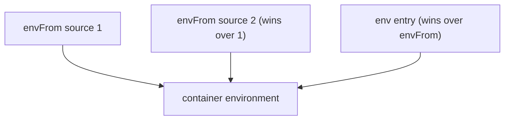

# Environment Variables From ConfigMaps And Secrets

Twelve-factor style applications read their settings from environment variables. Kubernetes can fill those variables from a ConfigMap or a Secret, so the same image runs with different settings in each namespace. This part shows the two injection forms, how to rename and prefix keys, what `optional` changes and what a wrong reference looks like.

## Two ways to inject

An environment variable can take one key, or a Pod can import every key of an object at once. The first form is `valueFrom` on a single `env` entry. It names the variable, the object and the key. The second form is `envFrom` on the container. It names an object and imports each key as a variable with the same name.

| Form | Field | Variable name | Chooses a key |
| --- | --- | --- | --- |
| One key from a ConfigMap | `env[].valueFrom.configMapKeyRef` | any name you choose | yes, with `key` |
| One key from a Secret | `env[].valueFrom.secretKeyRef` | any name you choose | yes, with `key` |
| All keys of a ConfigMap | `envFrom[].configMapRef` | the key name, with an optional `prefix` | no |
| All keys of a Secret | `envFrom[].secretRef` | the key name, with an optional `prefix` | no |

The kubelet resolves the references when it creates the container. It reads the object from the API server, builds the environment list and passes it to the container runtime. The values never change afterwards, even if the object changes.

## One Pod that uses every form

The `scout` Pod below reads a ConfigMap and a Secret. It renames one key, imports all keys with a prefix and tolerates a ConfigMap that does not exist. Save this as `pod-scout-env.yaml`:

<!-- astrona:playground:renew -->

```yaml
apiVersion: v1
kind: ConfigMap
metadata:
  name: scout-settings
  namespace: starfleet
data:
  LOG_LEVEL: info
  REGION: alpha
---
apiVersion: v1
kind: Secret
metadata:
  name: scout-db
  namespace: starfleet
type: Opaque
stringData:
  username: scout
  password: disposable-pass
---
apiVersion: v1
kind: Pod
metadata:
  name: scout-env
  namespace: starfleet
spec:
  containers:
  - name: scout
    image: docker.io/library/busybox:1.37.0
    command:
    - sh
    - -c
    - sleep 3600
    env:
    - name: LEVEL
      valueFrom:
        configMapKeyRef:
          name: scout-settings
          key: LOG_LEVEL
    - name: DB_USER
      valueFrom:
        secretKeyRef:
          name: scout-db
          key: username
    envFrom:
    - configMapRef:
        name: scout-settings
      prefix: CFG_
    - configMapRef:
        name: scout-extras
        optional: true
```

Apply it:

```sh
kubectl apply -f pod-scout-env.yaml
kubectl -n starfleet wait --for=condition=Ready pod/scout-env --timeout=120s
```

Then check the environment of the container:

```sh
kubectl -n starfleet exec scout-env -- printenv | sort | grep -E '^(CFG_|LEVEL|DB_USER)'
```

You should see four lines: `CFG_LOG_LEVEL=info`, `CFG_REGION=alpha`, `DB_USER=scout` and `LEVEL=info`. The `prefix` field put `CFG_` in front of each imported key. The `env` entry `LEVEL` renamed the key `LOG_LEVEL`, so the same value exists under two names. The Pod is running although `scout-extras` does not exist, because that reference is `optional`.

## Rename a key with valueFrom

The variable name in `env[].name` does not have to match the key. This is how you adapt an object to an application that expects a fixed variable name. If the application wants `APP_MODE` and the ConfigMap key is `mode`, one entry bridges the two:

```yaml
env:
- name: APP_MODE
  valueFrom:
    configMapKeyRef:
      name: scout-settings
      key: mode
```

`envFrom` cannot rename single keys. It can only add one `prefix` to all of them. When you need both a few renamed keys and bulk import, use both fields in the same container.

## Precedence and conflicts

A variable can be defined more than once. A name in `env` wins over the same name from `envFrom`. Among several `envFrom` sources, the one listed last wins. This rule lets you import a whole ConfigMap and override one value with a literal or a Secret key.



The kubelet applies the sources in that order, so the later and more specific definition replaces the earlier one.

## What optional changes

By default, a reference to an object or key that does not exist is an error. The container does not start, and the Pod shows the status `CreateContainerConfigError`. The Pod events name the missing object or key. With `optional: true` the reference is skipped, and the variable is simply absent. The application then has to cope with a missing value.

Prove the default behavior with a Pod that asks for a key that is not in the ConfigMap. Save this as `pod-scout-broken.yaml`:

```yaml
apiVersion: v1
kind: Pod
metadata:
  name: scout-broken
  namespace: starfleet
spec:
  containers:
  - name: scout
    image: docker.io/library/busybox:1.37.0
    command:
    - sh
    - -c
    - sleep 3600
    env:
    - name: LEVEL
      valueFrom:
        configMapKeyRef:
          name: scout-settings
          key: MISSING
```

Apply it and look at the status:

```sh
kubectl apply -f pod-scout-broken.yaml
kubectl -n starfleet get pod scout-broken
kubectl -n starfleet describe pod scout-broken
```

The status column shows `CreateContainerConfigError`, and the events at the end of the description name the key `MISSING` and the ConfigMap. The fix is to correct the key name or add the key to the ConfigMap. The kubelet retries on its own, so the Pod starts once the key exists.

## Keys that are not valid variable names

`envFrom` imports a key only when it is a valid environment variable name. A key such as `app.properties` or a key with characters that a variable cannot hold may be skipped. The Pod still starts, and the kubelet records an event with the reason `InvalidVariableNames`. If a variable you expect is missing, check the events of the Pod before you check the ConfigMap.

## Clean up

```sh
kubectl -n starfleet delete pod scout-env scout-broken --wait=false
kubectl -n starfleet delete configmap scout-settings
kubectl -n starfleet delete secret scout-db
```

You can now inject single keys and whole objects, rename and prefix them, and read the failure when a reference is wrong. The open question is how files from a volume are selected and protected, and how to freeze an object so that nobody changes it by accident.

## Common pitfalls

> [!WARNING]
> `envFrom` cannot rename a key; only a single `env` entry can. A missing key without `optional` gives `CreateContainerConfigError`, and a changed ConfigMap does not change the environment of a running container. A skipped key shows up only in the Pod events.
