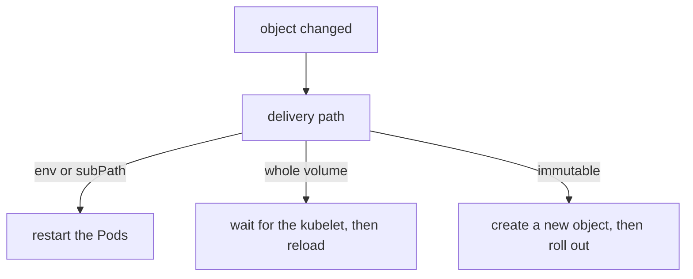

# Volume Selection, Immutability And Update Rules

A volume that delivers every key as a file is rarely what an application needs. It may expect one file with a fixed name, a file that only its owner can read, or a single file placed in a directory that already holds other files. This part shows the volume fields that control this, and the rules that decide which delivery path follows an update.

## Select keys and set file modes

A ConfigMap or Secret volume has an optional `items` list. Each item maps one `key` to a `path`, which is the file name inside the volume. When `items` is present, only the listed keys become files. A listed key that does not exist makes the volume fail, unless the volume is `optional`.

The field `defaultMode` sets the permission bits for every file in the volume. Individual items can override it with `mode`. The default is `0644` for ConfigMaps and Secrets. Write the value in octal, with a leading zero. For a Secret that holds a private key, use `0400` so that only the file owner can read it.

Save this as `pod-scout-files.yaml`:

<!-- astrona:playground:renew -->

```yaml
apiVersion: v1
kind: ConfigMap
metadata:
  name: scout-files
  namespace: starfleet
data:
  app.properties: |
    log.level=info
  extra.properties: |
    feature.radar=true
---
apiVersion: v1
kind: Pod
metadata:
  name: scout-files
  namespace: starfleet
spec:
  containers:
  - name: scout
    image: docker.io/library/busybox:1.37.0
    command:
    - sh
    - -c
    - sleep 3600
    volumeMounts:
    - name: selected
      mountPath: /settings
      readOnly: true
    - name: whole
      mountPath: /all
      readOnly: true
    - name: single
      mountPath: /etc/scout/scout.conf
      subPath: app.properties
      readOnly: true
  volumes:
  - name: selected
    configMap:
      name: scout-files
      defaultMode: 0400
      items:
      - key: app.properties
        path: scout.conf
  - name: whole
    configMap:
      name: scout-files
  - name: single
    configMap:
      name: scout-files
```

Apply it:

```sh
kubectl apply -f pod-scout-files.yaml
kubectl -n starfleet wait --for=condition=Ready pod/scout-files --timeout=120s
```

Then check what each mount contains:

```sh
kubectl -n starfleet exec scout-files -- ls /settings /all
kubectl -n starfleet exec scout-files -- stat -L -c '%a' /settings/scout.conf
kubectl -n starfleet exec scout-files -- cat /etc/scout/scout.conf
```

The `selected` volume holds only `scout.conf`, the renamed file, because `items` limited it to one key. The `stat` command prints `400`, the mode from `defaultMode`. The `whole` volume holds both `app.properties` and `extra.properties`. The `single` mount puts one file at a fixed path.

## What subPath does and costs

`subPath` mounts one entry of a volume instead of the whole volume. Without it, a mount at `/etc/scout` hides every file that the image already has in that directory. With `subPath`, only the one file appears at the path, and the other files in the directory stay. This makes `subPath` the usual way to drop one configuration file into an existing directory.

The cost is that a `subPath` mount never receives updates. The kubelet bind-mounts the single file directly, so it does not follow the `..data` link swap. A Pod with a `subPath` file sees the value from the time the container started, until the container is recreated. Check this by changing the ConfigMap:

```sh
kubectl -n starfleet patch configmap scout-files --type merge -p '{"data":{"app.properties":"log.level=debug\n"}}'
```

Wait about a minute, and then compare the two paths:

```sh
kubectl -n starfleet exec scout-files -- cat /all/app.properties /etc/scout/scout.conf
```

The file under `/all` shows `log.level=debug`. The file from the `subPath` mount still shows `log.level=info`. The Pod and the ConfigMap are both healthy, but only the whole-volume mount followed the change.

## Make an object immutable

Setting `immutable: true` on a ConfigMap or Secret freezes it. After that, the API server rejects any change to `data`, `binaryData` or `stringData`, and the flag cannot be turned off again. You can still delete the object and create it again. Mutable objects can be marked immutable later with `kubectl patch`.

Immutability has two benefits. It protects against an accidental edit that would break every Pod that mounts the object. It also lets the kubelet stop watching the object for changes, which reduces load on the API server in clusters with many Pods. The usual rollout pattern is to create a new object with a version in the name, such as `scout-config-v2`, point the Deployment at it and let the rolling update replace the Pods.

```sh
kubectl -n starfleet patch configmap scout-files --type merge -p '{"immutable":true}'
kubectl -n starfleet patch configmap scout-files --type merge -p '{"data":{"app.properties":"log.level=error\n"}}'
```

The first command succeeds. The second command fails, and the error from the API server says that the field is immutable. To change the data, delete the ConfigMap, create it again, and restart the Pods that use it.

## Which delivery path follows an update

Use this table when you decide how an application receives a change. The rows give the delivery path, and the columns give what happens after the object changes.

| Delivery path | Follows an update | Needed to adopt |
| --- | --- | --- |
| Environment variable (`env`, `envFrom`) | no | new container, for example `kubectl rollout restart` |
| Volume without `subPath` | yes, after the kubelet sync | the application reads the file again |
| Volume with `subPath` | no | new container |
| Immutable object | not possible | new object name and a rollout |



Each branch ends with an action that you can run and check, and none of them is automatic for the application.

## Clean up

```sh
kubectl -n starfleet delete pod scout-files --wait=false
kubectl -n starfleet delete configmap scout-files
```

You can now choose files with `items`, set their permissions, mount a single file with `subPath`, freeze an object and predict which Pods see a change. The next step in real work is a task that combines these tools under a time limit.

## Common pitfalls

> [!WARNING]
> `subPath` hides updates: the file stays at the value from container start. An `immutable` object cannot be edited or un-frozen, only deleted. A `defaultMode` must be written in octal with a leading zero, because `400` without the zero is read as decimal.
