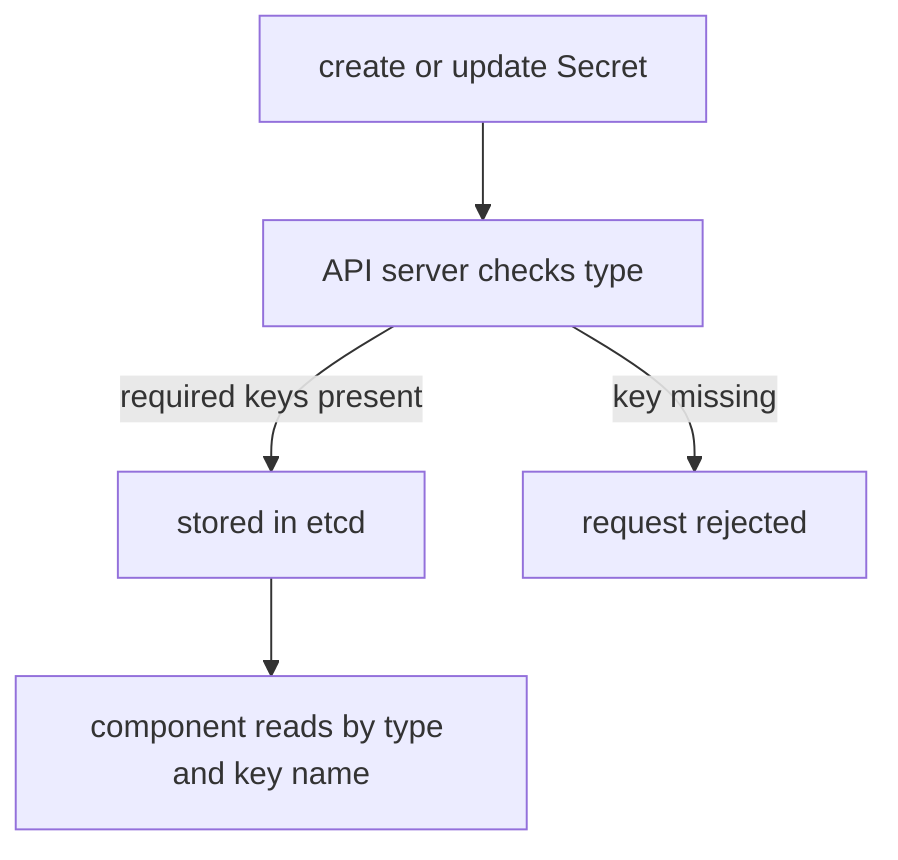

# Secret Types And Required Keys

A Secret with the wrong keys is only a pile of bytes until the component that needs it fails at the worst moment. A Pod cannot start with a TLS certificate that has no key, and an ingress controller cannot serve one. Kubernetes catches part of this problem early: the `type` field of a Secret tells the API server which keys the object must have, and the server checks them when you create or change the object.

## The type field

Every Secret has a `type`. When you do not set it, the type is `Opaque`, which means that the content is arbitrary and nothing is checked. A built-in type has a fixed name and a fixed set of required keys. Other components, such as the kubelet and ingress controllers, look for the type and the keys by name.

| Type | Required keys | Who uses it |
| --- | --- | --- |
| `Opaque` | none | your application |
| `kubernetes.io/basic-auth` | `username`, `password` | an application or controller that needs a login |
| `kubernetes.io/ssh-auth` | `ssh-privatekey` | a Pod that connects over SSH, for example to a Git server |
| `kubernetes.io/tls` | `tls.crt`, `tls.key` | a Pod or an ingress controller that serves HTTPS |
| `kubernetes.io/dockerconfigjson` | `.dockerconfigjson` | the kubelet, when it pulls an image |
| `kubernetes.io/service-account-token` | annotation `kubernetes.io/service-account.name` | a client that needs a long-lived ServiceAccount token |
| `bootstrap.kubernetes.io/token` | `token-id`, `token-secret` | the cluster, to let a new node join |

The older type `kubernetes.io/dockercfg` stores a legacy registry file under the key `.dockercfg`. New work should use `dockerconfigjson`.

## A basic-auth Secret

The first example is a login for the `scout` application. The type `kubernetes.io/basic-auth` only adds a check: both keys must exist. Save this as `secret-scout-login.yaml`:

<!-- astrona:playground:renew -->

```yaml
apiVersion: v1
kind: Secret
metadata:
  name: scout-login
  namespace: starfleet
type: kubernetes.io/basic-auth
stringData:
  username: scout
  password: disposable-pass
```

Apply it:

```sh
kubectl apply -f secret-scout-login.yaml
```

Then check the type and the key names, without the values:

```sh
kubectl -n starfleet get secret scout-login
kubectl -n starfleet get secret scout-login -o jsonpath='{.type}{"\n"}{.data}' | head -c 120
```

The listing shows the type `kubernetes.io/basic-auth` and two data items. The second command prints the type and then the base64 values. Do not use it with real credentials, because it shows them. `kubectl describe secret scout-login` is the safe command: it lists the key names and the sizes of the values, but not the values.

## The API server checks required keys

Remove the `password` key from the manifest and apply it again under another name. Save this as `secret-scout-nopass.yaml`:

```yaml
apiVersion: v1
kind: Secret
metadata:
  name: scout-nopass
  namespace: starfleet
type: kubernetes.io/basic-auth
stringData:
  username: scout
```

Apply it:

```sh
kubectl apply -f secret-scout-nopass.yaml
```

The API server refuses the object. The error says that the Secret is invalid and names the missing key `password`. The same happens when `tls.key` is missing from a TLS Secret. With type `Opaque` the same object is accepted, and the problem would appear later, in the application. A specific type moves the failure to the moment of creation.

The type of an existing Secret cannot be changed. To fix a Secret that was created with the wrong type, delete it and create it again with the right type. This matters because a Pod that references the old name keeps waiting for the new one.

## Types that belong to the cluster

Two types are mostly managed by Kubernetes itself. A `kubernetes.io/service-account-token` Secret holds a token for a ServiceAccount. Since Kubernetes 1.24 the control plane does not create such Secrets automatically. You create one by hand with the annotation `kubernetes.io/service-account.name`, and the token controller fills in the keys `token`, `ca.crt` and `namespace`. The token does not expire, which is why short-lived tokens from `kubectl create token` are preferred.

A `bootstrap.kubernetes.io/token` Secret lives in the namespace `kube-system` and has the name `bootstrap-token-<token-id>`. The keys `token-id` and `token-secret` form the token that a new node uses to authenticate when it joins the cluster. `kubeadm` creates and removes these Secrets, and the optional key `expiration` limits their life.

## Why the type matters in practice

A type is a contract between the person who creates the Secret and the component that reads it. An ingress controller looks for `tls.crt` and `tls.key`, and the kubelet looks for `.dockerconfigjson`. If you store the same data in an `Opaque` Secret with other key names, nothing checks it and nothing finds it. When a component cannot find a Secret that exists, compare the type and the key names first.



The API server enforces the keys at write time, and the consuming component enforces the type and names at read time.

## Clean up

```sh
kubectl -n starfleet delete secret scout-login
```

You now know the built-in types, their required keys and the point at which a wrong object is rejected. The open question is how to create the two types that need real files or credentials: the TLS pair and the registry login.

## Common pitfalls

> [!WARNING]
> A Secret's type cannot be changed after creation, so delete and recreate it. An `Opaque` Secret accepts any keys and hides mistakes until runtime. `kubectl get secret -o yaml` shows base64 values, so use `kubectl describe secret` when you only need the key names.
