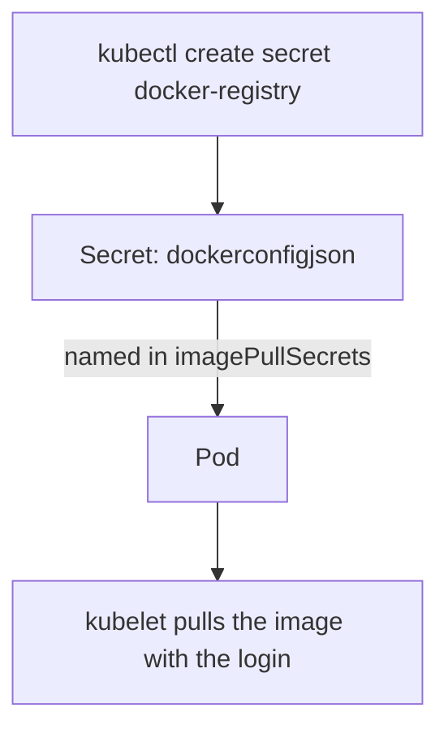

# TLS And Registry Credential Secrets

Two Secret types need input that is not a simple string. A TLS Secret needs a certificate and a private key that belong together, and a registry credential Secret needs a JSON document in a fixed format. Writing either by hand in base64 is slow and error-prone. `kubectl` has one subcommand for each, and this part uses them and then reads the result to see what they built.

## A TLS Secret

A TLS Secret holds a certificate and its private key. A certificate is a signed document that ties a public key to a name, and the private key is the secret half of that pair. A Pod that serves HTTPS, or an ingress controller, reads the two files and uses them to prove the name of the server. The Secret has the type `kubernetes.io/tls` and the keys `tls.crt` and `tls.key`.

For practice you create a self-signed certificate, which is a certificate signed by its own key. A real system uses a certificate from a certificate authority. The `openssl` command below makes a key and a certificate for the name `probe.starfleet.svc` that is valid for 30 days:

<!-- astrona:playground:renew -->

```sh
openssl req -x509 -newkey rsa:2048 -nodes -keyout probe.key -out probe.crt -days 30 -subj "/CN=probe.starfleet.svc"
```

The command writes `probe.key` and `probe.crt` to the current directory. Create the Secret from them:

```sh
kubectl -n starfleet create secret tls probe-tls --cert=probe.crt --key=probe.key
```

The command prints `secret/probe-tls created`. `kubectl` reads both files, checks that the certificate and the key form a valid pair, encodes them in base64 and sets the type. A key that does not match the certificate makes the command fail. Check the result by decoding the certificate from the Secret and reading its subject:

```sh
kubectl -n starfleet get secret probe-tls -o jsonpath='{.type}{"\n"}'
kubectl -n starfleet get secret probe-tls -o jsonpath='{.data.tls\.crt}' | base64 -d | openssl x509 -noout -subject
```

The first command prints `kubernetes.io/tls`. The second prints a line with the subject, which holds the common name `probe.starfleet.svc`. The backslash in `tls\.crt` is needed because the key name contains a dot, and `jsonpath` would otherwise read the dot as a path separator.

## Use the TLS Secret in a Pod

A Pod uses the Secret as a volume. Each key becomes a file, so the container finds `/tls/tls.crt` and `/tls/tls.key`. A private key should not be readable by every user, so set `defaultMode` to `0400`. Save this as `pod-tls-reader.yaml`:

```yaml
apiVersion: v1
kind: Pod
metadata:
  name: tls-reader
  namespace: starfleet
spec:
  containers:
  - name: reader
    image: docker.io/library/busybox:1.37.0
    command:
    - sh
    - -c
    - sleep 3600
    volumeMounts:
    - name: tls
      mountPath: /tls
      readOnly: true
  volumes:
  - name: tls
    secret:
      secretName: probe-tls
      defaultMode: 0400
```

Apply it and list the files:

```sh
kubectl apply -f pod-tls-reader.yaml
kubectl -n starfleet wait --for=condition=Ready pod/tls-reader --timeout=120s
kubectl -n starfleet exec tls-reader -- ls /tls
```

The listing shows `tls.crt` and `tls.key`. An ingress object that names this Secret in its `tls` section works the same way: the ingress controller reads the Secret from the API server by name and type.

## A registry credential Secret

A private container registry asks for a login before it sends an image. The kubelet, not the container, pulls the image, so the login must reach the kubelet. The Secret type `kubernetes.io/dockerconfigjson` has one key, `.dockerconfigjson`, whose value is a JSON document with an `auths` map from registry address to credentials. `kubectl create secret docker-registry` builds that document from flags.

```sh
kubectl -n starfleet create secret docker-registry registry-creds \
  --docker-server=registry.starfleet.example \
  --docker-username=scout \
  --docker-password=disposable-pass \
  --docker-email=scout@starfleet.example
```

The command prints `secret/registry-creds created`. The address `registry.starfleet.example` is an example name that does not exist, so no pull from it can succeed. The point of the exercise is the Secret, not the pull. Check the type and read the structure:

```sh
kubectl -n starfleet get secret registry-creds -o jsonpath='{.type}{"\n"}'
kubectl -n starfleet get secret registry-creds -o jsonpath='{.data.\.dockerconfigjson}' | base64 -d
```

The first command prints `kubernetes.io/dockerconfigjson`. The second prints one line of JSON, which starts with `{"auths":{"registry.starfleet.example":` and holds the fields `username`, `password`, `email` and `auth`. The field `auth` is the user name and the password joined by a colon and encoded in base64. The command shows the password, so use disposable values only.

## What a registry Secret does not do

Creating the Secret does not make any Pod use it. The kubelet only reads credentials that a Pod names in `imagePullSecrets`, directly or through its ServiceAccount. The Secret must also be in the same namespace as the Pod. A Secret in `outpost` cannot help a Pod in `starfleet`, so a team that runs in several namespaces creates the Secret in each of them.



The Secret is only data until a Pod refers to it, and then the kubelet is the component that uses it.

## Clean up

```sh
kubectl -n starfleet delete pod tls-reader --wait=false
kubectl -n starfleet delete secret probe-tls
rm probe.key probe.crt
```

The registry Secret stays for the next part. You can now create both special Secrets with one command each and read what they contain. The open question is how a Pod is told to use registry credentials, and how to do it once for every Pod of a ServiceAccount.

## Common pitfalls

> [!WARNING]
> A private key must never be committed or shared, so delete the local files after you create the Secret. A TLS Secret says nothing about expiry, so a certificate that has run out still loads and clients reject it. A registry Secret works only in its own namespace and only when a Pod names it.
