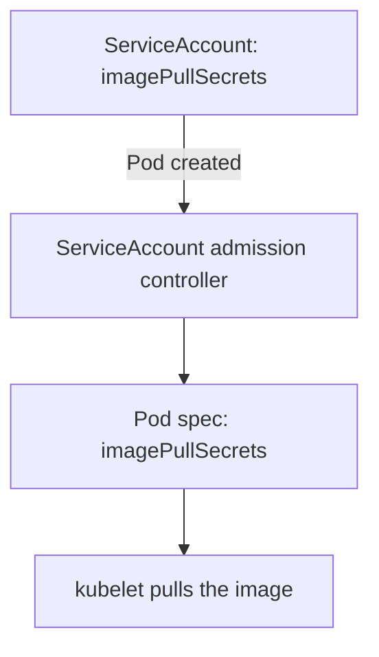

# Image Pull Secrets On Pods And ServiceAccounts

A Pod that uses an image from a private registry stays in `ImagePullBackOff` until the kubelet has credentials. The credentials live in a Secret, but the Pod must point at it. This part shows the two places where that pointer can live: in the Pod itself, and in the ServiceAccount that the Pod runs as. It also shows how to read the failure when the pull is denied.

## Who pulls the image

The kubelet on the node pulls images through the container runtime. It does this before the container exists, so the container cannot supply the login itself. The kubelet reads the `imagePullSecrets` list of the Pod, takes each Secret of type `kubernetes.io/dockerconfigjson` and tries the credentials for the registry in the image name. If the registry address does not match any entry in the Secret, the kubelet pulls without a login.

The first failure is `ErrImagePull`, and the retry state is `ImagePullBackOff`. The events of the Pod give the reason: for a private registry it is usually an authorization error, and for a wrong address it is a name resolution error. `kubectl describe pod` shows these events at the end of its output.

## Name the Secret in the Pod

The direct way is the field `imagePullSecrets` in the Pod spec. It is a list of objects with a `name`, and the field sits next to `containers`. The Secret must be in the namespace of the Pod. Save this as `pod-private-image.yaml`:

<!-- astrona:playground:renew -->

```yaml
apiVersion: v1
kind: Pod
metadata:
  name: private-image
  namespace: starfleet
spec:
  imagePullSecrets:
  - name: registry-creds
  containers:
  - name: scout
    image: registry.starfleet.example/scout:1.0
```

Apply it and look at the field:

```sh
kubectl apply -f pod-private-image.yaml
kubectl -n starfleet get pod private-image -o jsonpath='{.spec.imagePullSecrets}{"\n"}'
```

The second command prints `[{"name":"registry-creds"}]`. The image address does not exist, so the Pod never starts. Check the status and the events:

```sh
kubectl -n starfleet get pod private-image
kubectl -n starfleet describe pod private-image
```

The status shows `ErrImagePull` or `ImagePullBackOff`. The events show that the kubelet tried to pull `registry.starfleet.example/scout:1.0` and failed. This is the expected result here, because the registry is only an example. On a real private registry with correct credentials the pull succeeds.

## Put the Secret in a ServiceAccount

Writing `imagePullSecrets` in every Pod is tedious, and a forgotten entry causes a failure. A ServiceAccount can carry the list instead. A ServiceAccount is the identity that a Pod uses when it talks to the API server, and every Pod runs as one. When the API server creates a Pod, the ServiceAccount admission controller copies the `imagePullSecrets` of the Pod's ServiceAccount into the Pod spec. It adds each Secret that the Pod does not already list.

Create a ServiceAccount that carries the Secret. Save this as `serviceaccount-builder.yaml`:

```yaml
apiVersion: v1
kind: ServiceAccount
metadata:
  name: builder
  namespace: starfleet
imagePullSecrets:
- name: registry-creds
```

Apply it:

```sh
kubectl apply -f serviceaccount-builder.yaml
```

An existing ServiceAccount such as `default` can be changed with a patch:

```sh
kubectl -n starfleet patch serviceaccount default -p '{"imagePullSecrets":[{"name":"registry-creds"}]}'
```

Now every new Pod in `starfleet` that runs as `default` gets the Secret, which suits a namespace that pulls only from one private registry. Pods that exist already are not changed, because the copy happens when the Pod is created.

## Prove the copy without a registry

You do not need a working registry to see the injection. A server-side dry run sends a Pod through admission and prints the result without storing it. Run a Pod as `builder` and read the field:

```sh
kubectl -n starfleet run builder-test --image=docker.io/library/busybox:1.37.0 --overrides='{"spec":{"serviceAccountName":"builder"}}' --dry-run=server -o jsonpath='{.spec.imagePullSecrets}{"\n"}'
```

The command prints `[{"name":"registry-creds"}]`, although the Pod spec you wrote had no such field. The ServiceAccount admission controller added it. If the output is empty, the ServiceAccount has no `imagePullSecrets`.



The admission controller copies the list once, at creation, so a later change to the ServiceAccount only affects new Pods.

## Clean up

If you skipped the patch of `default`, leave out the second command.

```sh
kubectl -n starfleet delete pod private-image --wait=false
kubectl -n starfleet patch serviceaccount default --type json -p '[{"op":"remove","path":"/imagePullSecrets"}]'
kubectl -n starfleet delete serviceaccount builder
kubectl -n starfleet delete secret registry-creds
```

You can now give the kubelet registry credentials through a Pod or through a ServiceAccount, and prove the result with a dry run. The open question is how to keep all these Secrets safe: who may read them and what protects them in storage.

## Common pitfalls

> [!WARNING]
> Changing a ServiceAccount does not change Pods that already exist, so recreate them. A Pod keeps the entries it lists itself and gains the ServiceAccount entries. The Secret must be in the Pod's namespace, and the registry address in the Secret must match the image address.
