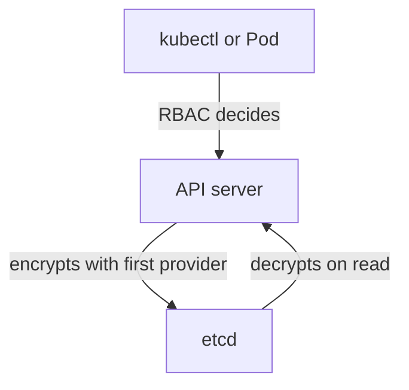

# Protecting Secrets With RBAC And Encryption At Rest

A Secret is only as safe as the weakest path to it. Anyone who can read the object through the API gets the value, anyone who can read etcd gets every value, and anyone who can create a Pod in the namespace can mount any Secret there. This part limits the first and third path with RBAC, and explains what an `EncryptionConfiguration` does for the second.

## RBAC decides who reads a Secret

RBAC, role-based access control, is the API server's authorization method. A `Role` lists the verbs allowed on resources in one namespace, and a `RoleBinding` gives the role to a user, group or ServiceAccount. For Secrets the verbs `get`, `list` and `watch` all return values. A subject with only `list` on `secrets` can still read every value, because the list response contains the full objects.

The field `resourceNames` narrows a rule to named objects. A rule with `resourceNames: ["scout-db"]` and the verb `get` allows reading that one Secret and no other. Create a Secret and a ServiceAccount that may read only it.

<!-- astrona:playground:renew -->

```sh
kubectl -n starfleet create secret generic scout-db --from-literal=password=disposable-pass
kubectl -n starfleet create serviceaccount auditor
kubectl -n starfleet create role secret-reader --verb=get --resource=secrets --resource-name=scout-db
kubectl -n starfleet create rolebinding auditor-secret-reader --role=secret-reader --serviceaccount=starfleet:auditor
```

Each command prints a line such as `role.rbac.authorization.k8s.io/secret-reader created`. Now ask the API server what the identity may do. The flag `--as` makes `kubectl` check the permission for another user, and a ServiceAccount user name has the form `system:serviceaccount:<namespace>:<name>`:

```sh
kubectl auth can-i get secret/scout-db -n starfleet --as=system:serviceaccount:starfleet:auditor
kubectl auth can-i get secret/other -n starfleet --as=system:serviceaccount:starfleet:auditor
kubectl auth can-i list secrets -n starfleet --as=system:serviceaccount:starfleet:auditor
```

The answers are `yes`, `no` and `no`. The first matches the name in the rule. The second is another Secret, and the third is a `list`, which the rule does not include. A denied request returns a nonzero exit status, so run each command by itself when you script it.

## Indirect access through Pods

RBAC on Secrets is not enough if other rights lead to the same data. A subject that can create a Pod in a namespace can write a Pod that mounts any Secret of that namespace and prints it. A subject that can run `kubectl exec` into a Pod that has the Secret mounted can read the file. Reading the logs of an application that prints its password also leaks it.

For this reason a review of access to Secrets looks at more than the verb `get`. It checks who can create or change Pods and Deployments, who can use `pods/exec`, and which ServiceAccounts are bound to broad roles such as `edit`. Give workloads their own ServiceAccount with a narrow role, and do not give them API access at all if they do not need it.

## Protect storage with encryption at rest

The API server stores every object in etcd. By default Secrets are stored there without encryption, so a copy of the etcd data or a backup holds every value as base64. Encryption at rest means that the API server encrypts selected resources before it writes them to etcd and decrypts them when it reads. The control plane operator turns it on; a user of the cluster cannot do it with `kubectl`.

The configuration is a file that the kube-apiserver reads at start. The flag `--encryption-provider-config` points to it. On a kubeadm cluster the file lives on the control plane node, for example in `/etc/kubernetes/enc/`, and the kube-apiserver static Pod manifest mounts that directory. This is an example of the file, not something you apply with `kubectl`:

```yaml
apiVersion: apiserver.config.k8s.io/v1
kind: EncryptionConfiguration
resources:
  - resources:
      - secrets
    providers:
      - aescbc:
          keys:
            - name: key1
              secret: <BASE64-ENCODED-32-BYTE-KEY>
      - identity: {}
```

The `providers` list is ordered. The first provider encrypts new writes, here `aescbc` with `key1`. When the server reads an object, it tries the providers in order until one can decode the data. The last entry `identity` means no encryption, and it lets the server still read objects that were stored before encryption was on. If `identity` were first, nothing would be encrypted. A key is 32 random bytes in base64, for example from `head -c 32 /dev/urandom | base64`.

## What encryption changes and what it does not

Objects written before the change stay unencrypted until they are written again. The usual way to rewrite all Secrets is `kubectl get secrets --all-namespaces -o json | kubectl replace -f -`. After that, the value in etcd starts with the prefix `k8s:enc:aescbc:v1:key1` followed by binary data. An administrator checks this by reading the key `/registry/secrets/<namespace>/<name>` with `etcdctl` on the control plane node.

Encryption at rest does not hide a Secret from the API. A user with `get` permission still receives the decoded value, because the API server decrypts before it answers. It protects the storage layer: etcd data files, snapshots and backups. The key file itself is on the control plane node, so access to that node still matters. A cluster that needs stronger separation uses a key management service provider, where the key stays outside the cluster.



RBAC guards the front of the API server, and encryption at rest guards the data behind it, so a cluster needs both.

## Clean up

```sh
kubectl -n starfleet delete rolebinding auditor-secret-reader
kubectl -n starfleet delete role secret-reader
kubectl -n starfleet delete serviceaccount auditor
kubectl -n starfleet delete secret scout-db
```

You can now limit reads with `resourceNames`, name the indirect paths that bypass a narrow rule, and explain what the `EncryptionConfiguration` provider order does. The module closes with these protections, since every type and delivery method in it depends on them.

## Common pitfalls

> [!WARNING]
> A rule that grants `list` on Secrets exposes every value, and the right to create Pods exposes them too. Putting `identity` first in the provider list switches encryption off. Old Secrets stay unencrypted until they are rewritten.
