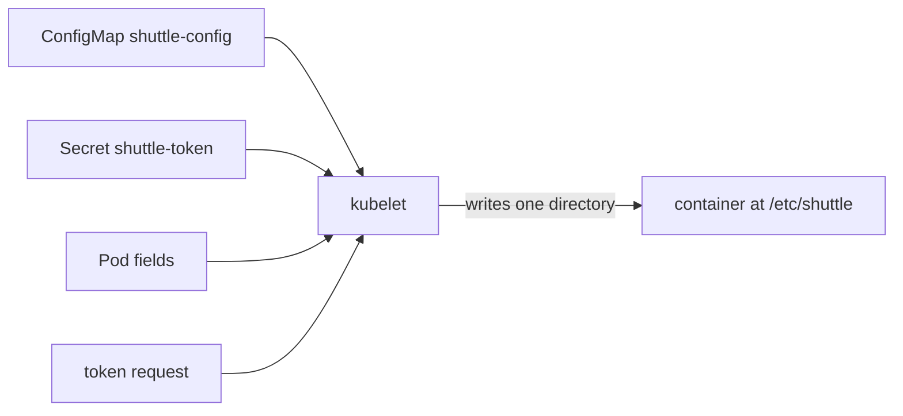

# Projected Volumes: Combining Configuration Sources

An application that reads its settings from one directory, for example `/etc/shuttle`, cannot use three separate volumes. A ConfigMap volume, a Secret volume and a downward API volume each need their own mount path, and two volumes cannot share a directory. A projected volume solves this. It is one volume whose content comes from several sources, and the kubelet writes all of them into a single directory tree.

## What a projected volume is

A projected volume is declared under `volumes[].projected`. Its `sources` list holds one entry per source, and each entry has exactly one kind. The kinds are `configMap`, `secret`, `downwardAPI`, `serviceAccountToken`, and `clusterTrustBundle`, which delivers trusted certificate authorities. All sources must be in the same namespace as the Pod, because the kubelet reads them for that Pod only.

The API server stores the Pod with the volume definition and nothing else. The kubelet on the node does the work. After the Pod is scheduled, the kubelet asks the API server for each source, writes the files into a directory on the node, and bind-mounts the directory into the container. The container runtime never sees the sources, only the finished directory. Because the kubelet writes the files, it also decides the file mode, and it keeps the files current.

Every Pod already uses this feature. When a Pod runs with a ServiceAccount token, the admission controller adds a projected volume named `kube-api-access-` followed by random letters. It has three sources: the token, the cluster certificate authority as `ca.crt`, and a downward API item that writes the namespace of the Pod to the file `namespace`. The container finds all three in `/var/run/secrets/kubernetes.io/serviceaccount`.

## Choose a path and a mode for each item

Each source lists its own `items`, which map a key or a field to a `path`. The path is relative to the mount point and may contain directories. A key from a ConfigMap can be written to `conf/flags.conf`, and a key from a Secret to `secrets/token`, so the merged directory has a clear structure. The kubelet creates the directories.

Each item can also carry a `mode`, the permission bits written in octal, for example `0400`. The volume has a `defaultMode` that applies to every item without its own `mode`. A token should have `0400`, and a settings file can keep the default `0644`. Use different paths for different sources. If two sources write the same path, the result must not be relied on.

The `serviceAccountToken` source asks the API server for a new token with `audience`, `expirationSeconds` and `path`. The audience says which service the token is for. The lifetime is at least 600 seconds and the default is 3600. The token is bound to the Pod, so the API server rejects it after the Pod is deleted. The kubelet renews the file before it expires, when the token is older than 80 percent of its lifetime. An application must read the file again to see the new token.



The kubelet reads four sources and delivers one directory, so the application has a single place to look.

## Build one: a Pod with three sources

Create a ConfigMap, a Secret and a Pod that merges them with the labels of the Pod. The Pod name is `shuttle`, and the files are placed in `conf/`, `secrets/` and `pod/`. Save this as `projected-shuttle.yaml`:

<!-- astrona:playground:renew -->

```yaml
apiVersion: v1
kind: ConfigMap
metadata:
  name: shuttle-config
  namespace: starfleet
data:
  flags: |
    warp=enabled
    shields=up
---
apiVersion: v1
kind: Secret
metadata:
  name: shuttle-token
  namespace: starfleet
stringData:
  token: disposable-token
---
apiVersion: v1
kind: Pod
metadata:
  name: shuttle
  namespace: starfleet
  labels:
    app: shuttle
    tier: scout
spec:
  containers:
  - name: shuttle
    image: docker.io/library/busybox:1.37.0
    command:
    - sh
    - -c
    - sleep 3600
    volumeMounts:
    - name: shuttle-files
      mountPath: /etc/shuttle
      readOnly: true
  volumes:
  - name: shuttle-files
    projected:
      defaultMode: 0444
      sources:
      - configMap:
          name: shuttle-config
          items:
          - key: flags
            path: conf/flags.conf
      - secret:
          name: shuttle-token
          items:
          - key: token
            path: secrets/token
            mode: 0400
      - downwardAPI:
          items:
          - path: pod/labels
            fieldRef:
              fieldPath: metadata.labels
```

Apply it:

```sh
kubectl apply -f projected-shuttle.yaml
```

Then check the result. Wait for the Pod and list the files with their modes:

```sh
kubectl -n starfleet wait pod/shuttle --for=condition=Ready --timeout=90s
kubectl -n starfleet exec shuttle -- find /etc/shuttle -type f -o -type l
kubectl -n starfleet exec shuttle -- cat /etc/shuttle/pod/labels
kubectl -n starfleet exec shuttle -- stat -L -c '%a %n' /etc/shuttle/secrets/token /etc/shuttle/conf/flags.conf
```

The `find` command lists the three files below `/etc/shuttle`, plus the hidden entries that the kubelet uses for atomic updates. The labels file has one line per label in the form `app="shuttle"`. The token file shows mode `400` and the settings file shows `444`, which is the `defaultMode` of the volume.

## How the kubelet updates the directory

The files are not written in place. The kubelet writes a new timestamped directory, then switches a symbolic link named `..data` to it in one step. The visible names are links that go through `..data`, so a reader sees either all old files or all new files, never a mix. This is the same mechanism as for a plain ConfigMap volume, and it works for every source of a projected volume.

Edit the ConfigMap and the change reaches the file after the kubelet sync period, which is usually under two minutes. The labels file changes when you change the Pod labels. The token is renewed by the same process. A `subPath` mount does not receive updates, as with every volume. Environment variables never update. For that reason a program that must see changes reads the file again, and a program that reads values once at start can use any method.

## Clean up

```sh
kubectl -n starfleet delete pod shuttle
kubectl -n starfleet delete configmap shuttle-config
kubectl -n starfleet delete secret shuttle-token
```

You can now merge several sources into one directory, give each item a path and a mode, and explain who writes the files and who updates them. The next problem is data that no ConfigMap holds, because it describes the Pod itself.

## Common pitfalls

> [!WARNING]
> All sources of a projected volume must be in the Pod namespace, and a missing ConfigMap or Secret keeps the Pod in `ContainerCreating` unless the source is marked `optional: true`. Two sources must never write the same path. A token with a short `expirationSeconds` is renewed only if the application reads the file again.
