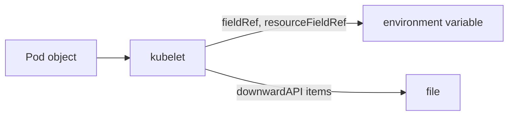

# The Downward API: Pod And Container Facts

Some values cannot be written in a manifest. The name of a Pod from a Deployment contains random letters that exist only after the Pod is created. The node that runs it is chosen by the scheduler. A container that must size its thread pool from its own CPU limit would need the limit repeated in two places, and the two copies drift apart. The downward API passes such facts from the Pod object into the container, so the manifest never repeats them.

## How the downward API works

The name says that information goes down from the cluster into the container, in the opposite direction of an API call. The container does not call the API server and needs no RBAC permission. The kubelet reads the fields from the Pod object that it already has, and delivers them in one of two ways. A field can be set as an environment variable with `env[].valueFrom`, or written as a file in a `downwardAPI` volume, which can also be a source of a projected volume.

There are two selectors. A `fieldRef` names a field of the Pod, written as `fieldPath`. A `resourceFieldRef` names a resource value of one container, written as `resource`. The kubelet resolves both when it starts the container. Starting a container is the point where an environment variable is fixed, so an environment variable never changes after that.

## Fields of the Pod with fieldRef

The set of fields is fixed by Kubernetes, and it differs between the two delivery methods. These fields work as environment variables and as files: `metadata.name`, `metadata.namespace` and `metadata.uid`. These work only as environment variables: `spec.nodeName`, `spec.serviceAccountName`, `status.hostIP`, `status.podIP` and `status.podIPs`. Labels and annotations are different. As an environment variable you pick one key, for example `metadata.labels['tier']`. As a file you take the whole map, with `metadata.labels` or `metadata.annotations`, and the kubelet writes one line per entry.

This difference has a practical effect. A volume file is refreshed when the labels or the annotations of the Pod change, because the kubelet watches the Pod. An environment variable stays at the value from the start of the container. An application that must see label changes needs the volume, and it must read the file again.

## Resource values with resourceFieldRef

The selector `resourceFieldRef` exposes the requests and limits of a container. The values are `limits.cpu`, `requests.cpu`, `limits.memory`, `requests.memory`, `limits.ephemeral-storage` and `requests.ephemeral-storage`. The optional `divisor` sets the unit of the answer. A CPU limit of `500m` with divisor `1m` gives `500`, and with divisor `1` it gives `1`, because CPU is rounded up to whole cores. A memory limit of `128Mi` with divisor `1Mi` gives `128`.

In an environment variable the container is the one that declares the variable, so `containerName` can stay out. In a volume the file belongs to the Pod, not to a container, so `containerName` is required to say which container is meant. If the container has no limit set, the kubelet answers with the allocatable amount of the node, which is rarely what the application should use. Set the limit first, then read it.



The kubelet is the only component that reads the fields, and it writes the answer into the container as a variable or as a file.

## Build one: a Pod that reads facts about itself

Create a Pod with labels, an annotation and CPU and memory limits. It exposes the Pod name, the node name, one label and the limits as variables, and the labels and the annotations as files. Save this as `facts-shuttle.yaml`:

<!-- astrona:playground:renew -->

```yaml
apiVersion: v1
kind: Pod
metadata:
  name: facts
  namespace: starfleet
  labels:
    app: facts
    tier: scout
  annotations:
    mission: survey
spec:
  containers:
  - name: shuttle
    image: docker.io/library/busybox:1.37.0
    command:
    - sh
    - -c
    - sleep 3600
    resources:
      requests:
        cpu: 100m
        memory: 64Mi
      limits:
        cpu: 500m
        memory: 128Mi
    env:
    - name: POD_NAME
      valueFrom:
        fieldRef:
          fieldPath: metadata.name
    - name: NODE_NAME
      valueFrom:
        fieldRef:
          fieldPath: spec.nodeName
    - name: TIER
      valueFrom:
        fieldRef:
          fieldPath: metadata.labels['tier']
    - name: CPU_LIMIT_MILLI
      valueFrom:
        resourceFieldRef:
          resource: limits.cpu
          divisor: 1m
    - name: MEMORY_LIMIT_MIB
      valueFrom:
        resourceFieldRef:
          resource: limits.memory
          divisor: 1Mi
    volumeMounts:
    - name: podinfo
      mountPath: /etc/podinfo
  volumes:
  - name: podinfo
    downwardAPI:
      items:
      - path: labels
        fieldRef:
          fieldPath: metadata.labels
      - path: annotations
        fieldRef:
          fieldPath: metadata.annotations
      - path: cpu-limit
        resourceFieldRef:
          containerName: shuttle
          resource: limits.cpu
          divisor: 1m
```

Apply it:

```sh
kubectl apply -f facts-shuttle.yaml
```

Then check the result. Wait for the Pod, read the variables and then the files:

```sh
kubectl -n starfleet wait pod/facts --for=condition=Ready --timeout=90s
kubectl -n starfleet exec facts -- printenv POD_NAME NODE_NAME TIER CPU_LIMIT_MILLI MEMORY_LIMIT_MIB
kubectl -n starfleet exec facts -- cat /etc/podinfo/labels /etc/podinfo/annotations /etc/podinfo/cpu-limit
```

The variables are `facts`, the name of the kind node, `scout`, `500` and `128`. The files hold the labels and the annotation, one per line, and the number `500`.

## See what updates and what does not

Change a label of the running Pod and look at both delivery methods after about a minute:

```sh
kubectl -n starfleet label pod facts tier=survey --overwrite
kubectl -n starfleet exec facts -- sh -c 'echo "$TIER"; cat /etc/podinfo/labels'
```

The variable still prints `scout`, because it was fixed when the container started. The file shows `tier="survey"` after the kubelet syncs. If the file still shows the old value, wait and read it again, since the sync is periodic. A container that needs the new label must read the file, or the Pod must be recreated.

## Clean up

```sh
kubectl -n starfleet delete pod facts
```

You can now pass Pod facts and resource values to a container without repeating them in the manifest, and you know which fields work as variables, which work as files, and which of them update. The remaining question is how those variables are used in a command and how a whole application should receive its configuration.

## Common pitfalls

> [!WARNING]
> `spec.nodeName`, `status.podIP` and `spec.serviceAccountName` work only as environment variables, and `metadata.labels` as a whole works only as a file. A `resourceFieldRef` in a volume needs `containerName`. A container without a limit reports the allocatable amount of the node, not a value you chose.
