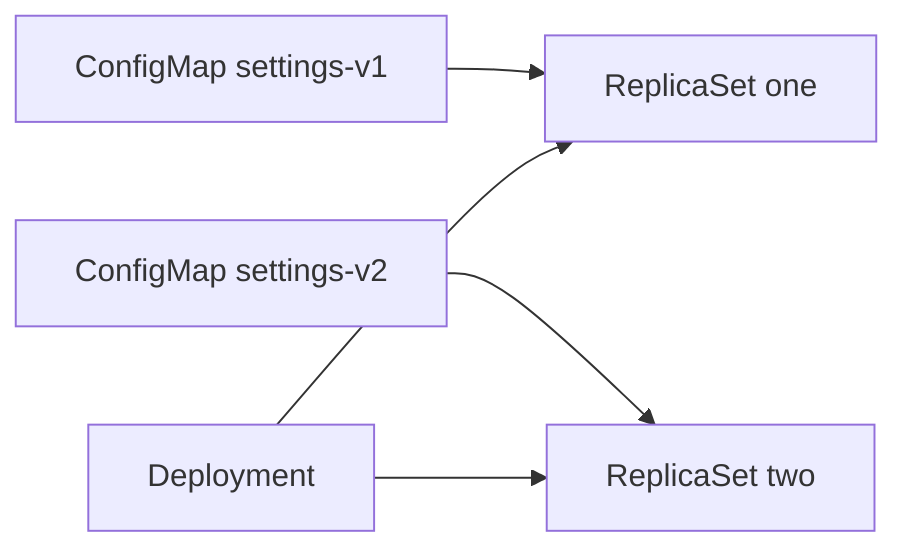

# Command Arguments And Configuration Patterns

Many programs take their settings from command-line arguments, not from the environment. A container image fixes the program, but the arguments belong to the manifest, and a value that lives in a ConfigMap must reach them. Once a value can arrive as an argument, a variable or a file, the question changes from how to deliver it to which method fits the application, and what happens when the value changes. This part answers both.

## Variable references in command and args

The fields `command` and `args` of a container are lists of strings. The kubelet expands a reference of the form `$(NAME)` inside them before it starts the container, using the variables declared in the `env` list of that container. The container runtime receives the final strings. No shell is needed, and the expansion also works for images that have no shell at all.

Three rules matter. A reference to a name that is not defined is left as it is, so `$(MISSING)` stays `$(MISSING)` and no error is raised. The text `$$(NAME)` is an escape and becomes the literal `$(NAME)`. Within the `env` list, a value can refer only to variables that appear earlier in the list. A plain `$NAME` without parentheses is not touched by the kubelet. If the command is `sh -c`, the shell expands `$NAME` itself at run time, and that works for every variable of the container, including those from `envFrom`.

Because `command` replaces the entry point of the image and `args` replaces its default arguments, a reference works in either. The usual layout is a fixed `command` with the program and an `args` list that carries the values from the ConfigMap.

## Build one: arguments filled from a ConfigMap

Create a ConfigMap and a Pod that prints its arguments and stops. The Pod uses `restartPolicy: Never`, so the output stays in the log. Save this as `args-scout.yaml`:

<!-- astrona:playground:renew -->

```yaml
apiVersion: v1
kind: ConfigMap
metadata:
  name: args-settings
  namespace: starfleet
data:
  mode: standby
  region: outpost
---
apiVersion: v1
kind: Pod
metadata:
  name: args-scout
  namespace: starfleet
spec:
  restartPolicy: Never
  containers:
  - name: scout
    image: docker.io/library/busybox:1.37.0
    command:
    - echo
    args:
    - mode=$(APP_MODE)
    - region=$(REGION)
    - label=$(APP_MODE)-$(REGION)
    - escaped=$$(APP_MODE)
    - missing=$(NOPE)
    env:
    - name: APP_MODE
      valueFrom:
        configMapKeyRef:
          name: args-settings
          key: mode
    - name: REGION
      valueFrom:
        configMapKeyRef:
          name: args-settings
          key: region
```

Apply it:

```sh
kubectl apply -f args-scout.yaml
```

Then check the result. Wait until the Pod finishes, then read its log:

```sh
kubectl -n starfleet wait pod/args-scout --for=jsonpath='{.status.phase}'=Succeeded --timeout=90s
kubectl -n starfleet logs args-scout
```

The log is one line: `mode=standby region=outpost label=standby-outpost escaped=$(APP_MODE) missing=$(NOPE)`. The first three arguments were expanded by the kubelet, the fourth lost one dollar sign, and the last stayed unchanged because no such variable exists.

## Choose a delivery method

The three methods differ in who reads the value, when, and whether it can change. An environment variable is read at container start and never changes. A command argument is the same, because it is fixed when the container is created. A file in a volume can change while the container runs, if the application reads it again.

Use an environment variable for a small value that the program reads once, such as a mode or a region. Use a file when the program expects a file, such as a configuration file with many lines or a certificate, or when it must see updates without a restart. Use an argument only when the program takes its settings from the command line, and fill it from a variable. Put secrets in files or in variables from a `secretKeyRef`, and never write them into `args`, because the arguments are visible in the Pod specification to everyone who can read Pods.

Use the downward API for facts that are about the Pod, a ConfigMap for settings that change between environments, and a Secret for values that must not be shared. A projected volume is the tool for combining them, when the application wants a single directory.

## Make a change reach the Pods

A Deployment does not watch its ConfigMaps. When the object changes, running containers keep their variables, and mounted files update after the kubelet sync, but no new Pod is created. Three patterns handle this. The first is `kubectl rollout restart deployment/<name>`, which changes an annotation in the Pod template and so starts a rollout. The second is a hash of the configuration written into a Pod template annotation by the deployment tool, which gives the same effect when the content changes. The third is a versioned name.

The versioned name is the most precise. Create a ConfigMap with `immutable: true` and a version in its name, for example `settings-v2`, and point the Deployment at it. Changing the Deployment spec creates a rollout with the usual rolling update and rollback. The old object stays, so `kubectl rollout undo` returns to a configuration that still exists. An immutable object cannot be edited, which prevents an accidental change that the kubelet would then deliver to every Pod at once.



Each ReplicaSet points at its own configuration, so a rollback restores both the Pods and the settings they use.

## Clean up

```sh
kubectl -n starfleet delete pod args-scout
kubectl -n starfleet delete configmap args-settings
```

You can now fill command arguments from variables, choose a delivery method by how often the value changes, and make a Deployment roll out when its configuration changes. These patterns tie together everything the module covered.

## Common pitfalls

> [!WARNING]
> `$(NAME)` is expanded only for variables in the container `env` list, and an unknown name is left in place without an error. Do not put a secret in `args`, because anyone who can read the Pod can read it. Editing a ConfigMap does not restart a Deployment, so plan a rollout.
