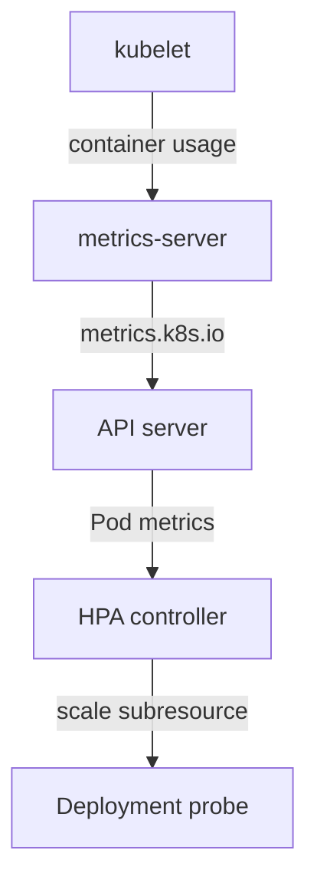

# Metric-Driven Replica Decisions And Their Boundaries

Two `probe` replicas each use all the CPU they asked for, and the target says half should be enough. The HorizontalPodAutoscaler (HPA) is the control loop that turns that gap into a new replica count. This part follows one decision from the kubelet that measures a container to the number the HPA writes, so you can tell which component to blame when the number is wrong or missing.

## Learning objectives

- Identify the autoscaling target and the metric requirements of an HPA.
- Interpret CPU utilization relative to requests.
- Explain tolerance and the minimum and maximum bounds.

## Before you start

A Pod runs one or more containers. A namespace groups namespaced objects. A request is the amount of CPU or memory the scheduler reserves for a container, and the amount a CPU utilization target is measured against. The playground for this module has the `probe` Deployment (two replicas) and the client Pods `shuttle` and `drifter`, and it already has the metrics server installed.

## The chain from container to replica count

The HPA is a controller inside `kube-controller-manager`. About every 15 seconds it reads each HPA object, asks the metrics API for the current measurements of the target's Pods, calculates a desired replica count, and writes that count to the target's `scale` subresource. The subresource is a small API endpoint that every scalable workload exposes. It carries the replica count, so the HPA does not need to know the Deployment's full schema.

The measurements come from a chain of components. The kubelet on each node reads container CPU and memory use from the container runtime. The metrics server (an add-on that is not part of a bare cluster) scrapes every kubelet and keeps the latest values in memory. It registers the API group `metrics.k8s.io` through an APIService object, so `kubectl top` and the HPA read the same data through the Kubernetes API server.



The diagram shows that the HPA never talks to a node or a container. If the metrics server is missing, every resource-based HPA in the cluster loses its input at once.

Check that the metrics API is registered and serving. The `Available` column of the APIService must be `True`:

<!-- astrona:playground:renew -->

```sh
kubectl get apiservice v1beta1.metrics.k8s.io
```

Then read the same data the HPA reads:

```sh
kubectl top pods -n starfleet
```

The command prints one row per Pod with CPU in millicores (one thousand millicores is one CPU core) and memory in mebibytes. If it fails with a message that the metrics API is not available, the HPA would fail in the same way.

## The target and the bounds

An HPA names its target in `scaleTargetRef`: an `apiVersion`, a `kind` and a `name` in the HPA's own namespace. Deployments, StatefulSets and ReplicaSets support the scale subresource, and so do custom resources that define it. `minReplicas` and `maxReplicas` bound every decision. The minimum defaults to 1 and the maximum has no default, so you must set it.

The HPA owns the replica count of its target. If the Deployment manifest also sets `spec.replicas` and you re-apply that manifest, you overwrite the HPA's decision until the next sync. The usual habit is to leave `replicas` out of a manifest once an HPA manages the workload.

## The calculation and its tolerance

For a utilization target, the controller uses this relation, where the metric values are averages over the target's Pods:

```text
desiredReplicas = ceil[ currentReplicas * ( currentMetricValue / desiredMetricValue ) ]
```

Two `probe` replicas that average 100 percent against a 50 percent target give `ceil[ 2 * (100 / 50) ]`, which is 4. A maximum of 3 would cap the result at 3. The same two replicas at 52 percent give a ratio of 1.04, and the controller does nothing, because it skips changes while the ratio is within a tolerance of 0.1 (10 percent) of 1.0. The tolerance stops the replica count from changing for tiny differences.

The controller also protects the average from bad data. It ignores Pods that are being deleted or have failed. It treats a Pod with no metric yet as if it used 0 percent when the HPA wants to scale up, and as if it used 100 percent when the HPA wants to scale down. It also holds back Pods that are not ready yet, because a Pod that is still starting often uses unusual amounts of CPU. These rules lean toward the safer result in each direction.

## Why requests matter

Utilization means usage divided by the request. A `probe` container that uses 15 millicores and requests 10 millicores is at 150 percent. The same container with no CPU request has no denominator. The HPA then cannot calculate a percentage, reports `FailedGetResourceMetric` or `missing request for cpu`, and sets the condition `ScalingActive` to `False`. The fix is a request on every container of the Pod, not a different target.

Changing a request changes the percentage without changing the load. Doubling a request halves the utilization the HPA sees, so the same traffic produces fewer replicas. Treat the request as part of the autoscaling configuration, and set it from observed use.

## Does the metric describe the bottleneck?

A CPU target helps only when more replicas lower the CPU of each replica. A `probe` that waits on a saturated database uses little CPU while its responses get slower. The HPA then sees low utilization and adds nothing, or adds replicas that put more load on the database. Choose a metric that rises when the real limit is reached, such as requests per second per Pod, and accept that this needs a metrics adapter that serves a custom or external metrics API.

Desired replicas are also not capacity. The Deployment controller creates the Pods, the scheduler needs free node resources to place them, and the readiness probe decides when they receive traffic. An HPA that asks for 10 replicas while only 6 fit leaves 4 Pods in `Pending`, and the HPA does not add nodes.

## Reading the raw measurement

`kubectl top` formats the answer of the metrics API for you. You can also ask the API server for the raw object, which shows exactly what the HPA receives: one entry per Pod, with a timestamp, a window length and the usage of each container.

```sh
kubectl get --raw /apis/metrics.k8s.io/v1beta1/namespaces/starfleet/pods
```

The response is JSON. Each item has a `timestamp` and a `window`, which is the period the kubelet averaged over. Values are quantities such as nanocores for CPU. If the timestamp is old, the metrics server has stopped scraping, and the HPA decides from stale data or reports an error.

## Worked example with the maximum

Suppose `probe` has `minReplicas: 2` and `maxReplicas: 3`, a target of 50 percent and a current average of 100 percent over two replicas. The formula gives 4, the maximum cuts it to 3, and the HPA sets `ScalingLimited` to `True` with the reason `TooManyReplicas`. If the average then falls to 60 percent over three replicas, the ratio is 1.2 and the formula gives `ceil[ 3 * 1.2 ]`, which is 4, and the cap holds the count at 3 again. Only an average clearly below the target, outside the tolerance, moves the count down.

## What you now know

You know the path from the kubelet through the metrics server and the API server to the HPA, how the controller turns an average and a target into a replica count, and why requests and tolerance change the result. The open question is how to write the HPA object and how to read its status when the result is not what you expected.

## Common pitfalls

> [!WARNING]
> An HPA changes replica counts only. It does not add nodes, and it does not change requests or limits. A missing CPU request, a missing metrics server, or a metric that does not follow the bottleneck all produce a replica count that looks wrong while the controller is working as designed.
