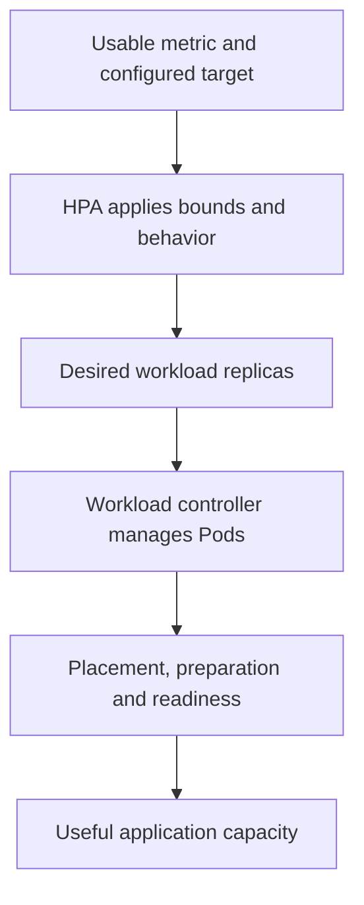

# Metric-Driven Replica Decisions And Their Boundaries

The HorizontalPodAutoscaler, or HPA, adjusts a supported workload's desired replica count from configured metrics. It does not directly create more nodes or rewrite every container's resource limit. Scaling decisions depend on metric availability, target interpretation and the workload's ability to provide useful capacity after replicas are added.

## Identify The Scaling Target

The HPA references a workload with a supported scale interface. Its minimum and maximum replicas constrain the desired range. A Deployment can therefore have its replica count influenced by the HPA, while a separate process continually forcing another count can create conflicting desired-state updates.

Resource metrics can express utilization relative to requests or an absolute usage value according to the configured target type. Custom and external metrics need appropriate metric APIs and adapters. An HPA definition does not automatically install those data sources.

For a CPU utilization target, CPU means central processing unit. Applicable container CPU requests supply the utilization denominator. Missing required requests can prevent meaningful utilization calculation for the target. A measured consumption number without that denominator does not establish the desired percentage.

## Work Through A Simplified Decision

Under a simplified average utilization model, desired replicas are based on current replicas multiplied by observed utilization divided by target utilization, rounded upward. With two replicas, one hundred percent observed utilization and a fifty percent target, that simple calculation suggests four replicas.

Real controller behavior includes tolerance, missing metrics, not-yet-ready Pods and stabilization or scaling policies. The simplified calculation teaches the relationship, not a promise that every observation instantly produces that exact count. A maximum of three would also constrain the final requested range.

The metric must fit the application. CPU can represent useful demand for some workloads but fail to represent a queue or external bottleneck for others. An application waiting on a saturated database may have low CPU while requests are slow. Increasing frontend replicas then may increase backend pressure without fixing the limiting dependency.

## From Desired Replicas To Useful Capacity

Adding desired replicas causes the workload controller to create or manage more Pods. Those Pods still need scheduling capacity, image access, startup and readiness. An HPA can request more capacity while all new Pods remain Pending. It does not guarantee the cluster has suitable nodes or storage for them.

A node autoscaler, when installed and configured, performs a different responsibility concerning infrastructure capacity. It has provider constraints, timing and placement limits. The presence of an HPA does not imply that node autoscaling is available or that every unschedulable Pod can be solved by adding a node.

Scaling down can remove replicas that hold temporary local state or active requests. The application should handle termination and shared state appropriately. A larger count is not universally safer, and a lower count needs an availability and disruption design that fits the workload.

## Stability And Diagnosis

Stabilization windows and scaling policies can reduce oscillation or constrain rate of change. A fluctuating metric can otherwise repeatedly increase and decrease capacity. Interpret configured behavior and current conditions before treating a delayed decrease as proof that the controller is broken.

If an HPA has no usable metrics, inspect the metric service, target and required requests. If it asks for additional replicas but none become ready, follow placement and preparation. If new ready replicas do not improve latency, investigate the application bottleneck and metric choice.

Successful autoscaling is a chain from meaningful measurement to appropriate desired replicas and usable application capacity. Each step has a separate responsible component and limit. That chain explains both a configuration choice and a realistic diagnosis.

## Dependency Flow

## Common pitfalls

> [!WARNING]
> HPA changes workload replica intent, not node capacity or every resource limit. Metrics, requests, stabilization, placement and application bottlenecks determine whether a replica change provides useful service.
