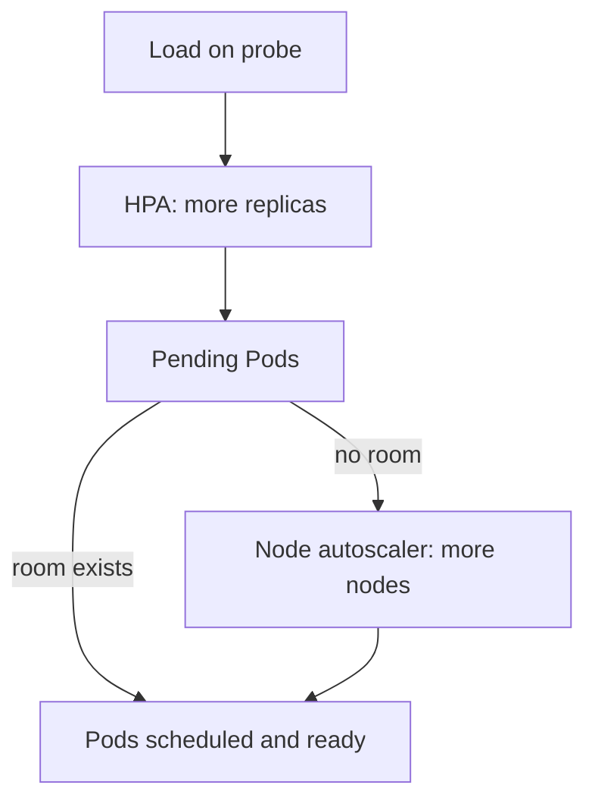

# Replica Autoscaling And Availability

An HPA can decide that `probe` needs ten replicas while the nodes have room for six. This part writes the HPA object that makes such decisions, shows how to read its status, and separates three controls that people often mix up: horizontal scaling, vertical sizing and node scaling. It also explains how a PodDisruptionBudget (a rule that limits how many Pods of one workload voluntary disruptions may remove at once) fits next to an autoscaler.

## Learning objectives

- Identify the autoscaling target and metric requirements.
- Create an HPA with `kubectl autoscale` and with an `autoscaling/v2` manifest.
- Read the HPA status and conditions.
- Distinguish replica scaling from node capacity and vertical sizing.

## Before you start

The HorizontalPodAutoscaler (HPA) is an API object that stores the autoscaling rule. The HPA controller in `kube-controller-manager` reads it and changes the replica count of the target. The playground has the `probe` Deployment in `starfleet` with two replicas and a CPU request of 10 millicores on its container.

## Two ways to create an HPA

The quick way is `kubectl autoscale`. It creates an HPA for one target with a minimum, a maximum and a CPU target. Use `--dry-run=client -o yaml` to print the object instead of creating it, so you can read what the command builds:

<!-- astrona:playground:renew -->

```sh
kubectl autoscale deployment probe -n starfleet --min=2 --max=4 --cpu=70% --dry-run=client -o yaml
```

Current `kubectl` versions take the target with `--cpu=70%`. Older versions used `--cpu-percent=70`, and you may meet that flag in older material. The command can express only one CPU target and no scaling behavior, so every other case needs a manifest.

The manifest form uses `apiVersion: autoscaling/v2`. It has the fields `scaleTargetRef`, `minReplicas`, `maxReplicas`, a list of `metrics` and an optional `behavior`. The older `autoscaling/v1` form can express only a CPU percentage, so use v2 for anything new. The API server serves both and converts between them.

## Reading the status

The HPA writes its observations to `status`. The fields to know are `currentReplicas`, `desiredReplicas`, `currentMetrics` and `conditions`. Three conditions explain almost every problem:

- `AbleToScale` is `True` when the controller can read and write the target's scale subresource.
- `ScalingActive` is `True` when the controller can read the metrics and calculate a result. It becomes `False` with a reason such as `FailedGetResourceMetric` when the metrics server has no data or a request is missing.
- `ScalingLimited` is `True` when the result was cut by `minReplicas`, `maxReplicas` or a scaling policy.

`kubectl describe hpa` prints the conditions with their reasons and messages, followed by recent events. Use it first, because the one-line `kubectl get hpa` output shows only a target such as the current and desired percentage and the three replica numbers:

```sh
kubectl describe hpa -n starfleet
```

Right after you create an HPA, the metrics column can read `<unknown>` for a short time. That is normal until the metrics server has scraped the new Pods. If it stays `<unknown>`, read the `ScalingActive` condition message.

## Three different capacity controls

Horizontal scaling changes how many Pods run. The HPA does it. Vertical sizing changes the requests and limits of each Pod, which a human or a Vertical Pod Autoscaler does. Node scaling changes how many nodes exist, which a node autoscaler such as Cluster Autoscaler or Karpenter does. They have different inputs and delays.



The diagram shows that the HPA only creates the demand for Pods. A different component must supply the room when the nodes are full.

Without a node autoscaler, new replicas that fit nowhere stay `Pending`, and the scheduler records an event such as `Insufficient cpu`. Raising the HPA maximum cannot fix that. Raising a Pod's request can make it worse, because fewer Pods fit on each node.

## Availability and the PodDisruptionBudget

An autoscaler does not guarantee availability. A voluntary disruption, such as a node drain during maintenance, evicts Pods through the eviction API. A PodDisruptionBudget (PDB) names a label selector and either `minAvailable` or `maxUnavailable`, and the eviction API refuses evictions that would break it.

A PDB with `minAvailable: 2` on a workload that the HPA holds at two replicas allows zero disruptions, so a drain of that node waits forever. The HPA minimum and the PDB must agree: the minimum must be larger than `minAvailable`, or the PDB must use `maxUnavailable`. A PDB protects only against voluntary disruptions, not against a node crash.

## Who owns the replica count

When an HPA manages a Deployment, two writers can change `spec.replicas`: the HPA and any person or pipeline that runs `kubectl scale` or applies a manifest with a `replicas` field. The last writer wins until the next HPA sync, which is about 15 seconds later. The HPA then recalculates from the metrics and overwrites the manual value, unless the manual value lies inside the bounds and the metric agrees with it.

This is why a manifest for an autoscaled workload leaves `replicas` out. If a pipeline must keep a `replicas` field, it resets the count on every deployment, and the cluster briefly runs the wrong number of Pods. A manual `kubectl scale` on an autoscaled workload is a short, temporary change, not a setting.

## A worked reading of the conditions

Suppose `kubectl describe hpa probe` reports `ScalingActive` as `False` with the reason `FailedGetResourceMetric` and a message that the metrics API could not be reached. You can narrow the cause in three steps. First check that the APIService for `metrics.k8s.io` is `Available`. Then run `kubectl top pods` to prove that data exists. Last, check that each container of the target has a CPU request.

If `AbleToScale` is `False` instead, the controller cannot reach the target's scale subresource. The usual causes are a `scaleTargetRef` with the wrong name, kind or API version. The HPA must live in the same namespace as its target, because the reference carries no namespace.

## What you now know

You can create an HPA with `kubectl autoscale` or an `autoscaling/v2` manifest, read `ScalingActive`, `AbleToScale` and `ScalingLimited`, and explain why the HPA, the node pool and the PDB are separate controls. The next question is how to make the decisions slower, faster or based on more than one metric.

## Common pitfalls

> [!WARNING]
> `kubectl autoscale` creates a CPU target only and cannot set behavior. `<unknown>` metrics that never clear point to a missing request or a missing metrics server, not to a wrong target value. A PDB that equals the HPA minimum blocks drains.
