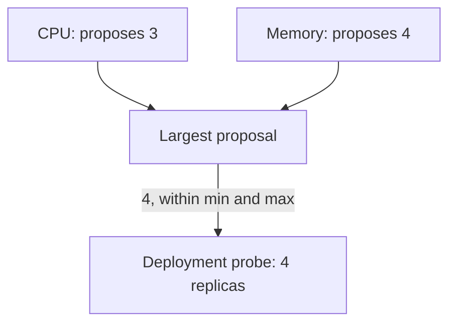

# Metric Types And Multiple Metrics

CPU is the metric that every cluster with a metrics server can use, but it is not always the metric that shows load. A queue consumer is busy when its queue is long, and a web server can wait on a database with an idle processor. The `autoscaling/v2` HorizontalPodAutoscaler (HPA) accepts five metric types and a list of them, and this part explains where each type gets its data and how the controller combines several.

## Learning objectives

- Name the five metric types and the API that serves each.
- Write an HPA with more than one metric.
- Explain how the controller combines the result of several metrics.

## Before you start

A metrics API is a Kubernetes API group served by an add-on, so that `kubectl` and controllers read measurements through the API server. The playground has the metrics server, which serves `metrics.k8s.io`. It also has the `probe` Deployment in `starfleet`, with two replicas that each request 50 millicores of CPU and 32 mebibytes of memory.

## Five metric types and three APIs

Each entry in `spec.metrics` has a `type`. The type decides which API the controller asks:

- `Resource` reads the CPU or memory of all containers of a Pod from `metrics.k8s.io`. The target is a `Utilization` (a percentage of the request) or an `AverageValue` (an absolute quantity).
- `ContainerResource` reads the CPU or memory of one named container from `metrics.k8s.io`. Use it when a sidecar container would distort the Pod total.
- `Pods` reads a custom metric that each Pod reports, such as requests per second, from `custom.metrics.k8s.io`. The target is an `AverageValue`.
- `Object` reads one metric of one other object, such as the hits on an Ingress, from `custom.metrics.k8s.io`. The target is a `Value` or an `AverageValue`.
- `External` reads a metric that does not belong to any Kubernetes object, such as the length of a queue in a cloud service, from `external.metrics.k8s.io`.

The metrics server serves only the first API. The other two APIs need an adapter, which is a separate add-on that translates a monitoring system such as Prometheus into the metrics API. Installing an HPA that names a `Pods` metric does not install an adapter. Without one, the HPA reports `ScalingActive` as `False`.

Check which metrics APIs the playground serves. The `metrics.k8s.io` group exists, and the custom and external groups do not:

<!-- astrona:playground:renew -->

```sh
kubectl api-versions | grep metrics
```

## Two metrics on one HPA

The `probe` Deployment must scale on CPU and on memory. Save this as `horizontalpodautoscaler-probe.yaml`:

```yaml
apiVersion: autoscaling/v2
kind: HorizontalPodAutoscaler
metadata:
  name: probe
  namespace: starfleet
spec:
  scaleTargetRef:
    apiVersion: apps/v1
    kind: Deployment
    name: probe
  minReplicas: 2
  maxReplicas: 5
  metrics:
  - type: Resource
    resource:
      name: cpu
      target:
        type: Utilization
        averageUtilization: 60
  - type: Resource
    resource:
      name: memory
      target:
        type: Utilization
        averageUtilization: 80
```

Apply it:

```sh
kubectl apply -f horizontalpodautoscaler-probe.yaml
```

Then check the result. The status lists one entry in `currentMetrics` for each metric, so the output has two lines after the controller has read both:

```sh
kubectl -n starfleet wait --for=condition=ScalingActive hpa/probe --timeout=240s
kubectl -n starfleet get hpa probe -o jsonpath='{range .status.currentMetrics[*]}{.resource.name}{" "}{.resource.current.averageUtilization}{"\n"}{end}'
```

## How the controller combines metrics

For every metric, the controller runs the same calculation that it runs for a single metric and gets one proposed replica count. It then takes the **largest** proposal. A workload that is idle on CPU but near its memory target therefore still scales up. The rule makes the HPA safe in one direction: it scales down only when every metric agrees that fewer replicas are enough.



The diagram shows two proposals and the one that wins. If one metric cannot be read, the controller still scales up when the readable metrics ask for it, but it refuses to scale down, because it cannot know what the missing metric would have proposed.

## Choosing utilization or average value

A `Utilization` target depends on the request. It breaks when the request is missing, and it changes when someone edits the request. An `AverageValue` target such as `200m` of CPU per Pod needs no request, because it compares the plain usage. Choose it when requests are set for scheduling reasons only and do not describe normal use.

Memory deserves a warning. A container's memory use often does not fall when load falls, because the runtime keeps memory for reuse. A memory target can therefore push replicas up and never bring them down, and adding replicas does not reduce the memory that each one holds. Prefer memory targets for workloads whose memory grows with traffic and returns when traffic ends.

## What you now know

You can name the five metric types and the three APIs behind them, write an HPA with two resource metrics, and predict that the largest proposal wins. The next question is how fast the replica count may change once the controller has a proposal.

## Common pitfalls

> [!WARNING]
> A `Pods`, `Object` or `External` metric needs a metrics adapter, and the HPA does not install one. Memory targets seldom allow a scale-down. If one metric cannot be read, the HPA does not scale down, even when the other metrics would allow it.
