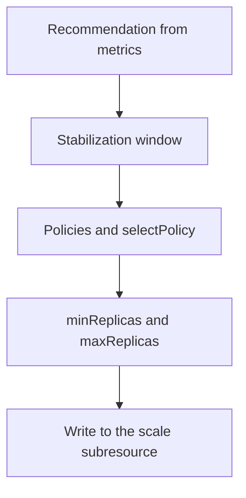

# Scaling Behavior And Stabilization

A new release sends a burst of traffic to `probe`, and the replica count jumps from 2 to 5. Two minutes later the burst ends and the count drops to 2, and the next burst arrives. Each change creates and deletes Pods, and the Pods spend their first seconds starting instead of serving. The `behavior` field of an `autoscaling/v2` HorizontalPodAutoscaler (HPA) is the tool that controls how fast the replica count may move in each direction.

## Learning objectives

- Configure `scaleUp` and `scaleDown` separately.
- Explain `stabilizationWindowSeconds`, `policies` and `selectPolicy`.
- Predict the replica count after one or more policy periods.

## Before you start

The HPA controller runs a calculation about every 15 seconds and gets a recommendation, which is the replica count the current metrics ask for. The `behavior` field does not change that calculation. It limits how the controller moves from the current count to the recommendation. The playground has the `probe` Deployment with two replicas in `starfleet`.

## The defaults

Without a `behavior` block, the controller scales up as fast as the recommendation asks, limited by a built-in rule: at most the larger of 4 Pods or 100 percent of the current replicas every 15 seconds. It scales down only after a stabilization window of 300 seconds, and then it may remove up to 100 percent of the replicas every 15 seconds. The asymmetry is deliberate. Adding capacity late hurts users, and removing capacity early only wastes a little money.

## The stabilization window

A stabilization window is a period in which the controller remembers its recent recommendations. For scale-down it picks the **highest** recommendation seen in the window, so one low reading cannot remove Pods that a reading 4 minutes earlier needed. For scale-up it picks the **lowest** recommendation in the window, which makes a scale-up wait until the demand has lasted. The default window is 300 seconds for `scaleDown` and 0 for `scaleUp`.

The window is the setting to raise when the count flaps. A window of 600 means that load must stay low for ten minutes before the count drops. Setting the window to 0 for `scaleDown` removes the delay, which suits a batch worker that should stop paying for idle replicas quickly.

## Policies and selectPolicy

A policy limits the size of one change. It has a `type` (`Pods` or `Percent`), a `value` and a `periodSeconds` between 1 and 1800. A policy of `Pods`, 2, 60 means that the controller may add at most 2 Pods in any 60 second period. The controller looks back over the period, counts the changes it already made, and allows only the remainder.

You can list several policies for one direction. `selectPolicy` decides which one applies when they differ. `Max` (the default) uses the policy that allows the largest change, `Min` uses the one that allows the smallest change, and `Disabled` turns off scaling in that direction. A `Disabled` scale-down is a legitimate way to build a workload that grows and never shrinks on its own.

Take `probe` at 2 replicas with a recommendation of 10 and the policies `Pods` 2 per 60 seconds and `Percent` 50 per 60 seconds. With `Max`, the first period allows the larger of 2 Pods and 50 percent of 2 (one Pod), so the count goes to 4. In the next period it allows the larger of 2 and 2 (50 percent of 4), so the count goes to 6. The recommendation is reached after four periods. With `Min` the first period allows 1 Pod.



The diagram shows the order: the window picks the recommendation, the policies limit the step, and the bounds cap the final count.

## Writing and reading behavior

Save this as `horizontalpodautoscaler-probe-behavior.yaml`. It scales up by at most 2 Pods per minute and scales down by one Pod every two minutes after ten quiet minutes:

```yaml
apiVersion: autoscaling/v2
kind: HorizontalPodAutoscaler
metadata:
  name: probe
  namespace: starfleet
spec:
  scaleTargetRef:
    apiVersion: apps/v1
    kind: Deployment
    name: probe
  minReplicas: 2
  maxReplicas: 6
  metrics:
  - type: Resource
    resource:
      name: cpu
      target:
        type: Utilization
        averageUtilization: 60
  behavior:
    scaleUp:
      policies:
      - type: Pods
        value: 2
        periodSeconds: 60
    scaleDown:
      stabilizationWindowSeconds: 600
      policies:
      - type: Pods
        value: 1
        periodSeconds: 120
```

Apply it:

<!-- astrona:playground:renew -->

```sh
kubectl apply -f horizontalpodautoscaler-probe-behavior.yaml
```

Then check the result. `kubectl describe hpa` prints a `Behavior` section with both directions, and the `ScalingLimited` condition shows when a policy or a bound capped a decision:

```sh
kubectl -n starfleet describe hpa probe
kubectl -n starfleet get hpa probe -o jsonpath='{.spec.behavior.scaleDown.stabilizationWindowSeconds}'
```

The second command prints 600. Fields you leave out keep their defaults, so `scaleUp` here has a window of 0 and `selectPolicy` of `Max`. Applying a new version of the object replaces `behavior` as written, so a field that you remove returns to its default and does not keep the old value.

## Tolerance

The default tolerance of 0.1 stops changes while the metric is within 10 percent of the target. Newer Kubernetes releases add a configurable tolerance for each direction inside `behavior`, behind a feature gate. Check whether your cluster version enables it before you rely on it. The `behavior` windows and policies need no gate.

## What you now know

You can limit the speed of scale-up and scale-down separately, predict the count after a number of periods, and explain why the window picks the highest recommendation for scale-down. The remaining problem is the case where the HPA does not calculate at all.

## Common pitfalls

> [!WARNING]
> A longer `scaleDown` window does not slow down scale-up, and a `Pods` policy limits only the count it names. `selectPolicy: Min` makes the slowest policy win, which surprises people who expect the fastest. `selectPolicy: Disabled` stops that direction completely, including when the workload is overloaded.
