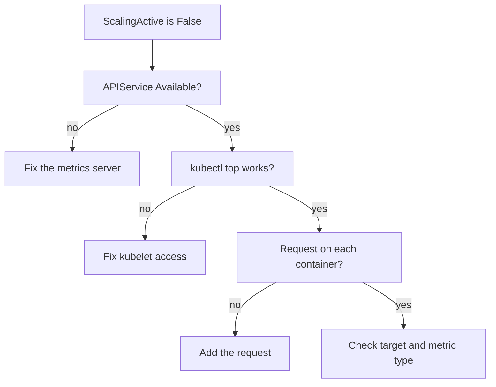

# Missing Requests And HPA Conditions

A HorizontalPodAutoscaler (HPA) that does nothing is the usual autoscaling failure in practice. The replica count stays at two, the load is high and no event says why. This part works through one concrete case, the `scout` Deployment without a CPU request, and then lists the causes in the order to check them.

## Learning objectives

- Diagnose an HPA whose `ScalingActive` condition is `False`.
- Fix a missing request without recreating the HPA.
- Separate metrics API problems from target and request problems.

## Before you start

A condition is a status entry with a `type`, a `status` of `True`, `False` or `Unknown`, a `reason` and a `message`. The HPA writes three of them: `AbleToScale`, `ScalingActive` and `ScalingLimited`. The playground has the `scout` Deployment in `starfleet`. Its container has no resource requests, and no HPA exists yet.

## Reproduce the failure

Create an HPA for `scout` with the quick command. It builds a CPU target of 60 percent:

<!-- astrona:playground:renew -->

```sh
kubectl autoscale deployment scout -n starfleet --min=2 --max=4 --cpu=60%
```

Wait about a minute for the controller to try, and then read the object:

```sh
kubectl -n starfleet describe hpa scout
```

The `Conditions` table shows `ScalingActive` as `False` with a reason such as `FailedGetResourceMetric`. The message and the events below it contain the text `missing request for cpu`, followed by the name of the container and the Pod. The HPA controller found a measurement for `scout` in the metrics API, but it had no request to divide it by.

The `kubectl get hpa` line shows `<unknown>` as the current value. That is the first thing to notice, and the condition message explains it.

## Fix it in place

The cause lives in the Deployment, so fix the Deployment and leave the HPA alone. A request on every container is the rule, and a Pod with a sidecar needs a request on the sidecar too, because the Pod total divides by the sum of all container requests:

```sh
kubectl -n starfleet set resources deployment scout --requests=cpu=50m,memory=32Mi
```

Changing the Pod template starts a rollout. The HPA keeps its history and its object, and it starts reading again once the new Pods have a measurement. Wait for the condition to turn `True` and look at the result:

```sh
kubectl -n starfleet wait --for=condition=ScalingActive hpa/scout --timeout=240s
kubectl -n starfleet get hpa scout
```

Deleting and recreating the HPA would also clear the message, but it loses the stabilization history and hides the cause. Treat the condition message as the instruction.

## The checks in order

When `ScalingActive` is `False`, check these causes in this order, because each one rules out the next:

1. The `metrics.k8s.io` APIService must be `Available`. The command `kubectl get apiservice v1beta1.metrics.k8s.io` shows it. If it is not, every HPA in the cluster fails the same way.
2. `kubectl top pods` for the target namespace must print values. If it prints an error, the metrics server is running but cannot reach the kubelets, which in a local kind cluster usually means a kubelet TLS problem.
3. Every container of the target must have the request that the metric needs. A `ContainerResource` metric needs it only on the named container.
4. The `scaleTargetRef` must name an existing object of the right kind in the same namespace. A wrong name makes `AbleToScale` `False` with a `FailedGetScale` reason.
5. A Pod that is new or not ready is left out of the average for a short time, so the first minute after a rollout can show `<unknown>` without a fault.



The diagram shows the order of the checks and where each failure leads.

## ScalingLimited is not an error

`ScalingLimited` as `True` means only that the result was cut by `minReplicas`, `maxReplicas` or a `behavior` policy. The reason `TooManyReplicas` names the maximum, and `TooFewReplicas` names the minimum. If load stays high and the HPA stays at the maximum with this condition, the HPA works, and the remaining decision is to raise the maximum or to fix the capacity.

## What you now know

You can read the three conditions, reproduce the missing-request failure, and repair it on the Deployment without recreating the HPA. You also have an ordered list of causes from the cluster-wide metrics service down to one container.

## Common pitfalls

> [!WARNING]
> Do not recreate an HPA to clear a condition. `<unknown>` in the first minute after a rollout is normal, but `<unknown>` that lasts needs a cause from the list. A request on only one container of a multi-container Pod still leaves the Pod-level percentage undefined.
