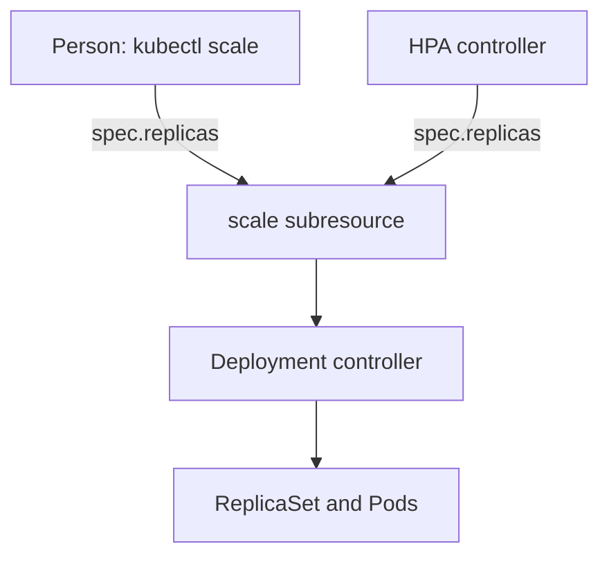

# Manual Scaling And The Scale Subresource

Not every workload needs a control loop. A team that knows a launch begins at nine o'clock can raise `scout` from 2 to 6 replicas by hand and lower it again in the evening. The same mechanism is what the HorizontalPodAutoscaler (HPA) uses, so understanding the manual path explains the automatic one. This part shows what `kubectl scale` sends, which objects accept it, and what happens when a person and an autoscaler both write the replica count.

## Learning objectives

- Scale a Deployment, a StatefulSet and a ReplicaSet with `kubectl scale`.
- Explain the scale subresource and the precondition flags.
- Predict the result when manual scaling meets an HPA.

## Before you start

A subresource is an extra API endpoint that belongs to one object, such as `scale`, `status` or `resize`. The playground has the `scout` Deployment in `starfleet` with two replicas, each requesting 50 millicores of CPU. No HPA exists in this environment.

## One endpoint for every scalable workload

Deployments, ReplicaSets, StatefulSets and replication controllers each have a different spec. They all expose the same small `Scale` object at the path `.../<name>/scale`. It carries `spec.replicas` for the desired count and `status.replicas` and `status.selector` for the observed state. A client that reads and writes only this object can scale any of them. `kubectl scale` and the HPA both do this.

Read the object that `kubectl scale` works on:

<!-- astrona:playground:renew -->

```sh
kubectl get --raw /apis/apps/v1/namespaces/starfleet/deployments/scout/scale
```

The response is a JSON `Scale` object with the replica count of `scout`. Custom resources can offer the same endpoint when their definition declares a scale subresource, and then `kubectl scale` and the HPA work on them as well.

## Scaling by hand

The command takes a resource and the desired count:

```sh
kubectl -n starfleet scale deployment scout --replicas=4
kubectl -n starfleet get deployment scout
```

The first command writes `spec.replicas` through the scale subresource and prints a line that says the Deployment was scaled. The Deployment controller then raises the replica count of the current ReplicaSet, and the ReplicaSet controller creates two Pods. The scheduler places them, and the kubelets start them. The `READY` column of the second command rises from 2 of 4 to 4 of 4 as the Pods pass their readiness probes.

A scale to 0 is allowed and keeps the object, its history and its Service. The Service then has no ready endpoints. Use it for work that can stop completely, such as a nightly job runner, and not for something that serves traffic.

## Preconditions

Two flags make a scale safe when other people or tools may change the same object. `--current-replicas=2` makes `kubectl` read the count first and refuse to scale unless the current count is 2. `--resource-version` refuses to scale if the object changed after a given version. Both turn a blind overwrite into a compare-and-set:

```sh
kubectl -n starfleet scale deployment scout --current-replicas=2 --replicas=3
```

The deployment now has 4 replicas, so this command fails with an error that states the expected and the actual count, and it changes nothing. Run the same command with `--current-replicas=4` to see it succeed.

## Manual scaling and an HPA

An HPA writes the replica count about every 15 seconds. A person who runs `kubectl scale` on a workload that an HPA manages changes the count for at most one sync period. The HPA then calculates a new count from the metrics and writes it, which undoes the manual change unless the metrics agree with it. If the manual count lies outside `minReplicas` and `maxReplicas`, the HPA pulls it back into the range at once.



The diagram shows two writers that share one endpoint, which is why the last writer wins. A pipeline that applies a manifest with a `replicas` field is a third writer.

To stop the autoscaler from fighting a manual change, you must change the HPA. Raise `minReplicas` to hold a floor, or delete the HPA to stop automatic scaling. Setting `maxReplicas` equal to `minReplicas` freezes the count and keeps the object for later.

## StatefulSets and rollouts

A StatefulSet scales one ordinal at a time. It creates `web-2` only after `web-1` is running and ready, and it removes the highest ordinal first on a scale-down. A Deployment scales all replicas in parallel. Scaling a Deployment during a rollout changes the total across both ReplicaSets in proportion to their sizes, so a scale during an update does not abort it.

## A worked example

The `scout` Deployment has 4 replicas after the commands above. A person runs `kubectl scale deployment scout --replicas=2`, and the Deployment controller lowers the desired count of the ReplicaSet. The ReplicaSet controller deletes two Pods. Each deleted Pod receives a termination signal, runs its shutdown handling for up to its termination grace period, and then stops. During that time the endpoint controller removes the Pod from the Service endpoints, so well-behaved clients see no failed request.

You can follow the sequence by watching the Pods with `kubectl get pods -w`. The deleted Pods pass through the `Terminating` state, and the Deployment shows the new ready count when they are gone. A scale-down never chooses a Pod by name. The ReplicaSet prefers to delete Pods that are not ready, that were created most recently, or that sit on nodes with more Pods of the same set.

## What you now know

You can scale any workload with `kubectl scale`, read the endpoint it uses, protect a change with a precondition, and predict the HPA overwriting a manual count. The next question is how to change the size of each replica instead of the number of replicas.

## Common pitfalls

> [!WARNING]
> A manual scale on an HPA-managed workload lasts only until the next sync. A manifest that contains `replicas` overwrites an autoscaler on every apply. Scaling to zero removes all capacity but keeps the Service, so requests fail instead of finding a missing object.
