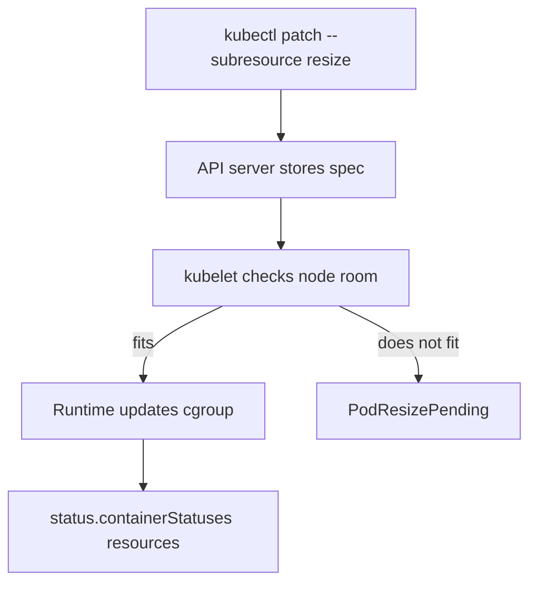

# In-Place Pod Resize

A container that needs more CPU for a few hours used to need a new Pod, because the resource requests of a running Pod were fixed. The new Pod meant a restart, a new IP address and a new scheduling decision. In-place Pod resize, stable since Kubernetes 1.35, lets you change the CPU and memory of a running container through the `resize` subresource of the Pod. This part shows the fields, the order of events, and the two ways a resize can wait or fail.

## Learning objectives

- Set a `resizePolicy` for each resource of a container.
- Resize a running Pod with `kubectl patch --subresource resize`.
- Read the desired and the applied resources and the resize conditions.

## Before you start

The quality of service (QoS) class of a Pod is `Guaranteed`, `Burstable` or `BestEffort`. The kubelet derives it from the requests and limits when the Pod is created, and it decides the order in which Pods are evicted under node pressure. The playground has the Pod `bridge` in `starfleet`. Its container requests and limits 100 millicores of CPU and 64 mebibytes of memory, so its class is `Guaranteed`.

## The fields

Each container may list a `resizePolicy`. An entry names a `resourceName` (`cpu` or `memory`) and a `restartPolicy`. The value `NotRequired` means the kubelet changes the container's cgroup limits while the process keeps running. The value `RestartContainer` means the kubelet restarts the container to apply the change. When you leave a resource out, it behaves as `NotRequired`. The `bridge` Pod resizes CPU live and restarts for memory, because many runtimes cannot shrink memory safely.

Read what the `bridge` Pod declares:

<!-- astrona:playground:renew -->

```sh
kubectl -n starfleet get pod bridge -o jsonpath='{.spec.containers[0].resizePolicy}'
```

Three places hold resources, and the difference matters. `spec.containers[].resources` is what you want. `status.containerStatuses[].allocatedResources` is what the kubelet accepted. `status.containerStatuses[].resources` is what the container actually runs with, so use it to prove that a resize finished.

## Resizing

The `resize` subresource accepts a patch of the Pod's container resources. `kubectl` needs version 1.32 or later for the `--subresource` flag. A `Guaranteed` Pod must stay `Guaranteed`, because the QoS class cannot change, so the requests and limits change together:

```sh
kubectl -n starfleet patch pod bridge --subresource resize --patch '{"spec":{"containers":[{"name":"bridge","resources":{"requests":{"cpu":"250m"},"limits":{"cpu":"250m"}}}]}}'
```

The API server validates the change and stores the new desired resources. The kubelet on the node sees the difference, checks that the node has room, updates the container's cgroup through the container runtime, and records the result in the Pod status. Because the CPU policy is `NotRequired`, the container keeps its process and its restart count.



The diagram shows where a resize can stop: at the node check, and nowhere else is the Pod restarted.

Check the applied result, the restart count and the container identity. The restart count must still be 0:

```sh
kubectl -n starfleet get pod bridge -o jsonpath='{.status.containerStatuses[0].resources}{"\n"}{.status.containerStatuses[0].restartCount}{"\n"}'
```

## When a resize waits

Ask for more CPU than the node owns, so you can see the failure state:

```sh
kubectl -n starfleet patch pod bridge --subresource resize --patch '{"spec":{"containers":[{"name":"bridge","resources":{"requests":{"cpu":"100"},"limits":{"cpu":"100"}}}]}}'
kubectl -n starfleet get pod bridge -o jsonpath='{.status.conditions[?(@.type=="PodResizePending")]}'
```

The Pod keeps running with its earlier resources. The `PodResizePending` condition appears with the reason `Infeasible` when the node can never satisfy the request, or `Deferred` when it might later, for example after another Pod ends. The `message` says why. A second condition, `PodResizeInProgress`, shows while the kubelet is applying an accepted change. Send a feasible patch to replace the impossible request, and the pending condition clears.

## Limits to remember

In-place resize changes CPU and memory only. It cannot change the QoS class, so a change that would turn a `Guaranteed` Pod into a `Burstable` Pod is rejected. A memory reduction can fail or cause an out-of-memory kill when the container already uses more than the new limit, so read the usage before you lower it. The scheduler counts the larger of the desired and the applied values while a resize is open, so a pending resize can hold back other Pods.

A controller-managed Pod is a special case. If you resize a Pod of a Deployment, the Deployment's template still has the old values, and the next rollout creates Pods with the old size. Change the template as well when the new size must last.

## Why the kubelet and not the scheduler

The scheduler picks a node once, when it binds the Pod. After that the kubelet owns the Pod on its node, so the kubelet decides whether a resize fits. It adds up the allocated resources of all Pods on the node and compares the total with the node's allocatable capacity. This explains the two reasons: a request above the whole node is `Infeasible`, and a request that fits the node but not the current mix of Pods is `Deferred`.

A deferred resize is retried by the kubelet when resources free up. It retries Pods in order of priority class first, then by QoS class, and then by how long the resize has waited. You do not need to repeat the patch, but you must watch the condition, because the Pod keeps running with the old size until the retry succeeds.

## What you now know

You can set a resize policy, resize a running Pod through the `resize` subresource, read the desired and the applied values, and recognize `PodResizePending` and its two reasons. The remaining question is how to choose the right size automatically.

## Common pitfalls

> [!WARNING]
> A resize of a Pod that a Deployment owns does not change the template, so the next rollout restores the old size. A `Guaranteed` Pod needs requests and limits changed together. `RestartContainer` restarts the container, so the restart count then rises.
