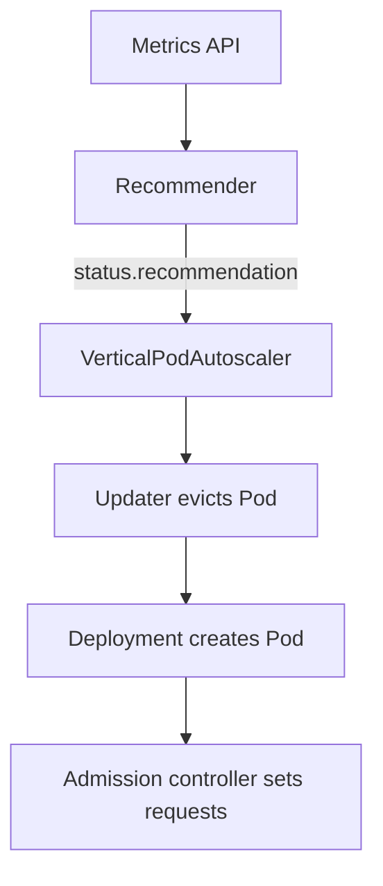

# Vertical Pod Autoscaler

Setting a request is a guess. Set it too low and the scheduler packs too many Pods on a node, and the container is throttled or killed. Set it too high and the cluster pays for capacity that nobody uses. The Vertical Pod Autoscaler (VPA) watches real usage and recommends, or applies, better requests. This part explains the components, the update modes and the limits of the VPA, which is not part of Kubernetes itself.

## Learning objectives

- Name the three VPA components and what each one does.
- Choose an update mode for a given workload.
- Explain why a VPA and an HPA must not use the same metric.

## Before you start

A custom resource definition (CRD) adds a new object kind to the API server, and a controller must act on those objects. The VPA is shipped as a CRD with three components that you install in the cluster. The playground does not install it, so this part is reading with one check of the cluster.

<!-- astrona:playground:renew -->

```sh
kubectl api-resources --api-group=autoscaling.k8s.io
```

The command lists the resource kinds that the API group `autoscaling.k8s.io` serves. A cluster without the VPA prints only the header line, or nothing, because the HPA lives in the `autoscaling` group and the VPA kind `VerticalPodAutoscaler` belongs to `autoscaling.k8s.io`. If the VPA were installed, the output would list `verticalpodautoscalers` with the short name `vpa`.

## The three components

The **recommender** reads the current and historical usage of the Pods from the metrics API, and calculates a recommendation for each container. It stores the result in the `status` of the VerticalPodAutoscaler object. The **updater** compares the running Pods with the recommendation, and when a Pod differs by a large margin it evicts the Pod through the eviction API, so that a controller creates a new one. The **admission controller** is a mutating webhook (a service the API server calls on every Pod creation) that rewrites the requests of a new Pod to the recommended values.



The diagram shows why a VPA normally restarts Pods: the new requests are applied when a Pod is created.

## What the object contains

A VerticalPodAutoscaler has a `targetRef` that names a workload, an `updatePolicy` with an `updateMode`, and an optional `resourcePolicy` with `containerPolicies`. A container policy can set `minAllowed` and `maxAllowed` to bound the recommendation, `controlledResources` to say whether CPU, memory or both are managed, and a per-container `mode` of `Off` to exclude a sidecar. The status reports four values for each container: `lowerBound`, `target`, `upperBound` and `uncappedTarget`. The `target` is the value to use, and the bounds tell you how stable the data is.

## Update modes

- `Off` produces recommendations and changes nothing. Use it first on every workload, to read the numbers and to copy them into the manifest by hand.
- `Initial` sets the requests only when a Pod is created and never evicts a running Pod.
- `Recreate` also evicts running Pods whose requests differ from the recommendation.
- `Auto` currently behaves like `Recreate`. Newer releases of the VPA add a mode that first tries an in-place resize and falls back to eviction, so read the release notes of the version you install.

A workload with fewer than two replicas is not evicted by default, because an eviction would cause an outage. The updater does not touch Pods that are not managed by a controller either.
 A PodDisruptionBudget also limits how many Pods the updater may evict at once.

## The conflict with the HPA

An HPA that uses a CPU utilization target divides usage by the request. A VPA that changes the request changes the percentage, so the two controllers react to each other and the replica count and the request chase one another. The rule is to give each controller its own signal. Use the VPA for memory and the HPA for a custom metric such as requests per second, or run the VPA in `Off` mode and apply its numbers by hand.

## Where the VPA does not help

The VPA changes the size of each Pod, so it cannot add replicas for a stateless service that needs more concurrency. It reads history, so a workload with a new load pattern gets a late recommendation. It needs the metrics server, and a Job that lasts only a few minutes gives it too little data. It does not change the limits that the application itself sets, such as a thread pool.

## A worked recommendation

The `scout` container requests 50 millicores of CPU and 32 mebibytes of memory, but over a week it uses about 120 millicores and 90 mebibytes at its busiest. The scheduler believed that three such Pods fit in 150 millicores, so it packed them on one node, and the containers share a processor that is oversubscribed. A VPA in `Off` mode would report a `target` near the observed peak plus a safety margin, with a lower `lowerBound` and a higher `upperBound` that show the uncertainty.

You then have three choices. Copy the `target` into the Deployment manifest and roll out. Switch to `Initial`, so that each new Pod starts with the target and running Pods stay untouched. Or switch to `Recreate`, which evicts Pods one at a time, limited by the PodDisruptionBudget. The first choice keeps full control, and the last one needs the application to tolerate restarts at any time.

## Memory and CPU behave differently

When a container exceeds its CPU limit, the kernel throttles it and the process slows down. When it exceeds its memory limit, the kernel kills the process, and the kubelet records an out-of-memory kill. A VPA therefore treats a memory recommendation that is too low as the more dangerous mistake. The recommender raises its memory recommendation after an out-of-memory kill, and it uses a safety margin on top of the observed peak.

Because the recommendation follows past usage, it does not predict a launch. A workload that doubles its traffic next week gets a recommendation for last week. Combine the VPA's numbers with what you know about expected load.

## Reading a VPA in a cluster that has one

On a cluster where the VPA is installed, `kubectl get vpa` lists the objects, and `kubectl describe vpa <name>` prints the `Recommendation` section with the `Lower Bound`, `Target`, `Uncapped Target` and `Upper Bound` for each container. The condition `RecommendationProvided` is `True` only after the recommender has collected enough samples, which can take several minutes for a new workload.

If the recommendation is missing, check three things: the `targetRef` must name an existing workload in the same namespace, the metrics API must work, and the recommender Pod must run. A `minAllowed` that is higher than the observed need pins the target at the minimum, and that explains a recommendation that never changes.

## What you now know

You can name the recommender, the updater and the admission controller, choose `Off`, `Initial` or `Recreate`, and keep the VPA and the HPA on separate signals. The exam expects you to recognize these concepts, and you do not need to install the VPA to use them.

## Common pitfalls

> [!WARNING]
> The VPA is an add-on, and a cluster without it has no `VerticalPodAutoscaler` kind. `Recreate` and `Auto` evict Pods, which restarts the application. A VPA and an HPA that both react to CPU utilization on the same workload produce unstable counts and sizes.
