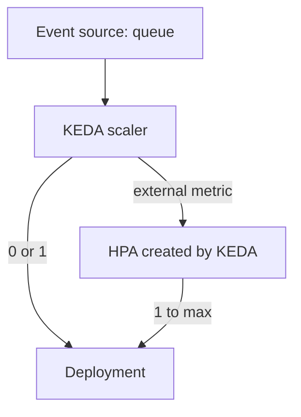

# Event-Driven Autoscaling And Scale To Zero

A worker that reads messages from a queue has no useful CPU signal. It is idle when the queue is empty and busy when the queue is full, and the best number of replicas is the queue length divided by the speed of one worker. At night it should not run at all. This part explains what the built-in HorizontalPodAutoscaler (HPA) can and cannot do for such a workload, and what KEDA adds.

## Learning objectives

- Explain why the HPA cannot scale a workload to zero replicas by default.
- Describe what KEDA adds: scalers, the `ScaledObject` and the metrics adapter.
- Decide when event-driven scaling is a better fit than a CPU target.

## Before you start

An event source is a system that holds work, such as a message queue, a stream or a database table. An external metric is a number about such a source that does not belong to any Kubernetes object. The playground has the `scout` Deployment with an HPA on CPU, so you can read what the HPA field documents say about the lower bound.

## The lower bound of the HPA

An HPA must have at least one replica to measure. With zero Pods there is no per-Pod metric to average, and a CPU target has nothing to read. Kubernetes therefore keeps `minReplicas` at 1 or more by default. A feature gate named `HPAScaleToZero` allows `minReplicas: 0`, but only when the HPA has at least one `Object` or `External` metric, and the gate is alpha and off by default in Kubernetes 1.35. It becomes beta and on by default in Kubernetes 1.37, so read the field description in your own cluster, because the gate status depends on the version:

<!-- astrona:playground:renew -->

```sh
kubectl explain horizontalpodautoscaler.spec.minReplicas --api-version=autoscaling/v2
```

Without that gate, an HPA can reduce an idle workload to one Pod, and cannot reduce it to none. Scale to zero also adds a second problem: something must watch the event source while no Pod exists, and wake the workload when work arrives. A Pod cannot do that for itself.

## What KEDA adds

KEDA (Kubernetes Event-driven Autoscaling) is an add-on project. It installs three parts. The **operator** watches custom resources named `ScaledObject` (for Deployments and similar workloads) and `ScaledJob` (for Jobs). The **scalers** are small adapters for event sources such as message queues, streams, databases, cron schedules and HTTP rate. The **metrics adapter** serves the numbers of the scalers to the HPA as an external metrics API.

A `ScaledObject` names a target workload, a minimum and a maximum, and a list of triggers. When you create one, KEDA does two different things. For scaling between zero and one replica, KEDA itself reads the event source and sets the replica count, because the HPA cannot act at zero. For scaling between one replica and the maximum, KEDA creates a normal HPA with an `External` metric and the metrics adapter supplies its value.



The diagram shows two paths into one Deployment. The first path wakes the workload from zero, and the second path scales it with ordinary HPA logic.

## Reading the result in a cluster that has KEDA

The HPA that KEDA creates shows in `kubectl get hpa`, and its name starts with `keda-hpa-`. Its `scaleTargetRef` and its `External` metric look like any other HPA. Do not edit it by hand, because KEDA owns the object and overwrites your change. Change the `ScaledObject` instead. Check the HPA objects in the playground to see the normal shape of an HPA:

```sh
kubectl get hpa -A
```

The playground has no KEDA, so the list contains only the `scout` HPA that the environment created.

## Scale to zero in practice

Scale to zero saves resources, and it adds a cold start. The first message waits for the Pod to be scheduled, the image to be pulled if it is not cached, the container to start and the readiness probe to pass. A workload with a strict latency goal cannot accept that wait. A queue consumer can.

A scale to zero also removes the Service endpoints. A web service behind a Service cannot be woken by an ordinary request, because the request fails before any component sees it. HTTP scale to zero needs an interceptor that holds the request while the Pod starts, and that is a different add-on.

## Choosing a signal

Use a CPU or memory target when more load always means more processor or memory use per Pod. Use a queue length, a stream lag or a request rate when the work arrives from outside and waits there. Use a schedule when the load is known in advance, such as a batch window at night. Each of the last two needs an adapter or an event-driven scaler, and a `Pods` metric needs one even though the workload is in the cluster.

## The fields of a ScaledObject

A `ScaledObject` is a custom resource, so its schema belongs to KEDA and not to Kubernetes. The fields that matter for the exam concepts are these:

- `scaleTargetRef` names the Deployment, StatefulSet or other workload to scale.
- `minReplicaCount` and `maxReplicaCount` set the bounds, and `minReplicaCount: 0` allows the scale to zero that KEDA handles itself.
- `pollingInterval` sets how often KEDA reads the event source for the zero-to-one decision.
- `cooldownPeriod` sets how long KEDA waits after the last event before it scales from one replica to zero.
- `triggers` lists the event sources, and each trigger has a `type` such as a queue and its `metadata`, for example a queue name and a target length per replica.

The target length per replica is the equivalent of the CPU target. With a target of 10 messages per replica and 95 waiting messages, the HPA that KEDA created asks for `ceil[ 95 / 10 ]`, which is 10 replicas, bounded by the maximum.

## Failure cases

A trigger that cannot reach its event source fails every poll. KEDA then reports the problem on the `ScaledObject` status and in the operator log, and it keeps the last replica count or applies a fallback if you configured one. The workload does not scale on its own in that state, so a broken credential looks like an autoscaler that ignores the queue.

A second case is a workload that never reaches zero. The usual cause is a long `cooldownPeriod`, a trigger that still reports work, or a second controller that holds `minReplicas` at one. Check the `ScaledObject` conditions first, and the HPA that KEDA created second.

## What you now know

You know why the HPA stops at one replica, what the KEDA operator, scalers and metrics adapter do, and how KEDA combines a zero-to-one step of its own with a normal HPA. You can pick between CPU, queue-based and scheduled signals. The next question is what happens to the Pods that these controllers add when the nodes are full.

## Common pitfalls

> [!WARNING]
> Do not edit the HPA that KEDA created, because KEDA overwrites it. A scale to zero of a workload behind a Service makes every request fail until a Pod is ready. The `HPAScaleToZero` gate is off by default in Kubernetes 1.35, so `minReplicas: 0` is rejected unless the gate is on.
