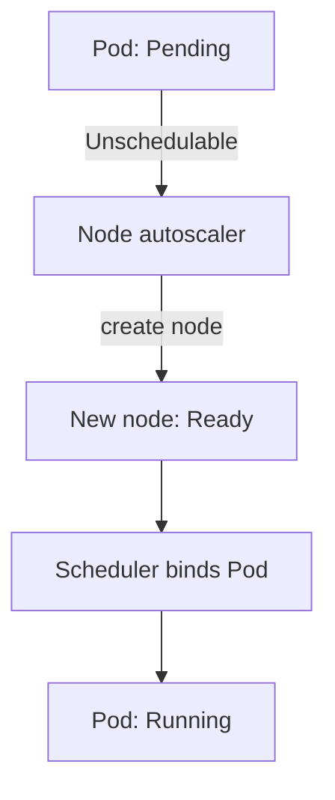

# Node-Level Autoscaling

A HorizontalPodAutoscaler (HPA) that asks for ten `scout` replicas creates the demand for ten Pods. If the nodes can host only six, four Pods wait in the `Pending` state, and the HPA cannot change that. A node autoscaler is the component that adds a node when Pods cannot be placed, and removes a node when it is not needed. This part follows the signal from a `Pending` Pod to a new node, and compares the two common node autoscalers, Cluster Autoscaler and Karpenter.

## Learning objectives

- Recognize an unschedulable Pod and read the scheduler event that explains it.
- Describe how a node autoscaler reacts to it and when it removes a node.
- Compare Cluster Autoscaler and Karpenter at the level of concepts.

## Before you start

The scheduler is the component that binds each new Pod to a node. It only considers the requests of the Pod and the free allocatable resources of each node, not the current usage. The playground has one control-plane node and one worker node, and it has no node autoscaler. That is useful, because you can see exactly what a missing node autoscaler looks like.

## An unschedulable Pod

Save this as `pod-probe-large.yaml`. The Pod requests 100 CPU cores, which no node in the playground has:

```yaml
apiVersion: v1
kind: Pod
metadata:
  name: probe-large
  namespace: starfleet
spec:
  containers:
  - name: probe
    image: docker.io/library/busybox:1.37.0
    command: ["sh", "-c", "sleep 3600"]
    resources:
      requests:
        cpu: "100"
```

Apply it:

<!-- astrona:playground:renew -->

```sh
kubectl apply -f pod-probe-large.yaml
```

Then check the result. The Pod stays in `Pending`, and the Events at the end of the description contain a `FailedScheduling` event from the scheduler. Its message says that none of the nodes are available and names the reason, which is `Insufficient cpu`:

```sh
kubectl -n starfleet get pod probe-large
kubectl -n starfleet describe pod probe-large
```

The Pod condition `PodScheduled` is `False` with the reason `Unschedulable`. This condition is the exact signal that node autoscalers watch.

## What a node autoscaler does

A node autoscaler is a separate controller that you install in the cluster. It watches for Pods whose `PodScheduled` condition is `False` with the reason `Unschedulable`. It then asks the infrastructure provider for a node that the Pod would fit on, and when the node joins and becomes `Ready`, the scheduler binds the waiting Pod to it. A Pod that fits no possible node, such as this 100-core Pod, stays `Pending`, because adding a node cannot help.



The diagram shows that the node autoscaler reacts to a scheduling failure and not to CPU use. It sizes the cluster from requests, in the same way the scheduler does.

## Scale-down of nodes

The autoscaler also removes nodes. The Cluster Autoscaler considers a node for removal when the sum of the requests on it is below a threshold of the node's capacity (50 percent by default) for a period, and when every Pod on it can run somewhere else. It drains the node through the eviction API, so a PodDisruptionBudget can delay it. Pods that block removal include Pods with local storage that is not marked safe to delete, Pods without a controller, and Pods with the annotation `cluster-autoscaler.kubernetes.io/safe-to-evict` set to `"false"`.

## Cluster Autoscaler and Karpenter

The Cluster Autoscaler scales groups of identical nodes that the cloud provider already defines, such as an auto scaling group or a managed node pool. It picks which group to grow and changes its size. Its node shapes are the shapes of its groups.

Karpenter does not work from fixed groups. It reads the requirements of all pending Pods together, such as CPU, memory, architecture and zone, and creates nodes of the best fitting size directly through the provider. It also consolidates: it replaces several lightly used nodes with fewer or cheaper nodes. Its objects are a `NodePool`, which sets the limits and constraints, and a `NodeClaim`, which represents one requested node.

Both components need permission from the cloud provider, so a kind cluster cannot run either in a meaningful way. Both depend on correct requests. A Pod with no request looks free to the scheduler and to the autoscaler, so the nodes fill with work that was never counted.

## Putting the three controls together

A traffic increase raises CPU use, the HPA raises replicas, new Pods go `Pending`, the node autoscaler adds a node, and the Pods start. Each step has a delay: up to a minute for the metrics, about 15 seconds for the HPA, and several minutes for a node. A workload that must absorb a sudden peak needs spare capacity in advance, because the node step cannot be fast.

Remove the large Pod before you continue, so it does not stay in the playground:

```sh
kubectl -n starfleet delete pod probe-large
```

## What you now know

You can recognize an unschedulable Pod, read the `FailedScheduling` event, and explain how a node autoscaler turns that signal into a node. You can compare the group-based Cluster Autoscaler with the requirements-based Karpenter, and you know that both depend on requests. The last question is how disruption limits and rollouts interact with all this.

## Common pitfalls

> [!WARNING]
> A node autoscaler reacts to `Unschedulable` Pods, not to CPU use, so Pods without requests never trigger it. A Pod that fits no possible node stays `Pending` forever. A PodDisruptionBudget or a `safe-to-evict: "false"` annotation can keep a node from being removed.
