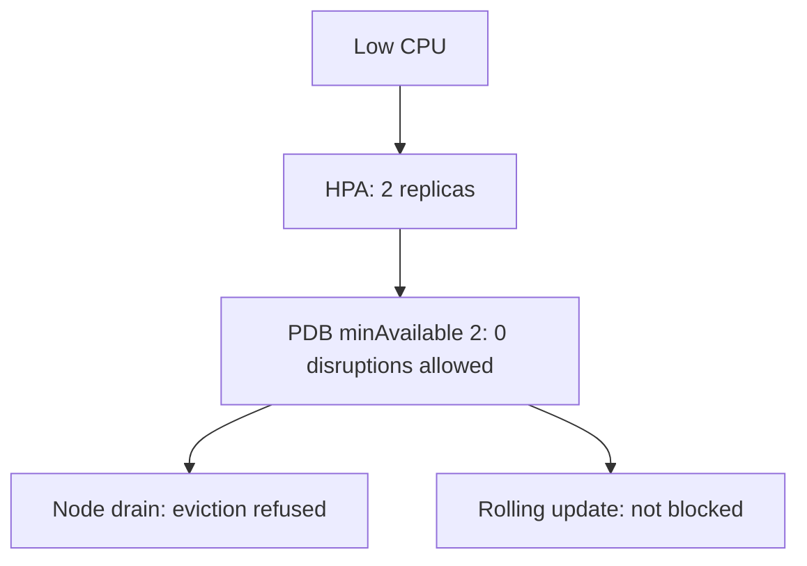

# HPA, Disruption Budgets And Rollouts

Three controllers can change the number of ready `scout` Pods at the same time: the HorizontalPodAutoscaler (HPA) that sets the replica count, the Deployment controller that replaces Pods during a rollout, and the eviction API that removes Pods when a node is drained. Each follows its own rules. This part shows which rules apply to which controller, and how a PodDisruptionBudget (PDB) and the HPA bounds must agree so that a workload stays available.

## Learning objectives

- Explain which disruptions a PodDisruptionBudget limits and which it does not.
- Read the allowed disruptions of a budget and relate them to the HPA bounds.
- Describe how an HPA and a rolling update work on the same Deployment.

## Before you start

A PDB is an object with a label selector and either `minAvailable` or `maxUnavailable`. A rolling update is the default Deployment strategy. It starts new Pods and stops old Pods in steps. The playground has the `scout` Deployment with three replicas, an HPA with a minimum of 2 and a maximum of 5, and a PDB that requires at least 2 available Pods.

## What the budget limits

A PDB limits voluntary disruptions that go through the eviction API. A node drain uses that API, and so does a node autoscaler that removes a node. The API server checks the budget for each eviction, and it answers `429 Too Many Requests` when the eviction would leave fewer Pods available than the budget allows. The drain tool then waits and retries.

A PDB does not limit a rolling update. The Deployment controller deletes old Pods directly, and the pace comes from the fields `maxSurge` and `maxUnavailable` in the Deployment strategy. A PDB also cannot protect against involuntary disruptions such as a node crash, an out of memory kill or a deleted Pod. Those events still count against the budget in the status, but nothing blocks them.

## Reading the budget

The controller computes the status from the current Pods. `currentHealthy` is the number of ready Pods that match the selector, `desiredHealthy` is the number the budget requires, `expectedPods` is the number of Pods the owning controllers want, and `disruptionsAllowed` is the difference between healthy and desired, never below zero.

<!-- astrona:playground:renew -->

```sh
kubectl get pdb scout -n starfleet
kubectl get hpa scout -n starfleet
```

With three ready replicas and `minAvailable: 2`, one disruption is allowed. If the HPA lowers the count to its minimum of 2, the allowed disruptions fall to zero. The HPA lowers the count only after its scale-down stabilization window of five minutes, so the budget can change a few minutes after the Deployment starts.



The diagram shows that the same replica count that the HPA picks decides how much room the eviction API has. A drain waits at the minimum, but a rollout goes on.

## Unhealthy Pods and the budget

A Pod that is running but not ready does not count as healthy, so a crash-looping replica can make a budget block the eviction of the healthy ones. The field `unhealthyPodEvictionPolicy` of the PDB controls this. The default, `IfHealthyBudget`, evicts an unhealthy Pod only when the budget is currently met. The value `AlwaysAllow` lets the drain evict unhealthy Pods at any time, which clears a stuck drain without weakening the protection of the healthy Pods.

## Eviction compared with deletion

The eviction API is a subresource of the Pod. A drain calls it for every Pod on the node, and a call that would break a budget fails. A plain `kubectl delete pod` does not call the eviction API. It deletes the Pod immediately, whatever the budget says. This difference explains why a budget can protect a workload from a node drain while the same workload loses a Pod to an operator who deletes it by hand.

## Making the bounds agree

The HPA minimum and the budget must leave room for at least one disruption at the minimum. With `minAvailable: 2`, the minimum must be 3 or more. The other form of the budget scales with the workload: `maxUnavailable: 1` always allows one Pod to be missing, whatever the replica count is. A percentage works too, and it is rounded up to a whole Pod. For a workload that must not be disrupted at all, `maxUnavailable: 0` blocks every eviction, and you then have to remove the budget before you drain a node.

A budget with a selector that matches no Pod protects nothing. Check that `expectedPods` is the number you intend, because a label typo shows up as a zero there.

## The HPA during a rollout

A rolling update changes the Pod template, so the Deployment controller creates a new ReplicaSet and shifts the replicas to it. The HPA keeps working on the Deployment. It writes the total replica count to the scale subresource, and the Deployment controller divides that count between the old and the new ReplicaSets in proportion. The HPA also ignores the CPU of Pods that are not ready, so the start-up spike of a new Pod does not trigger a scale-up by itself.

Start a rollout of `scout` by changing a label of the Pod template, and watch the replica sets:

```sh
kubectl -n starfleet rollout restart deployment/scout
kubectl -n starfleet rollout status deployment/scout
```

The restart works by adding an annotation to the Pod template, which counts as a template change. The command waits until the new Pods are ready. During the rollout, the surge allows one extra Pod above the replica count by default, so the HPA maximum of 5 does not limit the temporary count. The default `maxUnavailable` of 25 percent means that a few Pods can be missing, and the PDB does not change that.

## Reading the strategy fields

The Deployment strategy has two numbers that you can set as whole Pods or as percentages. `maxSurge` is how many Pods above the desired count may exist during the update. `maxUnavailable` is how many Pods below the desired count may be missing. Percentages of `maxSurge` round up and percentages of `maxUnavailable` round down. Setting `maxUnavailable: 0` and `maxSurge: 1` makes the rollout start a new Pod and wait for it to be ready before it stops an old one, which is the safest choice when the node has spare room.

## Putting the controls together

A safe design has four parts that agree with each other. The requests are set from observed use, so the percentage target means something. The HPA minimum is high enough to carry normal traffic. The budget leaves room for one eviction at that minimum. The readiness probe is accurate, so Pods only receive traffic when they can serve it. If one of these is wrong, the failure often looks like another component: a stuck drain, Pods that never leave `Pending`, or a rollout that is slow.

## What you now know

You can say which controllers a PDB limits, read the allowed disruptions, and choose a budget that works with the HPA minimum. You know that a rolling update follows `maxSurge` and `maxUnavailable` and that the HPA divides its replica count between the old and the new ReplicaSets.

## Common pitfalls

> [!WARNING]
> A PDB does not slow a rolling update and does not stop a node crash. A budget whose `minAvailable` equals the HPA minimum allows no eviction, so drains and node scale-down wait. A selector typo gives a budget that protects nothing.
