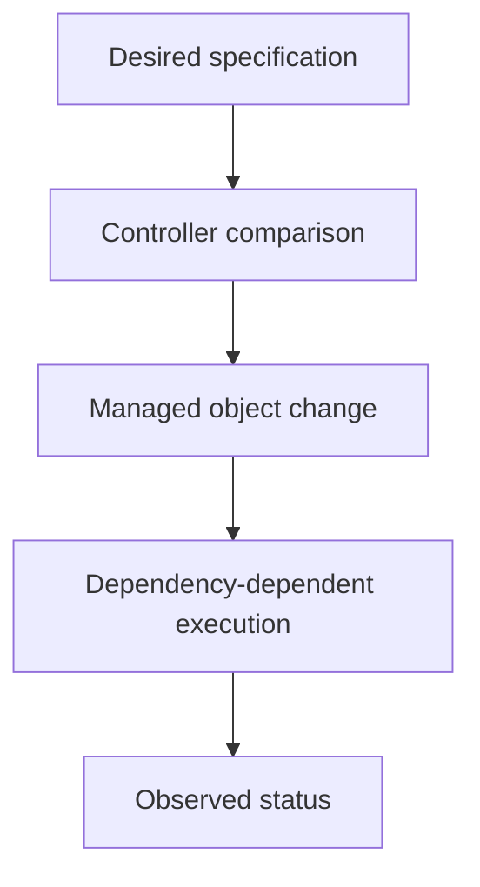

# Desired State And Reconciliation

A controller replaces a lost application Pod, but the replacement cannot mount its storage. Reconciliation created the requested object while a later dependency prevented readiness.

## Learning objectives

- Explain owner-driven replacement and desired state.
- Distinguish process startup from useful service.
- Choose health checks with appropriate recovery actions.

## Before you start

This chapter is standalone reading material; no running cluster or installed tools are required. A Pod is the Kubernetes unit for running one or more containers, and a namespace groups namespaced objects. Treat the worked configurations as teaching examples rather than recorded observations from a provisioned environment.

## Responsible components and behavior

The `scout` application needs three replicas, but only two Pods remain after a failure. A replica is one copy of the workload. Kubernetes uses a controller to compare the desired replica count with the current objects and request another Pod. This repeated comparison and correction is reconciliation.

A resource's specification describes desired behavior. Its status records what the system currently observes. Accepting a resource request does not prove that its containers are ready. The controller, scheduler and kubelet still need to act, and each can encounter conditions that prevent progress. A missing image, insufficient node capacity or an unavailable volume can stop a valid request from becoming a running workload.

A Deployment is a resource for managing replaceable application replicas and updates. Its controller manages ReplicaSets, which maintain a requested number of Pods. A ReplicaSet controller responds to the missing `scout` Pod by creating a replacement object. The scheduler assigns that object to a node, and the node's kubelet runs it. The replacement is a new Pod with a new identity, even when it serves the same application.

Reconciliation is continuous, but it is not instantaneous or a guarantee of application correctness. An application can return incorrect results while every Pod appears healthy. Controllers also cannot repair a missing external dependency unless a controller explicitly manages it. Desired state must describe something the available system can achieve.

For a scenario question, identify the desired value, the observed value and the controller responsible for closing the difference. If a Deployment asks for three replicas and only two exist, the replica controller needs to act. If three Pods exist but one cannot start, inspect the node and startup dependencies instead.

## Reconciliation Through A Failure Timeline

Start with a Deployment requesting three replicas and a ReplicaSet that owns three Pod objects. One Pod is deleted. The ReplicaSet controller eventually observes that only two managed Pods remain and creates another. That new Pod first exists as an API object, then needs a scheduling assignment, node preparation and a running container.

Object count and serving capacity therefore can disagree during recovery. The new Pod may bring the object count back to three while only two replicas can accept requests. If its image cannot be downloaded, creating still more replacement objects does not repair image access. The controller has performed one responsibility successfully while another component remains blocked.

The control loop can be described with three values: the desired count, the observed managed count and the available count. Desired count answers how many replicas are requested. Observed managed count answers how many relevant objects exist. Available count reflects whether enough replicas meet the controller's availability conditions. Read each value according to its meaning rather than treating all three as synonyms for “running.”

A direct edit to a managed Pod can also be temporary. If the owning controller later replaces it, the new Pod comes from the controller's template, not necessarily from the manual change. Durable configuration belongs in the object that declares the intended template. This is why repairing an application by editing one disposable replica can produce a surprising regression after replacement.

## What Self-Healing Cannot Promise

Reconciliation works only for the state a controller knows how to manage. A Deployment can request another web process, but it cannot infer which unfinished customer transaction that process held in memory. The application needs durable records and safe retry behavior to handle that loss.

Likewise, a controller may continually retry a desired change that the environment cannot satisfy. The repeated effort is useful because a missing dependency might later return, but it is not proof that the request is achievable. A practical explanation identifies the managed state, the corrective action and the dependency that still prevents completion.

## Work through the decision

A specification describes requested state, and status describes current observations. A controller compares them and acts within its responsibility. For a Deployment, ReplicaSet ownership explains why deleting one child does not erase the required population.

The new Pod has a new identity, even if it serves the same application name. Scheduling, image access, storage and startup are later transitions with their own failures. Reconciliation is repeated correction toward an achievable declaration, not instant application repair. It cannot restore external data or correct a business calculation unless a specific implementation manages that requirement.

Reconciliation connects declared intent with observed state, while independent dependencies constrain what can actually be achieved.

Reconciliation connects declared intent with observed state, while independent dependencies constrain what can actually be achieved.

## Common pitfalls

> [!WARNING]
> A successful API request means the requested object was accepted. It does not mean reconciliation has finished or the application works.
