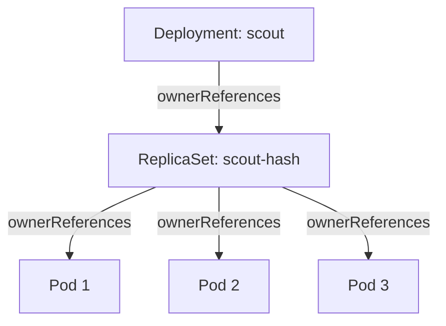

# ReplicaSet Ownership And Garbage Collection

When a Pod in a Deployment disappears, a new one appears within seconds. Nobody typed a command, and the Deployment itself did not create the Pod. This part follows the chain of objects that makes this happen and the two mechanisms that hold the chain together: owner references and label selectors. Once you can see the chain, you can predict what a delete command removes and what it leaves behind.

## The three-level chain

A Deployment manages updates, but it does not manage Pods directly. The Deployment controller, which runs inside `kube-controller-manager`, creates a ReplicaSet for each version of the Pod template. A ReplicaSet is an object that keeps a fixed number of identical Pods running. The ReplicaSet controller, also part of `kube-controller-manager`, creates and deletes the Pods.

The playground runs a Deployment named `scout` with three replicas in the `starfleet` namespace. Start by listing the ReplicaSet that the Deployment created.

<!-- astrona:playground:renew -->

```sh
kubectl -n starfleet get replicaset -l app=scout
```

You see one ReplicaSet whose name is the Deployment name plus a hash. The hash comes from the Pod template, so a new template produces a new ReplicaSet with a new name. The ReplicaSet shows desired, current and ready counts, and all three should reach three.

## Owner references

Every object that a controller creates carries a field named `metadata.ownerReferences`. This field names the owner by kind, name and uid, and it contains `controller: true` for the one controller that manages the object. The uid matters: a new object with the same name has a new uid, so it is not the same owner.

Print the owner of each `scout` Pod:

```sh
kubectl -n starfleet get pods -l app=scout -o custom-columns=NAME:.metadata.name,OWNER_KIND:.metadata.ownerReferences[0].kind,OWNER:.metadata.ownerReferences[0].name
```

Every Pod names the same ReplicaSet with owner kind `ReplicaSet`. If you print the owner of that ReplicaSet in the same way, it names the Deployment. The chain is therefore Deployment, ReplicaSet, Pod.



The arrows show ownership: each child object stores a reference to its owner, and the owner does not store a list of its children.

## The selector finds the Pods to count

An owner reference says who owns an object. A label selector says which objects a controller counts. The ReplicaSet does not keep a list of its Pods. Each time it reconciles, it lists the Pods in its namespace that match its selector and that it controls, then compares the count with `spec.replicas`.

Read the selector of the ReplicaSet:

```sh
kubectl -n starfleet get replicaset -l app=scout -o jsonpath='{.items[0].spec.selector.matchLabels}{"\n"}'
```

The selector holds the label `app: scout` and also a label named `pod-template-hash`. The Deployment controller adds this second label so that two ReplicaSets of the same Deployment never select the same Pods during a rolling update. For this reason, a loose Pod that only has the label `app=scout` is not counted by this ReplicaSet.

A plain ReplicaSet that you write yourself has no such label. If you create a bare Pod whose labels match a ReplicaSet selector and the Pod has no controller owner, the ReplicaSet adopts it: the controller writes its own `ownerReferences` entry into the Pod. The ReplicaSet then counts one more Pod than it wants and deletes one. Adoption only applies to Pods that have no controller owner. A Pod that already belongs to another controller is never taken.

## Replacement is a new object

Delete one Pod and list the Pods again:

```sh
kubectl -n starfleet delete pod $(kubectl -n starfleet get pods -l app=scout -o name | head -n 1)
kubectl -n starfleet get pods -l app=scout
```

The list shows three Pods again. One of them has a different name and a very young age. The ReplicaSet controller saw two matching Pods, compared that with the three it wants, and created a new Pod from its template. The new Pod has a new name, a new uid and probably a new IP address. The scheduler then picks a node, and the kubelet on that node starts the container.

## Deleting an owner and the garbage collector

The garbage collector is a controller in `kube-controller-manager` that deletes objects whose owners no longer exist. When you delete a Deployment, the API server removes the Deployment, and the garbage collector then sees ReplicaSets that point to a missing owner and deletes them. It does the same for their Pods. This is called cascading deletion, and it is the default.

`kubectl delete` has three modes, set with `--cascade`:

- `background` (the default): the owner is deleted at once, and the garbage collector removes the dependents afterwards.
- `foreground`: the owner stays visible with a `foregroundDeletion` finalizer until all dependents with `blockOwnerDeletion` set are gone, and then it is removed.
- `orphan`: the owner is deleted and the garbage collector removes the owner reference from the dependents instead of deleting them.

Try the orphan mode on the ReplicaSet. The Pods keep running because nothing deletes them:

```sh
kubectl -n starfleet delete replicaset -l app=scout --cascade=orphan
kubectl -n starfleet get pods -l app=scout -o custom-columns=NAME:.metadata.name,OWNER:.metadata.ownerReferences[0].name
```

Right after the command, the three Pods keep their names. The Deployment still exists, so its controller notices that it has no ReplicaSet for the current template and creates one. The new ReplicaSet has the same name, because the name comes from the template hash. Its selector matches the orphaned Pods, and they have no controller owner, so it adopts them. A few seconds later the owner column names the ReplicaSet again. If the check runs before adoption, the owner column is empty, which shows the orphan state.

## What to remember for a failure

When a Pod is not replaced, check the owner first. A Pod with no `ownerReferences` is a bare Pod, and nothing recreates it. When a Deployment keeps creating Pods that are then deleted, check whether two controllers select the same labels. When a delete leaves objects behind, check the cascade mode and look for finalizers, which are keys in `metadata.finalizers` that block deletion until a controller removes them.

You now know which object creates a Pod, how the link between them is stored, and what happens to a Pod when its owner goes away. The next question is how to run controllers that do not just count replicas: one Pod per node, and Pods with a fixed identity.

## Common pitfalls

> [!WARNING]
> Editing a Pod that a ReplicaSet owns does not change the template, so the next replacement starts from the old template. Change the Deployment instead. Deleting a ReplicaSet by hand with the default mode also deletes its Pods, and the Deployment creates a new set. Use `--cascade=orphan` only when you want the Pods to survive.
