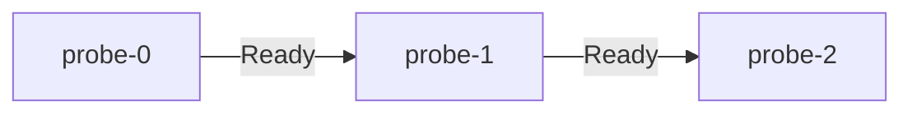

# DaemonSet And StatefulSet

A ReplicaSet treats its Pods as interchangeable and does not care which node runs them. Two kinds of workload break that assumption. Some programs must run once on every node, such as a log collector or a network agent. Others need a stable name and their own disk, such as a database replica. A DaemonSet covers the first case and a StatefulSet covers the second. Both are self-healing, but the thing they restore is different from a plain replica count.

## DaemonSet: one Pod per node

A DaemonSet is a controller that runs one copy of a Pod on every node that matches its rules. The DaemonSet controller, part of `kube-controller-manager`, creates one Pod per eligible node and sets a node affinity on each Pod for that node. The default scheduler then binds the Pod. When a node joins the cluster, the controller creates a Pod for it. When a node is removed, the Pod is garbage collected. There is no `replicas` field, because the node count decides the Pod count.

The playground has a DaemonSet named `shuttle` in `starfleet`. The cluster has a control-plane node and a worker node. List the nodes and then the `shuttle` Pods with their nodes:

<!-- astrona:playground:renew -->

```sh
kubectl get nodes
kubectl -n starfleet get pods -l app=shuttle -o wide
```

You see one `shuttle` Pod per node, including the control-plane node. That is not the default. A control-plane node carries the taint `node-role.kubernetes.io/control-plane:NoSchedule`. A taint is a marker on a node that repels Pods unless a Pod has a matching toleration. The `shuttle` Pod template contains a toleration for this key, so the DaemonSet controller and the scheduler place it on the control-plane node as well.

Without that toleration, the DaemonSet would only run on the worker. The controller also adds some tolerations automatically, for example for the `not-ready` and `unreachable` node conditions, so that node agents keep running while a node is unhealthy. A `nodeSelector` or node affinity in the template narrows the set of nodes in the other direction.

## DaemonSet updates

A DaemonSet has an `updateStrategy`. The default is `RollingUpdate`, which replaces Pods node by node, and `maxUnavailable` (default 1) limits how many nodes lose their agent at the same time. The other value is `OnDelete`, which only replaces a Pod after you delete it by hand. Choose `OnDelete` when an agent update must be timed per node.

## StatefulSet: identity that survives replacement

A StatefulSet is a controller for Pods that need a stable identity. It gives each Pod an ordinal number from 0 to replicas minus 1 and builds the Pod name from the StatefulSet name and that number. The StatefulSet `probe` creates `probe-0`, `probe-1` and `probe-2`. When a Pod is deleted, the controller creates a new Pod with the same name, and it does not pick a new random suffix.

Look at the Pods:

```sh
kubectl -n starfleet get pods -l app=probe
```

Three Pods exist with the ordinals in their names. The ordinal order is not only cosmetic. By default the controller starts them in order and waits for each Pod to be Running and Ready before it creates the next one. It stops them in reverse order. The field that controls this is `podManagementPolicy`. The default value, `OrderedReady`, gives this strict order. The value `Parallel` creates and deletes all Pods at once and drops the ordering, which suits stateful programs that do not depend on start order.



The arrows show that the controller creates `probe-1` only after `probe-0` is Ready, and `probe-2` only after `probe-1` is Ready.

## Stable network identity and the headless Service

Each Pod needs a name that other Pods can resolve and that does not change. A normal Service load-balances over all Pods behind one virtual IP address, so it cannot name a single Pod. A headless Service is a Service with `clusterIP: None`. It has no virtual IP. The cluster DNS returns one record for each ready Pod behind it, and it also gives every Pod its own name in the form `pod-name.service-name`.

The StatefulSet field `serviceName` must name this Service. For `probe`, the Service is also called `probe`, so the full name of the second Pod is `probe-1.probe.starfleet.svc.cluster.local`. A StatefulSet does not create the Service for you. If the Service is missing or has a selector that does not match, the Pods still run, but the per-Pod DNS names do not resolve.

Check the name resolution from inside another Pod. The command asks the cluster DNS for the address of one Pod:

```sh
kubectl -n starfleet exec probe-0 -- nslookup probe-1.probe
```

The answer is the IP address of `probe-1`. If you delete `probe-1` and run the command again after the new Pod is Ready, the name is the same and the IP address can differ. Clients should use the name, not the address.

## Stable storage with volumeClaimTemplates

A PersistentVolumeClaim (PVC) is a request for storage that a Pod mounts as a volume. The field `volumeClaimTemplates` in a StatefulSet tells the controller to create one PVC per Pod. The claim name is the template name, a dash and the Pod name, so `probe-0` uses the claim `data-probe-0`. When `probe-0` is replaced, the new Pod mounts the same claim, and the data is still there.

Delete the Pod `probe-1`, wait for it to return and list the claims:

```sh
kubectl -n starfleet delete pod probe-1
kubectl -n starfleet get pvc
```

Three claims named `data-probe-0`, `data-probe-1` and `data-probe-2` exist before and after the deletion. The controller never deletes these claims when it scales down or when a Pod is replaced. By default they stay after you delete the StatefulSet too, and you remove them yourself. The field `persistentVolumeClaimRetentionPolicy` can change this, but the safe default keeps the data.

## StatefulSet updates

A StatefulSet also has an update strategy. With `RollingUpdate`, the default, the controller replaces Pods from the highest ordinal down to zero, one at a time, and waits for each new Pod to be Ready. The field `rollingUpdate.partition` holds back every Pod with an ordinal below the given number, so you can update only `probe-2` first and test it. With `OnDelete`, the controller replaces a Pod only after you delete it.

## Choosing the controller

Use a Deployment when Pods are interchangeable and can run anywhere. Use a DaemonSet when the program belongs to the node. Use a StatefulSet when each replica needs its own name, its own storage and a defined start order. A StatefulSet recovers slowly by design: with `OrderedReady`, one Pod that never becomes Ready blocks every Pod with a higher ordinal from starting, so a failed readiness check on `probe-0` at first start leaves the set stuck at one Pod.

You now know how placement and identity change what self-healing means. A last family of controllers does not keep Pods running forever. It runs a task to its end, and that needs a different set of fields.

## Common pitfalls

> [!WARNING]
> A StatefulSet does not delete its PersistentVolumeClaims, so old data can reappear when you scale back up or recreate the set under the same name. A missing headless Service or a wrong `serviceName` breaks the per-Pod DNS names without any Pod failing. A DaemonSet Pod that stays Pending on a tainted node almost always lacks a toleration.
