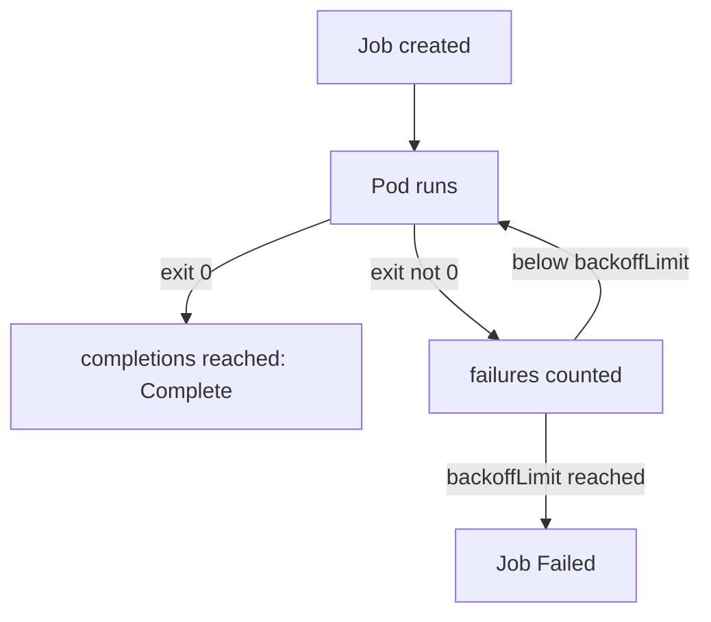

# Jobs And CronJobs

A Deployment restarts a Pod that exits, because it expects the program to run forever. A backup, a database migration or a nightly report does the opposite: it should run, finish and stop. If a controller restarted it after success, the work would repeat. A Job is a controller that runs Pods until a set number of them have finished successfully. A CronJob is a controller that creates Jobs on a schedule. Both self-heal in their own way: they retry failed work, and they stop when the work is done.

## What a Job does

The Job controller, part of `kube-controller-manager`, creates Pods from the Job's template and counts how many ended with exit code 0. When the count reaches `spec.completions`, the Job gets the condition `Complete` and the controller stops creating Pods. If the Job fails, it gets the condition `Failed`. The playground has a Job named `bridge-report`. Read its main fields:

<!-- astrona:playground:renew -->

```sh
kubectl -n starfleet get job bridge-report -o jsonpath='completions={.spec.completions} parallelism={.spec.parallelism} backoffLimit={.spec.backoffLimit} ttl={.spec.ttlSecondsAfterFinished}{"\n"}'
```

The line shows three completions, two Pods at a time, two retries and a one-hour time to live. Each field has its own job:

- `completions` is how many successful Pods the Job needs. The default is 1.
- `parallelism` is how many Pods may run at the same time. The default is 1. With three completions and parallelism two, the controller starts two Pods and starts the third as soon as one ends.
- `backoffLimit` is how many failures the Job tolerates before it is marked `Failed`. The default is 6.
- `activeDeadlineSeconds` is a time limit for the whole Job. When it passes, the controller stops all running Pods and marks the Job `Failed`, no matter how many retries are left.
- `ttlSecondsAfterFinished` tells the TTL controller to delete the finished Job, and with it the Pods, after this many seconds. Without it, finished Jobs and their Pods stay until someone deletes them.

List the Pods that the Job created:

```sh
kubectl -n starfleet get pods -l job-name=bridge-report
```

Three Pods in the `Completed` state exist, unless the Job was already deleted by its time to live. A completed Pod keeps its logs, which is why it is not removed at once.

## restartPolicy and retries

A Job template must set `restartPolicy` to `Never` or `OnFailure`. The default `Always` is rejected, because it would restart a finished container forever. The two allowed values retry in different ways.

With `Never`, a failed Pod stays as it is, and the controller creates a new Pod for the retry. Every attempt is a separate Pod with its own logs and its own writable layer. With `OnFailure`, the kubelet restarts the container inside the same Pod, so the Pod keeps its volumes, including an `emptyDir`, between attempts. The restart count of the container counts toward `backoffLimit`.

Between attempts, the controller waits with an exponential back-off: 10 seconds, then 20, then 40 and so on, up to six minutes. A failing Job with a high `backoffLimit` therefore takes a long time to fail.



The diagram shows the loop: a Pod that exits with 0 counts toward completion, a Pod that fails goes back through the retry check until the limit is reached.

Save this as `job-retry-demo.yaml`. The first attempt writes a marker file and fails. Any later attempt finds the marker and succeeds. With `OnFailure` the marker survives, because the container restarts inside the same Pod:

```yaml
apiVersion: batch/v1
kind: Job
metadata:
  name: retry-demo
  namespace: starfleet
spec:
  backoffLimit: 3
  ttlSecondsAfterFinished: 600
  template:
    spec:
      restartPolicy: OnFailure
      volumes:
      - name: scratch
        emptyDir: {}
      containers:
      - name: demo
        image: docker.io/library/busybox:1.37.0
        command:
        - sh
        - -c
        - 'if [ -f /scratch/attempt ]; then echo second attempt ok; exit 0; fi; touch /scratch/attempt; echo first attempt fails; exit 1'
        volumeMounts:
        - name: scratch
          mountPath: /scratch
```

Apply it:

```sh
kubectl apply -f job-retry-demo.yaml
```

Then check the result. The wait ends when the Job is complete, and the Pod list shows one restart:

```sh
kubectl -n starfleet wait --for=condition=complete job/retry-demo --timeout=120s
kubectl -n starfleet get pods -l job-name=retry-demo
```

The Pod shows one restart and the state `Completed`. If you change `restartPolicy` to `Never`, the marker is lost with the first Pod, and every new Pod fails the same way until `backoffLimit` ends the Job. The Pod template of a Job is immutable once the Job exists, so you fix such a mistake by deleting the Job and creating it again.

## CronJob: a Job factory

A CronJob stores a `schedule` in cron syntax, five fields for minute, hour, day of month, month and day of week, and a `jobTemplate`. At each scheduled time, the CronJob controller creates a Job from the template. The schedule uses the time zone of `kube-controller-manager` unless you set `spec.timeZone`. The playground CronJob `drifter-sweep` runs every two minutes. Show its settings:

```sh
kubectl -n starfleet get cronjob drifter-sweep -o jsonpath='schedule={.spec.schedule} policy={.spec.concurrencyPolicy} deadline={.spec.startingDeadlineSeconds} suspend={.spec.suspend}{"\n"}'
```

The fields that matter after the schedule are these:

- `concurrencyPolicy` decides what happens when a new run is due while the previous Job still runs. `Allow` (the default) starts another one. `Forbid` skips the new run. `Replace` deletes the running Job and starts a new one. A job that must not overlap, such as a report that writes one file, needs `Forbid`.
- `startingDeadlineSeconds` is how late a run may start. If the controller misses the time, for example because it was down, and the delay passes this deadline, it counts the run as missed and skips it. If more than 100 runs were missed, the controller stops scheduling and logs an error.
- `suspend` set to `true` stops new runs without deleting the CronJob. Runs already in progress continue.
- `successfulJobsHistoryLimit` (default 3) and `failedJobsHistoryLimit` (default 1) set how many finished Jobs the CronJob keeps. A CronJob that creates a Job every minute with limits of 100 fills the cluster with old Pods.

To test a CronJob without waiting for the schedule, create a Job from it. The command copies the `jobTemplate`:

```sh
kubectl -n starfleet create job manual-sweep --from=cronjob/drifter-sweep
```

Unlike a Job, a CronJob spec can be changed with `kubectl patch`, and the next run uses the new values.

## Reading a stuck batch workload

When a CronJob does not run, check `suspend` first, then the schedule and the time zone, then `startingDeadlineSeconds`. When Jobs pile up, check `concurrencyPolicy`, the history limits and `ttlSecondsAfterFinished`. When a Job fails at once, read the Pod logs of the failed attempt and compare `restartPolicy`, `backoffLimit` and the exit code. Each of these is a field, so each is a one-line fix once you find it.

You now know which fields stop a task from retrying, from finishing, from running at all and from cleaning up. The next task uses exactly these fields.

## Common pitfalls

> [!WARNING]
> A Job with `restartPolicy: Never` and `backoffLimit: 0` fails on the first error without a retry. A CronJob with `concurrencyPolicy: Allow` can run two copies of a slow task at once. Without `ttlSecondsAfterFinished`, finished Jobs and Pods stay forever. The Pod template of a Job cannot be edited: delete and recreate the Job.
