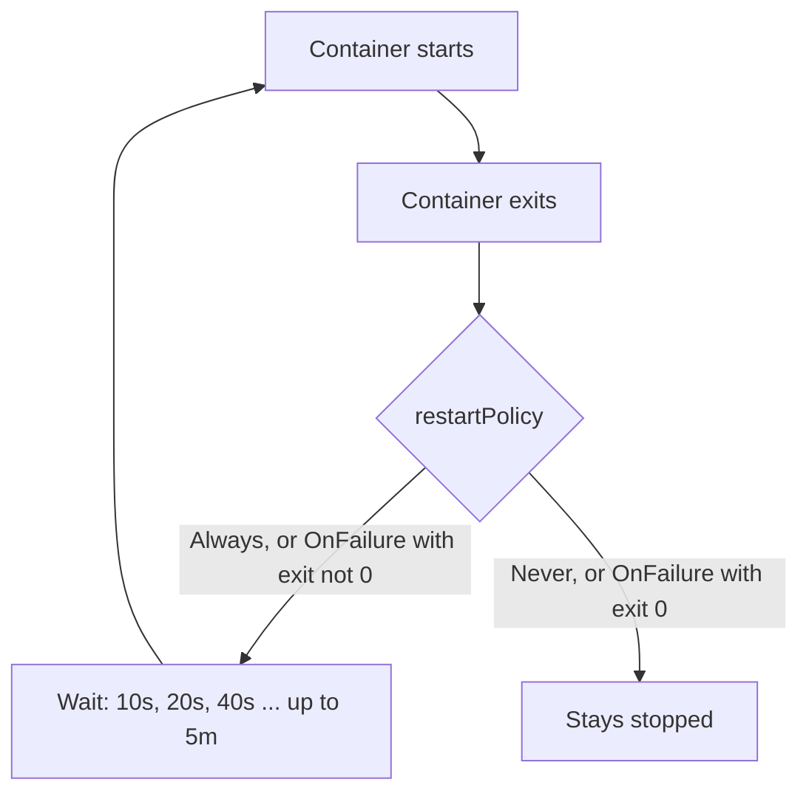

# Restart Policy, Crash Loops And Pod Status

A container exits for many reasons: a bug, a missing file, a deliberate end of a task. Kubernetes must decide whether the exit is a failure to repair or a result to keep. The Pod field `restartPolicy` gives that decision to the kubelet, the agent on each node that starts and restarts containers. This part shows what the three values do, why a failing container ends in `CrashLoopBackOff`, and how to read the three levels of status that describe a Pod.

## What restartPolicy decides

`restartPolicy` is a field of the Pod spec, not of a single container. It applies to every regular container in the Pod. It has three values.

- `Always` restarts a container whenever it exits, with exit code 0 or not. It is the default for a bare Pod.
- `OnFailure` restarts a container only when it exits with a non-zero exit code.
- `Never` does not restart a container.

The workload controllers limit the choice. A Deployment, ReplicaSet, DaemonSet and StatefulSet run services that should stay up, so they accept only `Always`. A Job runs a task to completion, so it accepts only `OnFailure` or `Never`. A bare Pod accepts all three.

The restart is done by the kubelet on the node, inside the same Pod. The Pod keeps its name, its UID and its node. Only the container is created again, and the Pod status counts each restart in `restartCount`. This is different from a controller replacing a Pod: a ReplicaSet creates a new Pod object, and the kubelet only restarts a container.

The playground has two Pods with the same failing command. `shuttle` in `starfleet` uses `restartPolicy: Always`. `drifter` in `outpost` uses `Never`.

<!-- astrona:playground:renew -->

List both Pods:

```sh
kubectl -n starfleet get pod shuttle
kubectl -n outpost get pod drifter
```

`shuttle` shows a growing `RESTARTS` count and, after a few restarts, the status `CrashLoopBackOff`. `drifter` shows the status `Error` and no restarts. It ran once, exited with code 1 and stayed stopped, because `Never` forbids a restart. The Pod phase of `drifter` is `Failed`.

## Why the delay grows: CrashLoopBackOff

If the kubelet restarted a failing container at once every time, a broken container would use CPU and fill the logs without end. The kubelet waits between restarts instead. The delay starts at 10 seconds and doubles after each failed restart: 10, 20, 40 seconds, and so on, up to a maximum of 5 minutes. The delay resets to the start after the container has run for 10 minutes without failing.

`CrashLoopBackOff` is the reason shown while the kubelet waits for the next restart. It is not a Pod phase and not an error by itself. It tells you that the container starts, exits and is restarted, and that the delay between tries is growing. The real cause is in the exit code and the logs of the last run.

Read the last state and the log of the previous run of `shuttle`:

```sh
kubectl -n starfleet get pod shuttle -o jsonpath='{.status.containerStatuses[0].lastState.terminated}{"\n"}'
kubectl -n starfleet logs shuttle --previous
```

The first command prints the termination record of the last run: the exit code, the reason and the start and end times. For `shuttle` the exit code is 1. The second command prints the log of the previous container instance, which ends with the line `failing`. Plain `kubectl logs` can show an empty log of a container that has just restarted, so `--previous` is the better tool for a crash loop.



The diagram shows the decision the kubelet makes after every exit, and the growing wait that produces `CrashLoopBackOff`.

## Phase, conditions and container states

A Pod reports its health on three levels, and they answer different questions. Mixing them up is a common exam error.

The Pod phase is a short summary of the lifecycle: `Pending` (accepted, but not all containers are set up, which includes waiting to be scheduled and pulling images), `Running` (bound to a node, and at least one container is running or starting or restarting), `Succeeded` (all containers ended with success and will not be restarted), `Failed` (all containers ended and at least one failed) and `Unknown`. A crash-looping Pod is in the phase `Running`, because the kubelet is still restarting its container.

The Pod conditions are a list of true or false facts: `PodScheduled`, `PodReadyToStartContainers`, `Initialized`, `ContainersReady` and `Ready`. A Service sends traffic only to Pods whose `Ready` condition is true.

The container state is per container and has three values: `Waiting` (with a reason such as `CrashLoopBackOff` or `ImagePullBackOff`), `Running` and `Terminated` (with an exit code and a reason).

Print the conditions of the `scout` Pod, which is healthy:

```sh
kubectl -n starfleet get pod scout -o jsonpath='{range .status.conditions[*]}{.type}={.status}{"\n"}{end}'
```

Each condition prints as a line of the form `type=status`. For a healthy Pod they are all `True`. For `shuttle` the `Ready` condition would be `False` while its container waits to restart, although its phase is `Running`.

## Giving a slow application time with a startupProbe

Some applications need a long time to start. A liveness probe asks the kubelet to restart a container when a check fails. If it begins too early, it kills the slow application before it is up, and the Pod ends in a loop of its own making.

A startup probe solves this. While a startup probe is configured and has not yet succeeded, the kubelet does not run the liveness and readiness probes. When the startup probe succeeds once, the kubelet stops running it and starts the other probes. If the startup probe fails more times than `failureThreshold` allows, the kubelet kills the container and the restart policy applies. The time the application may take is `periodSeconds` times `failureThreshold`.

Save this as `pod-bridge-slow.yaml`. The container needs about 20 seconds before it creates the file `/tmp/started`. The liveness probe would fail after 5 seconds without the startup probe, which allows 60 seconds:

```yaml
apiVersion: v1
kind: Pod
metadata:
  name: bridge-slow
  namespace: starfleet
spec:
  containers:
    - name: bridge
      image: docker.io/library/busybox:1.37.0
      command: ["sh", "-c", "sleep 20; touch /tmp/started; while true; do sleep 5; done"]
      startupProbe:
        exec:
          command: ["test", "-f", "/tmp/started"]
        periodSeconds: 5
        failureThreshold: 12
      livenessProbe:
        exec:
          command: ["test", "-f", "/tmp/started"]
        periodSeconds: 5
        failureThreshold: 1
```

Apply it:

```sh
kubectl apply -f pod-bridge-slow.yaml
```

Then check the result after about 40 seconds:

```sh
kubectl -n starfleet get pod bridge-slow
```

The Pod is `Running` and `Ready` with 0 restarts. If you remove the `startupProbe` block and apply the Pod again under a new name, the liveness probe fails within seconds of the start, and the container restarts.

## What you can now explain

You can say which component restarts a container and under which `restartPolicy`, why the delay between restarts grows to 5 minutes, and why a crash-looping Pod still has the phase `Running`. You can read phase, conditions and container states separately, and you know that a startup probe holds back the liveness and readiness probes while a slow application starts. The open question is what happens before the main containers start, and that is the job of init containers.

## Common pitfalls

> [!WARNING]
> `CrashLoopBackOff` is a symptom, not a cause. Read `lastState.terminated` and `kubectl logs --previous` before you change anything. Do not set a liveness probe without a startup probe on a slow application, and do not use `restartPolicy: Always` for a task that should finish once. You cannot change `restartPolicy` on an existing Pod; create the Pod again.
