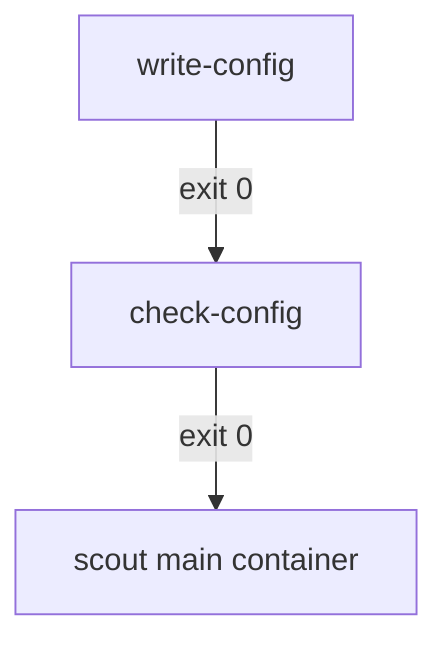

# Init Containers And Native Sidecar Containers

Some work must finish before an application starts, and some helpers must run next to it for its whole life. A restart policy cannot express either. Kubernetes gives a Pod two more kinds of container for this. Init containers prepare the Pod and then exit. Native sidecar containers start before the application and keep running beside it. This part shows how both start, what happens when they fail, and how to tell them apart in the Pod spec.

## Init containers run in order, to completion

An init container is a container listed under `spec.initContainers`. The kubelet starts the init containers one at a time, in the order of the list. Each one must exit with code 0 before the next one starts. Only after the last init container succeeds does the kubelet start the regular containers listed under `spec.containers`.

All containers of a Pod can share volumes. An init container often writes a file into an `emptyDir` volume, and the main container reads it. An init container can also use a different image from the main container, so that tools needed only for setup stay out of the application image.

The `scout` Pod in the playground has two init containers, `write-config` and `check-config`, and one main container. `write-config` writes the file `/work/config.txt`. `check-config` tests that the file is not empty. The main container prints the file.

<!-- astrona:playground:renew -->

Read the state of the init containers and the log of the main container:

```sh
kubectl -n starfleet get pod scout -o jsonpath='{range .status.initContainerStatuses[*]}{.name}{" exit="}{.state.terminated.exitCode}{"\n"}{end}'
kubectl -n starfleet logs scout
```

Both init containers show `exit=0`, and the log prints `mode=survey`. The Pod condition `Initialized` becomes true when the last init container has succeeded. While the init containers run, `kubectl get pod` shows a status such as `Init:0/2` or `Init:1/2`, the number of finished init containers out of the total.



The diagram shows that each init container must succeed before the next container starts.

## What happens when an init container fails

If an init container fails, the main containers do not start. What happens next depends on the Pod `restartPolicy`. With `Always` or `OnFailure` the kubelet restarts the failed init container, with the same growing delay that it uses for regular containers. The status shows `Init:Error` and later `Init:CrashLoopBackOff`. With `Never` the kubelet does not retry, and the whole Pod is marked `Failed`.

A failing init container is a common reason why a Pod stays in `Pending` or shows a status that starts with `Init:`. Look at the init container, not the main container. The main container has no log yet, because it never started.

Save this as `pod-drifter-init-fail.yaml`. The init container exits with code 1 on purpose:

```yaml
apiVersion: v1
kind: Pod
metadata:
  name: drifter-init-fail
  namespace: outpost
spec:
  restartPolicy: OnFailure
  initContainers:
    - name: prepare
      image: docker.io/library/busybox:1.37.0
      command: ["sh", "-c", "echo preparing; exit 1"]
  containers:
    - name: drifter
      image: docker.io/library/busybox:1.37.0
      command: ["sh", "-c", "echo main-started; sleep 3600"]
```

Apply it and read the status after a few seconds:

```sh
kubectl apply -f pod-drifter-init-fail.yaml
kubectl -n outpost get pod drifter-init-fail
```

The status starts with `Init:`, for example `Init:Error`, and the `READY` column shows `0/1`. The log of the `drifter` container does not exist, but `kubectl -n outpost logs drifter-init-fail -c prepare` prints `preparing`. The init container reruns until it succeeds or the Pod is deleted. If you change the Pod to `restartPolicy: Never`, the Pod ends in the phase `Failed` after the first failure.

Two more facts matter for a design. Init containers do not support `lifecycle`, `livenessProbe`, `readinessProbe` or `startupProbe` unless they are native sidecars. And because the init containers run again when the Pod is restarted as a whole, they should be safe to run more than once.

## Native sidecar containers

A sidecar is a helper container that runs next to the main container for the whole life of the Pod, for example a log shipper. Before native sidecars, teams listed such a helper as a second regular container. That has two problems: its start order is not defined, and a Job never finishes while the helper keeps running.

A native sidecar is an init container with `restartPolicy: Always` set on the container itself. This field is available on init containers only. It has been stable since Kubernetes 1.33. The kubelet starts a native sidecar in its place in the init list. It then does not wait for it to exit. It waits for the container to be started: its process is running and, if a `startupProbe` exists, that probe has succeeded. Then it starts the next init container.

The `probe` Pod in the playground has a native sidecar `log-shipper` with a startup probe. The main container `probe` writes lines to `/logs/app.log`, and the sidecar follows the file.

Check the container policy and the sidecar log:

```sh
kubectl -n starfleet get pod probe -o jsonpath='{.spec.initContainers[0].restartPolicy}{"\n"}'
kubectl -n starfleet logs probe -c log-shipper
```

The first command prints `Always`. The second prints the lines that the main container wrote, because the sidecar runs `tail -F` on the shared file.

Three behaviors set a native sidecar apart from a regular init container and from a second regular container.

- The kubelet restarts it when it exits, whatever the Pod `restartPolicy`. Its own `restartPolicy: Always` rules.
- A readiness probe on the sidecar counts toward the Pod `Ready` condition. A startup or liveness probe on it works as for any container.
- On shutdown the kubelet stops the main containers first, and then stops the sidecars in the reverse order of the list. The sidecar stays available while the application finishes its last work. A sidecar also does not keep a Job from completing after the main container ends.

## What you can now explain

You know that init containers run one after another to completion before any main container, and that a failure blocks the Pod and is retried or failed according to `restartPolicy`. You can recognise a native sidecar by `restartPolicy: Always` under `initContainers`, and you know it starts before the main container, restarts on its own and stops last. The open question is how a container stops, and that is the topic of lifecycle hooks and the termination period.

## Common pitfalls

> [!WARNING]
> An init container that never exits blocks the Pod forever, because the kubelet waits for exit code 0. Set `restartPolicy: Always` only when the container must keep running. Do not put a required setup step in a sidecar, because the next container starts as soon as the sidecar is started, not finished. Read the init container log with `-c`, because the main container has no log while the init phase fails.
