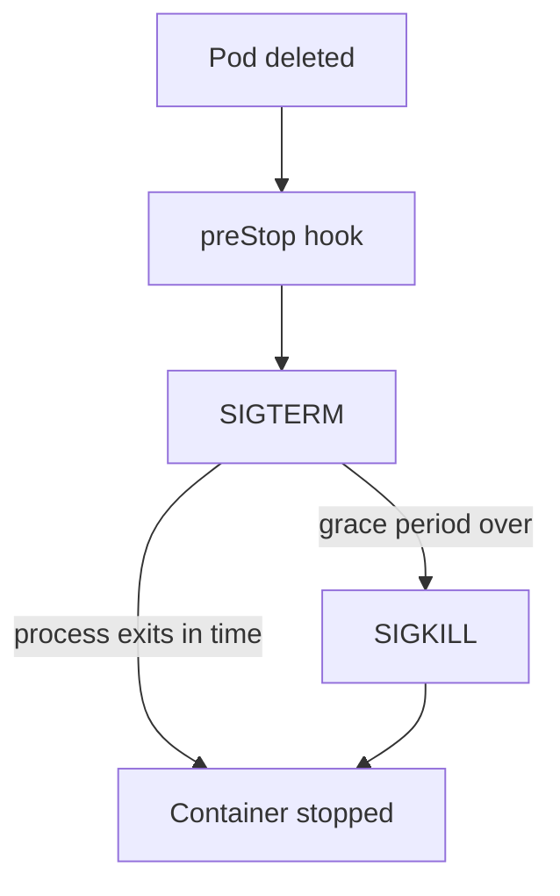

# Lifecycle Hooks And Graceful Termination

A Pod ends often: a rolling update, a scale down, a node drain or a manual delete. If the container is cut off in the middle of a request, a user sees an error. Kubernetes gives each container a bounded time and two hooks to finish its work. This part follows a delete from the API request to the last signal, and shows where the hooks, the grace period and the Service endpoints fit in.

## The termination sequence

When a Pod is deleted, the API server does not remove it at once. It sets a deletion timestamp, and the Pod becomes `Terminating`. Two things then happen at about the same time. The kubelet on the node starts to stop the containers. The endpoint controller (the control plane component that keeps the Service endpoints up to date) removes the Pod from the Service endpoints.

The kubelet follows these steps for each container:

1. It runs the `preStop` hook, if one is defined, and waits for it to finish.
2. It sends the signal SIGTERM to the main process of the container, which asks the process to stop.
3. It waits until the process exits or until the grace period ends.
4. It sends SIGKILL, which stops the process at once and cannot be handled.

The grace period is `terminationGracePeriodSeconds` in the Pod spec. It defaults to 30 seconds. It starts when the Pod becomes `Terminating`, so the `preStop` time and the time after SIGTERM share the same budget. If the hook uses 5 seconds of a 45 second grace period, the process has 40 seconds left after SIGTERM.



The diagram shows the order that the kubelet follows, and that SIGKILL is the fallback when the process ignores SIGTERM.

## The two hooks

A lifecycle hook is a handler that the kubelet runs at a fixed point in a container life. It is set under `lifecycle` in the container spec. A handler is an `exec` command, an `httpGet` request or a `sleep` action.

`postStart` runs right after the container is created. It runs at the same time as the container main process, and there is no promise about the order. The container is not marked `Running` until the hook returns, and if the hook fails, the kubelet kills the container and the restart policy applies.

`preStop` runs when the container is told to stop, before SIGTERM. It must finish within the grace period. If it hangs, the kubelet waits until the grace period ends and then sends SIGKILL. The hook is called only when the Pod is deleted or evicted. It is not called when the container exits by itself or crashes.

The `bridge` Pod in the playground has a `postStart` hook, a `preStop` hook that takes 5 seconds, a SIGTERM handler and `terminationGracePeriodSeconds: 45`.

<!-- astrona:playground:renew -->

Read the grace period, delete the Pod without waiting, and read its status and log while it stops:

```sh
kubectl -n starfleet get pod bridge -o jsonpath='{.spec.terminationGracePeriodSeconds}{"\n"}'
kubectl -n starfleet delete pod bridge --wait=false
kubectl -n starfleet get pod bridge
kubectl -n starfleet logs bridge
```

The first command prints `45`. After the delete, `kubectl get pod` shows the status `Terminating`. The log shows the lines in order: `bridge-running`, `prestop-begin`, then, about 5 seconds later, `prestop-end` and `got-sigterm`. The Pod disappears right after the process exits, long before the 45 seconds are used. The grace period is a limit, not a wait.

## A process that ignores SIGTERM

Many containers run a shell script or a program as the main process, and some of them never handle SIGTERM. In a container, the main process is PID 1, and the kernel does not apply the default action of a signal to PID 1 unless the process installed a handler. The signal is then ignored, and the container runs until SIGKILL ends it after the grace period.

Save this as `pod-drifter-stubborn.yaml`. The shell has no `trap` for SIGTERM, and the grace period is 8 seconds:

```yaml
apiVersion: v1
kind: Pod
metadata:
  name: drifter-stubborn
  namespace: outpost
spec:
  terminationGracePeriodSeconds: 8
  containers:
    - name: drifter
      image: docker.io/library/busybox:1.37.0
      command: ["sh", "-c", "while true; do sleep 1; done"]
```

Apply it, then delete it and watch the time:

```sh
kubectl apply -f pod-drifter-stubborn.yaml
kubectl -n outpost delete pod drifter-stubborn
```

The delete command returns after about 8 seconds, the whole grace period, because nothing handles SIGTERM. The container ends with exit code 137, which is 128 plus the signal number 9 of SIGKILL. A rolling update of a Deployment with such Pods is slow for the same reason: every Pod takes the full grace period to stop.

## Endpoints, readiness and the race at shutdown

Removal from the Service endpoints and the stop signal run in parallel, and no one waits for the other. A proxy on a node can still send a request to the Pod for a short time after the Pod got SIGTERM. If the process closes its listener at once, those requests fail.

The usual remedy is a short `preStop` hook, for example `sleep 5`. It keeps the process fully working while the endpoint removal spreads to all nodes, and only then SIGTERM arrives. This is why the 5 second `preStop` in `bridge` is not a waste. The Pod also stops being ready as soon as it is `Terminating`: the endpoint controller marks it as terminating and not ready, so new connections go to other Pods.

## What you can now explain

You can name the order of a stop: `preStop`, SIGTERM, wait, SIGKILL, inside one grace period. You know that the process must handle SIGTERM or the Pod waits the full period and ends with exit code 137, and that a short `preStop` hook covers the race with endpoint removal. Restart policy, init containers and hooks together describe how a container starts, runs and stops.

## Common pitfalls

> [!WARNING]
> A `preStop` hook that takes longer than the grace period is cut off by SIGKILL, so set `terminationGracePeriodSeconds` above the hook time plus the time the application needs to finish. Do not rely on `preStop` for a crash: it does not run when the container exits on its own. A shell script as PID 1 often ignores SIGTERM unless it uses `trap` or `exec` to start the real program.
