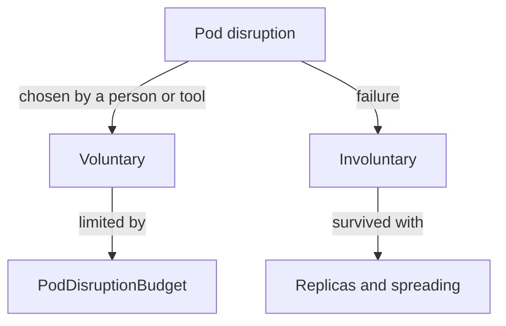

# Voluntary And Involuntary Disruption And PodDisruptionBudgets

The `scout` Deployment runs three replicas so that the application survives the loss of one. That promise breaks the moment an administrator restarts the wrong two nodes together. This chapter explains which events remove Pods, which of them Kubernetes can limit, and how a PodDisruptionBudget states the limit for one application.

## Two kinds of disruption

A disruption is any event that ends a running Pod before its work is finished. Kubernetes sorts disruptions into two groups, because the cluster can only control one of them.

An involuntary disruption is a failure that nobody chose. Examples are a hardware fault on the machine, a kernel panic, a virtual machine that the cloud provider removes, a network partition that cuts a node off, and a node that evicts Pods because it runs out of memory. Kubernetes cannot prevent these events. It can only replace the lost Pods afterwards.

A voluntary disruption is an action that a person or a tool chooses. An application owner causes one by deleting a Deployment, by changing a Pod template so that a rolling update starts, or by deleting a Pod. A cluster administrator causes one by draining a node for repair or an upgrade, or by removing a node to scale the cluster down. Kubernetes can limit some of these, because they go through the API server.

The difference matters for design. Replicas and spreading protect against involuntary disruption. A PodDisruptionBudget protects against voluntary disruption. An application that needs both must use both.



The diagram shows that a budget belongs only to the voluntary branch, while replicas and placement answer the involuntary branch.

## What a PodDisruptionBudget is

A PodDisruptionBudget (PDB) is a resource in the `policy/v1` API. It names a group of Pods with a label selector and states how many of them must stay available, or how many may be unavailable, during a voluntary disruption. It does not start or stop Pods itself. Other components read it when they want to remove a Pod.

The spec has three fields that matter. The `selector` is a label selector that picks the Pods the budget covers. It is required, and an empty selector matches every Pod in the namespace. The field `minAvailable` is the number of selected Pods that must stay available after an eviction. The field `maxUnavailable` is the number of selected Pods that may be unavailable. Both accept a whole number or a percentage, and a budget can set only one of the two. Percentages round up.

The `scout` Deployment has three replicas. A budget with `minAvailable: 2` and a budget with `maxUnavailable: 1` mean the same thing for it: one Pod at a time. They differ when the replica count changes. If the Deployment scales to five, `minAvailable: 2` allows three Pods to be down, while `maxUnavailable: 1` still allows one. Choose the field that matches the rule you really want. Note that `maxUnavailable` works only for Pods that belong to a controller that the budget can read the replica count from, such as a Deployment.

## Reading the budget status

The disruption controller, which runs inside the kube-controller-manager, watches every PDB and the Pods it selects. It writes four numbers to the status of the PDB. The value `expectedPods` is the number of Pods the owning controllers want. The value `currentHealthy` is the number that are ready now. The value `desiredHealthy` is the number the budget requires. The value `disruptionsAllowed` is `currentHealthy` minus `desiredHealthy`, never below zero.

The Eviction API reads `disruptionsAllowed`. If it is above zero, an eviction succeeds and the number goes down. If it is zero, the API server refuses the eviction. A budget with `minAvailable: 3` on three replicas gives `desiredHealthy` 3 and `disruptionsAllowed` 0, so no Pod can ever be evicted. That is the most common mistake with budgets.

Connect to the playground first. It starts a `scout` Deployment with three replicas and a budget named `scout-pdb`.

<!-- astrona:playground:renew -->

```sh
export KUBECONFIG="$(astrona kubeconfig ats-024-playground-040-04)"
test "$(kubectl config current-context)" = "kind-astro-ats-024-playground-040-04" || exit 1
```

Read the budgets and the Pods they cover:

```sh
kubectl -n starfleet get pdb
kubectl -n starfleet describe pdb scout-pdb
```

The table shows the minimum available value and the column `ALLOWED DISRUPTIONS`. For `scout-pdb` the minimum is 2 and one disruption is allowed, because three Pods are ready. The `describe` output repeats the selector and the current, desired and expected counts.

## Breaking a budget on purpose

Now make a budget that blocks everything. Save this as `pdb-scout-strict.yaml`:

```yaml
apiVersion: policy/v1
kind: PodDisruptionBudget
metadata:
  name: scout-pdb
  namespace: starfleet
spec:
  minAvailable: 3
  selector:
    matchLabels:
      app: scout
```

Apply it:

```sh
kubectl apply -f pdb-scout-strict.yaml
```

Then check the result:

```sh
kubectl -n starfleet get pdb scout-pdb
```

The disruption controller recomputes the status within a few seconds, and `ALLOWED DISRUPTIONS` becomes 0. The `minAvailable` field was changed in place. A PDB spec can be updated, but a single budget never holds `minAvailable` and `maxUnavailable` together, so replacing one with the other means removing the first field. Apply the original value again with `minAvailable: 2` before the next chapter.

## What a budget does not cover

A budget limits only the evictions that go through the Eviction API. The API server checks it when `kubectl drain`, the cluster autoscaler or another tool asks for an eviction. Several actions skip that check:

- Deleting a Pod directly with `kubectl delete pod`, or deleting its Deployment.
- A rolling update. Pods that the update removes count against the budget, but the Deployment's own `maxUnavailable` and `maxSurge` settings control the update, not the PDB.
- Involuntary disruption. A node failure cannot be refused. The lost Pods still count against the budget, so `disruptionsAllowed` can drop to zero while the node is down.

A budget also needs a selector that matches the same Pods as the controller. If the selector matches no Pod, `expectedPods` is 0 and the budget protects nothing, with no error message. Always read `expectedPods` after you create a budget.

## Unhealthy Pods and unhealthyPodEvictionPolicy

A Pod that is running but not ready is unhealthy. By default the budget uses the policy `IfHealthyBudget`. An unhealthy Pod can be evicted only if the budget is already met. When an application is broken and too few Pods are ready, this default can make a drain wait forever for Pods that will never become healthy.

The field `unhealthyPodEvictionPolicy` accepts `AlwaysAllow`, which lets the API server evict unhealthy Pods whatever the budget says. Use it when a broken Pod is worth less than a finished node drain. The `probe-pdb` budget in the playground uses this setting. Ready Pods stay fully protected either way.

## What you can do now

You can separate voluntary from involuntary disruption, write a budget with `minAvailable` or `maxUnavailable`, and read `disruptionsAllowed` to know what it will permit. You know that a budget is checked only by evictions. The open question is how a tool asks for an eviction and what it does when the answer is no.

## Common pitfalls

> [!WARNING]
> A budget with `minAvailable` equal to the replica count allows no disruption, so every drain will wait. A budget whose selector matches no Pod shows `expectedPods` as 0 and protects nothing. A single budget cannot set `minAvailable` and `maxUnavailable` together. Direct deletion and node failure ignore budgets.
