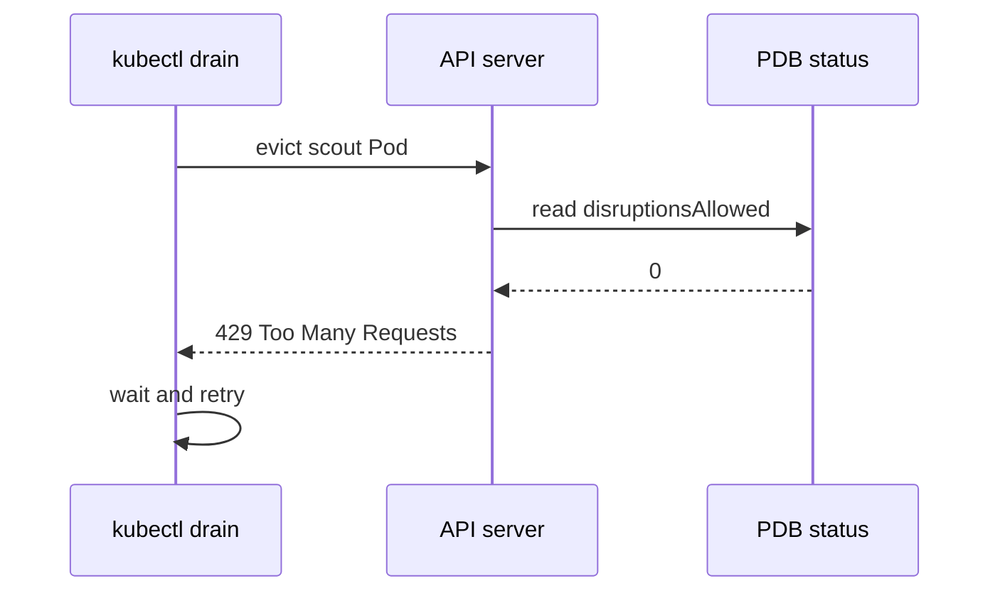

# Drain, Cordon And Eviction

The worker node that runs the `scout` Pods needs a kernel update. The administrator must empty the node without taking the application down. This chapter follows that task: what `kubectl cordon` and `kubectl drain` do, how the Eviction API checks a PodDisruptionBudget, and why a drain sometimes waits instead of finishing.

## Cordon: stop new Pods

To cordon a node means to mark it unschedulable. The command `kubectl cordon <node>` sets the field `spec.unschedulable` on the Node object. The node lifecycle controller then adds the taint `node.kubernetes.io/unschedulable` with the effect `NoSchedule`. The scheduler stops placing new Pods on the node. Pods that already run there are not touched, and they keep serving requests.

Cordon is useful on its own. It freezes the node while you decide what to do next. The command `kubectl uncordon <node>` reverses it. Cordon changes only scheduling; it never removes a Pod.

## Drain: cordon, then evict

The command `kubectl drain <node>` does two things in order. First it cordons the node. Then it asks the API server to evict every Pod that runs there, except the Pods it is told to skip. The drain command is a client program. It decides which Pods to evict and keeps asking until they are gone. The API server decides whether each eviction is allowed.

Drain refuses to start when it finds a Pod that it should not remove silently. Each refusal has a flag that accepts the consequence:

- `--ignore-daemonsets` skips Pods that a DaemonSet manages. The DaemonSet controller would recreate them on the same node at once, so evicting them is pointless. Drain refuses without this flag as soon as one such Pod exists.
- `--delete-emptydir-data` allows eviction of Pods that use an `emptyDir` volume. The data in that volume is lost when the Pod leaves the node.
- `--force` allows removal of Pods that no controller manages, called bare Pods. Nothing recreates a bare Pod after the eviction.
- `--timeout=<duration>` stops waiting after the duration. The default waits without limit.
- `--grace-period=<seconds>` replaces the Pod's own termination grace period.
- `--disable-eviction` deletes Pods instead of evicting them. That skips every PodDisruptionBudget, so use it only when you accept the risk.

## The Eviction API and the budget check

An eviction is a request to the Eviction API. It is a `POST` to the `eviction` subresource of a Pod, with a small `Eviction` object as the body. The API server reads the PodDisruptionBudgets that select the Pod and checks `disruptionsAllowed`. If the number is above zero, the API server deletes the Pod with its normal grace period and lowers the number. If it is zero, the API server refuses.

The refusal is an HTTP status code. The code 429 means "try again": the eviction would break the budget right now. The code 500 means the request cannot be judged, for example because more than one budget selects the same Pod. A drain treats both as temporary. It prints a message that says it will retry and asks again every few seconds until the Pod is gone or the timeout ends.



The diagram shows that the client repeats the request while the API server only reads the budget status. A retry can succeed once a replacement Pod becomes ready somewhere else and raises `disruptionsAllowed`.

## Draining the playground worker

The playground has one worker node, so a replacement for an evicted `scout` Pod has nowhere to go while the node is cordoned. The control-plane node carries a `NoSchedule` taint. That makes the budget behaviour easy to see. Connect and list the nodes and Pods first.

<!-- astrona:playground:renew -->

```sh
export KUBECONFIG="$(astrona kubeconfig ats-024-playground-040-04)"
kubectl get nodes
kubectl -n starfleet get pods -o wide
```

Both nodes are Ready. The Pods run on the worker node, whose name ends in `-worker`. Cordon it and look at the result:

```sh
kubectl cordon astro-ats-024-playground-040-04-worker
kubectl get nodes
```

The worker is listed with `SchedulingDisabled`. The node name is the one that `kubectl get nodes` shows. Now try a plain drain with a short timeout:

```sh
kubectl drain astro-ats-024-playground-040-04-worker --timeout=30s
```

The command stops before it evicts anything. It reports that it cannot delete DaemonSet-managed Pods without `--ignore-daemonsets`, and that the Pod `shuttle` is not managed by a controller and needs `--force`. Add both flags:

```sh
kubectl drain astro-ats-024-playground-040-04-worker --ignore-daemonsets --force --timeout=30s
```

This time the drain starts evicting. The bare `shuttle` Pod is removed and never comes back. The `scout` Pods are evicted while the budget allows. With `minAvailable: 2` on three Pods, the first eviction succeeds. The Deployment creates a replacement, but the only node is cordoned, so the replacement stays Pending and `currentHealthy` stays at 2. The next eviction receives 429 and the drain prints retry messages until the 30 seconds end. The command then exits with a timeout error and leaves the node cordoned.

Restore the node so that the replacement Pods can start:

```sh
kubectl uncordon astro-ats-024-playground-040-04-worker
```

The Pending Pods are scheduled and the budget recovers. In a real cluster with several worker nodes, the replacement would start on another node and the drain would finish.

## Sending an eviction by hand

A drain is a loop over the Eviction API, and you can call it directly. Save this as `eviction.json`, and replace `<SCOUT_POD>` here and in the next command with the name of a `scout` Pod from `kubectl -n starfleet get pods`:

```json
{
  "apiVersion": "policy/v1",
  "kind": "Eviction",
  "metadata": {
    "name": "<SCOUT_POD>",
    "namespace": "starfleet"
  }
}
```

Send it to the Pod's `eviction` subresource:

```sh
kubectl create --raw /api/v1/namespaces/starfleet/pods/<SCOUT_POD>/eviction -f eviction.json
```

With `disruptionsAllowed` above zero, the API server accepts the request and the Pod terminates. With zero, the command fails with the message that the eviction would violate the budget.

## What you can do now

You can cordon a node, predict which flags a drain needs, and explain why a drain keeps retrying when a budget allows no disruption. You also know that the API server, not the drain command, applies the budget. The open question is what happens when no one asks for an eviction because the node simply disappears.

## Common pitfalls

> [!WARNING]
> `--disable-eviction` and `kubectl delete pod` skip the budget. `--force` removes bare Pods for good. `--delete-emptydir-data` destroys the data in `emptyDir` volumes. A drain that waits is often a budget that allows no disruption, or replacements that cannot be scheduled, so read `kubectl get pdb` and the Pending Pods before you add `--disable-eviction`.
