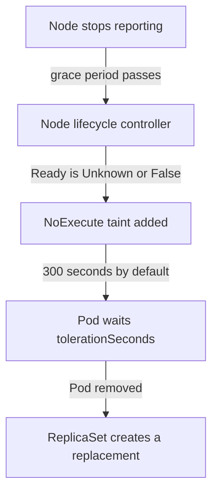

# Node Failure And Topology Spread

A node can stop answering without anyone running a command. The kubelet crashes, the machine loses power or the network between the node and the control plane fails. This chapter explains how the control plane notices, how long the `scout` Pods stay on the dead node, how to change that time, and how to place the replicas so that one failed node never holds all of them.

## How the control plane notices a lost node

The kubelet is the agent on each node. It reports the node's condition to the API server and renews a Lease object about every ten seconds. The node lifecycle controller, which runs inside the kube-controller-manager, watches those updates. When a node stops reporting for longer than its grace period, the controller changes the `Ready` condition of the Node object. The value becomes `Unknown` when the node is silent, and `False` when the kubelet reports that the node is not healthy.

The controller then adds a taint to the Node. A taint is a key, an optional value and an effect that repels Pods unless they tolerate it. A `Ready` condition of `False` adds `node.kubernetes.io/not-ready`. A `Ready` condition of `Unknown` adds `node.kubernetes.io/unreachable`. The controller adds each taint with two effects, `NoSchedule` and `NoExecute`.

The effect `NoSchedule` stops the scheduler from placing new Pods on the node. The effect `NoExecute` also affects Pods that already run there. A Pod that does not tolerate the taint is evicted at once. A Pod that tolerates it without `tolerationSeconds` stays forever. A Pod that tolerates it with `tolerationSeconds` stays that many seconds after the taint appears, and the control plane then removes it. If the taint disappears first, the Pod stays.

## The default of 300 seconds

Pods do not stay on a dead node forever by default, and they do not leave immediately either. The DefaultTolerationSeconds admission controller, a step inside the API server that changes new objects, adds two tolerations to every Pod that has none for these keys. They tolerate `node.kubernetes.io/not-ready` and `node.kubernetes.io/unreachable` with the effect `NoExecute` and `tolerationSeconds: 300`.

The result is that the control plane waits about five minutes after a node is tainted before it removes its Pods. Then the Deployment's ReplicaSet notices the missing Pods and creates replacements, and the scheduler places them on healthy nodes. A short network problem that heals inside five minutes causes no restart at all. An outage that lasts longer leaves the application at reduced capacity for the whole wait.

The taint-based removal is a deletion by the control plane. It does not use the Eviction API, so a PodDisruptionBudget cannot refuse it. The lost Pods still count as unavailable in the budget status.



The diagram shows the order of events and where the default wait sits. The scheduler then places the replacement on a node that is still healthy.

## Choosing your own tolerationSeconds

You can set the two tolerations in the Pod template yourself. A Pod that serves requests should often leave a lost node faster than 300 seconds, because every second of waiting is a second with fewer replicas. A Pod that holds slow local state may prefer a longer wait. Both values are a trade between recovery time and unnecessary moves.

Connect to the playground and read the tolerations that the API server added to a `scout` Pod.

<!-- astrona:playground:renew -->

```sh
export KUBECONFIG="$(astrona kubeconfig ats-024-playground-040-04)"
kubectl -n starfleet get pods -l app=scout -o jsonpath='{.items[0].spec.tolerations}'
```

The output lists the not-ready and unreachable tolerations with `tolerationSeconds` 300. Now save a Deployment that sets 30 seconds for both keys. Save this as `deployment-scout-fast-failover.yaml`:

```yaml
apiVersion: apps/v1
kind: Deployment
metadata:
  name: scout
  namespace: starfleet
spec:
  replicas: 3
  selector:
    matchLabels:
      app: scout
  template:
    metadata:
      labels:
        app: scout
    spec:
      tolerations:
      - key: node.kubernetes.io/not-ready
        operator: Exists
        effect: NoExecute
        tolerationSeconds: 30
      - key: node.kubernetes.io/unreachable
        operator: Exists
        effect: NoExecute
        tolerationSeconds: 30
      containers:
      - name: scout
        image: docker.io/library/busybox:1.37.0
        command: ["sleep", "3600"]
        readinessProbe:
          exec:
            command: ["true"]
          periodSeconds: 2
        resources:
          requests:
            cpu: 10m
            memory: 16Mi
```

Apply it:

```sh
kubectl apply -f deployment-scout-fast-failover.yaml
```

Then check the result:

```sh
kubectl -n starfleet rollout status deployment/scout
kubectl -n starfleet get pods -l app=scout -o jsonpath='{.items[0].spec.tolerations}'
```

The Pod template changed, so the Deployment replaced its Pods in a rolling update. The new Pods carry your two tolerations with 30 seconds, and the API server did not add the default ones because the keys are already present.

## Spreading replicas with topology spread constraints

Faster failover helps only if some replicas survive the failure. Three replicas on one node all disappear together. A topology spread constraint tells the scheduler to balance matching Pods across failure domains. A topology domain is a group of nodes that share the value of one node label. The label `kubernetes.io/hostname` makes every node its own domain. A zone label makes every availability zone a domain.

A constraint has these fields:

- `topologyKey` is the node label that defines the domains.
- `labelSelector` selects the Pods that are counted, normally the application's own label.
- `maxSkew` is the largest allowed difference between the domain with the most matching Pods and the domain with the fewest. It must be greater than zero.
- `whenUnsatisfiable` is `DoNotSchedule`, the default, which leaves a Pod Pending when the rule cannot hold, or `ScheduleAnyway`, which only prefers the balanced placement.

The `probe` Deployment in the playground has a constraint with `maxSkew: 1`, the key `kubernetes.io/hostname` and `ScheduleAnyway`. List where its Pods run:

```sh
kubectl -n starfleet get pods -l app=probe -o wide
```

The playground has one worker node, so both Pods run on it. The constraint is a preference and cannot be met, so the scheduler places the Pods anyway. With `DoNotSchedule` the result could be worse. By default the scheduler counts tainted nodes such as the control-plane node as domains, even though no Pod can run there. Skew against an empty domain can then leave Pods Pending. The field `nodeTaintsPolicy: Honor` removes tainted nodes from the count. The scheduler evaluates constraints only when it places a Pod, so scaling down or deleting Pods can later leave an uneven spread.

## Anti-affinity as the stricter alternative

Pod anti-affinity expresses a similar goal with a different rule. With `requiredDuringSchedulingIgnoredDuringExecution` and the key `kubernetes.io/hostname`, no two matching Pods may share a node. That is stricter than `maxSkew: 1`, because it fails when there are fewer nodes than replicas. The `preferredDuringSchedulingIgnoredDuringExecution` form only prefers separation. Topology spread is the better fit for many replicas, since it allows several Pods per node when the skew stays small.

## What you can do now

You can follow the path from a silent node to a replacement Pod, change the waiting time with `tolerationSeconds`, and choose between `DoNotSchedule` and `ScheduleAnyway` for replica placement. Together with a budget that allows one disruption at a time, these settings keep an application available through both kinds of disruption.

## Common pitfalls

> [!WARNING]
> A short `tolerationSeconds` makes replicas move during brief network problems, and the default of 300 seconds keeps traffic on a dead node for five minutes. `DoNotSchedule` can leave Pods Pending when the cluster has fewer eligible domains than the rule needs. Taint-based removal ignores PodDisruptionBudgets, and spreading does not move Pods that are already running.
