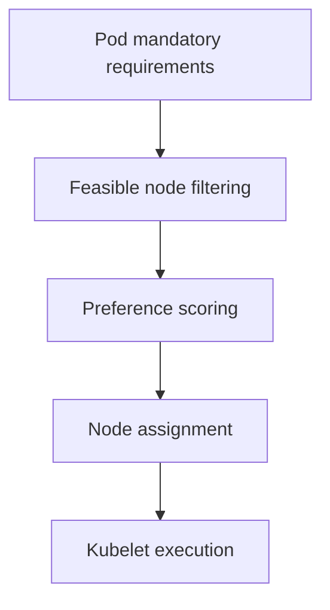

# Filtering, Scoring And Placement Rules

A Pod needs an accelerator, but the only idle node lacks its required label. Free CPU does not make that node eligible. Scheduling first satisfies mandatory requirements, then evaluates preferences.

## Learning objectives

- Explain scheduling filters and preferences.
- Compare required and preferred affinity.
- Interpret taints and tolerations.

## Before you start

This chapter is standalone reading material; no running cluster or installed tools are required. A Pod is the Kubernetes unit for running one or more containers, and a namespace groups namespaced objects. Treat the worked configurations as teaching examples rather than recorded observations from a provisioned environment.

## Responsible components and behavior

The `scout` Pod requires a node with an attached accelerator. The scheduler cannot pick any idle machine. It examines unscheduled Pods and first filters out nodes that fail mandatory requirements. It then scores eligible nodes according to configured preferences and selects a suitable node.

A node selector requires matching node labels. Node affinity expresses richer conditions and can distinguish required rules from preferred rules. Required affinity removes unsuitable nodes from consideration. Preferred affinity influences scores but allows placement elsewhere when the preference cannot be satisfied.

Pod affinity and anti-affinity describe placement relative to other Pods. Affinity can keep related workloads near each other; anti-affinity can separate replicas. A topology domain is a grouping such as a node or availability zone, identified through node labels. The rule's topology key determines what “near” or “separate” means.

Topology spread constraints control how Pods are distributed across eligible topology domains. They can help keep all application replicas from concentrating in one failure domain. Required spreading and anti-affinity can also leave Pods Pending when the available cluster cannot satisfy them. A desired availability pattern still needs enough suitable nodes.

The scheduler normally chooses a node once for a Pod. It does not continuously move the running Pod to a better-scoring node whenever circumstances change. A replacement Pod can receive a new assignment. Placement rules also do not guarantee that external storage or network dependencies are available.

Suppose three nodes have ample CPU but none has the required accelerator label. Adding replicas or reducing the image size will not solve the mandatory label mismatch. Identify each hard constraint before considering preferences or runtime symptoms.

## Working Through Required And Preferred Rules

Assume the cluster has three nodes. Node A has an accelerator label and enough requested capacity. Node B has capacity but no accelerator label. Node C has the label but lacks enough available requested CPU. A Pod requiring the accelerator label and sufficient CPU can use A; B and C fail different mandatory checks.

Adding a preference for zone B does not make node B eligible if it still lacks the required label. Preferences rank the nodes that survive filtering. If only A survives, a preference cannot manufacture another valid candidate. If no node survives, the Pod remains unassigned even when some nodes score well on an irrelevant preference.

A node affinity requirement acts on node labels. A Pod affinity requirement acts on the location of other Pods selected by their labels, interpreted through a topology key. These are different inputs. Wanting a database and client in the same zone is not the same as wanting the client on a node with a particular disk label.

## Availability Versus Placement Flexibility

Hard anti-affinity can require replicas to occupy separate nodes. That supports resilience against one node loss but also requires enough eligible nodes. If the application asks for four replicas and only three nodes satisfy the other constraints, the fourth can remain Pending. Relaxing the rule changes the availability contract, so it is a design decision rather than a harmless workaround.

Topology spread constraints offer a way to express distribution across domains and a tolerated imbalance. Their behavior still depends on available domains and whether the rule permits scheduling when its desired balance cannot be met. The important associate-level concept is that distribution is an explicit constraint or preference, not an automatic consequence of increasing replica count.

Evaluate placement by listing the hard filters first, then the preferences among eligible nodes. Include resources and storage topology alongside labels. This makes it possible to explain why a seemingly idle cluster still cannot place a particular workload.

## Work through the decision

Required node affinity and selectors remove non-matching nodes from consideration. Preferred affinity influences scores among feasible choices without making the preference mandatory. Pod affinity and anti-affinity instead relate placement to other Pods under a declared topology key.

Consider a preferred separation across zones with all replicas still able to fit one zone. That is different from a required separation that makes an additional replica unschedulable when no other eligible domain exists. Review node labels, existing Pod placement and resource demand together. Changing a required hardware constraint to force placement can violate the application requirement even when the status becomes Running.

A placement fix must preserve the requirement that made a node suitable, rather than merely produce an assignment.

A placement fix must preserve the requirement that made a node suitable, rather than merely produce an assignment.

## Common pitfalls

> [!WARNING]
> A preferred affinity rule is not a requirement. Required rules can prevent placement even when a node has enough unused resources.
