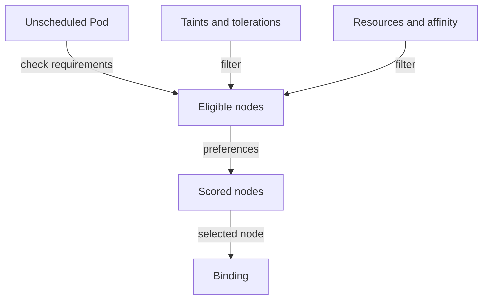
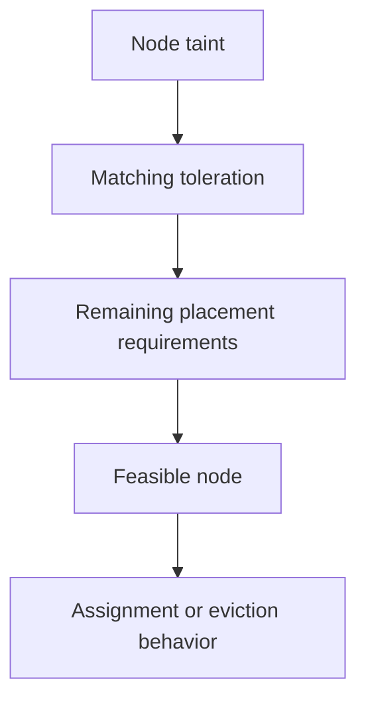

# Taints, Tolerations And Eligibility

A Pod tolerates a dedicated-node taint but lands elsewhere. The toleration removed one rejection condition; it did not request that node. Attraction and permission to tolerate are different rules.

## Learning objectives

- Explain scheduling filters and preferences.
- Compare required and preferred affinity.
- Interpret taints and tolerations.

## Before you start

This chapter is standalone reading material; no running cluster or installed tools are required. A Pod is the Kubernetes unit for running one or more containers, and a namespace groups namespaced objects. Treat the worked configurations as teaching examples rather than recorded observations from a provisioned environment.

## Responsible components and behavior

An operator reserves a node for specialized workloads. A taint is a node condition used to repel Pods unless they have a matching toleration. A toleration lets a Pod tolerate that taint; it does not require the Pod to run on that node.

Taint effects determine the consequence. `NoSchedule` prevents new placement of Pods that do not tolerate it. `PreferNoSchedule` expresses a softer avoidance. `NoExecute` can also evict existing Pods that do not tolerate it. A toleration for that effect can include a time limit, allowing the Pod to remain only for a specified period.

Use a placement requirement as well as a toleration when a workload must use dedicated nodes. The toleration makes the node permissible, and a node selector or required affinity narrows the target set. Other filters still apply: a tolerated node can lack requested resources or violate a storage topology condition.

Tolerating a taint participates in eligibility; scoring still chooses among the nodes that remain.

If `scout` tolerates a dedicated-node taint but lands on an ordinary node, that behavior can be correct because permission is not attraction. If it remains Pending on the dedicated node, inspect all the remaining requirements rather than assuming the toleration guarantees scheduling.

Placement questions become easier when the mechanisms are separated: labels describe nodes, selectors and affinity select or prefer locations, taints restrict access, and tolerations remove specific restrictions. None creates missing hardware or available capacity.

## Combining Dedicated Nodes With Tolerations

Suppose node A carries a taint indicating that it is dedicated to accelerator workloads. A general web Pod without a matching toleration is repelled under `NoSchedule`. An accelerator Pod with a matching toleration is allowed to consider A, but it can also consider untainted nodes unless another rule narrows its placement.

To require the accelerator Pod to use the dedicated group, combine the toleration with a node selector or required node affinity. The toleration removes the taint restriction. The selector supplies the attraction as a hard requirement. Neither alone expresses both intentions.

Tolerations match through defined keys, values, operators and effects. A narrowly specified toleration can permit one taint while leaving other taints effective. A broader existence-based match can permit more nodes than expected if it is not scoped carefully. Read the actual matching condition rather than assuming a descriptive name proves what it allows.

## Existing Pods And Eviction

A new `NoSchedule` taint prevents new non-tolerating placement but does not by itself remove an already running Pod. `NoExecute` can remove non-tolerating existing Pods. A matching toleration can allow indefinite residence or, when configured with a duration, temporary residence before eviction.

Temporary toleration can be useful for transient node problems: immediate eviction may be unnecessary when a node is expected to recover quickly. The duration nevertheless describes a policy decision, not a guarantee that the node will recover or that the replacement will find capacity elsewhere.

A controller can create a replacement after eviction, and that replacement goes through scheduling again. If every suitable node has the same untolerated taint or lacks capacity, eviction does not create a healthy alternative. Connect the taint's effect with the workload's desired replica count, replacement eligibility and application availability to explain the full result.

## Work through the decision

A taint affects how nodes accept or retain Pods. A matching toleration permits the relevant exception. `NoSchedule` concerns new placement, `PreferNoSchedule` expresses avoidance, and `NoExecute` can also affect existing Pods under the toleration's supported lifetime.

To require the dedicated hardware, combine appropriate toleration with a required selector or affinity. The scheduler still checks capacity and other mandatory constraints. A toleration cannot make an unhealthy node useful or supply a missing device. During maintenance or node failure, distinguish deliberately applied taints from condition-derived ones before weakening an isolation rule.

Tolerations permit specific taint behavior; they do not replace selection, capacity or node-health requirements.

Tolerations permit specific taint behavior; they do not replace selection, capacity or node-health requirements.

## Common pitfalls

> [!WARNING]
> A toleration permits placement on a tainted node. It does not attract a Pod there or override resource, affinity or storage constraints.
