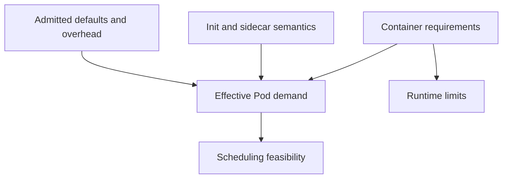

# Expressing Resource Needs For Every Container

The main process requests little memory, but its supporting container buffers a large amount of data. Scheduling and resource enforcement need the complete workload. A familiar request-to-limit ratio cannot replace that accounting.

## Learning objectives

- Explain defaults, quota and resource requirement admission.
- Distinguish policy rejection from scheduler placement.
- Evaluate complete container resource needs.

## Before you start

This chapter is standalone reading material; no running cluster or installed tools are required. A Pod is the Kubernetes unit for running one or more containers, and a namespace groups namespaced objects. Treat the worked configurations as teaching examples rather than recorded observations from a provisioned environment.

## Responsible components and behavior

A resource request declares capacity used in Kubernetes scheduling and related allocation behavior. A resource limit constrains allowed usage according to the resource and runtime. Application developers must express the needs of the complete Pod, including supporting containers, rather than assigning one memorable value to every workload.

## Understand CPU And Memory Units

CPU means central processing unit. Kubernetes CPU quantities express compute capacity, with millicpu representing thousandths of a CPU unit. Memory quantities express bytes with decimal or binary suffix conventions. Confusing `M` with `Mi`, or using a suffix intended for fractional CPU on memory, can create a drastically different requirement from the author's intention.

A request is not a measurement of current usage. A process using little CPU during one observation can still have a large declared request, and scheduling considers the declared capacity against the node's available allocation. Conversely, a very small request does not prove that the application can safely operate with little memory.

Limits also differ by resource. CPU usage can be throttled when the allowed runtime allocation is exhausted. A memory limit can result in an out-of-memory termination when the container exceeds its allowed memory. These are different failure mechanisms and require different application sizing and diagnostic evidence.

## Include The Whole Workload

Ordinary simultaneously running application containers contribute their requests to Pod placement. Init-container resource accounting has special rules because regular initialization runs sequentially before ordinary application containers. Restartable init sidecars complicate that simple sequential model because they continue running beside later containers.

For a `scout` application with a helper, scheduling cannot be reasoned about only from the main container's request. The helper consumes capacity too, and configured Pod overhead or supported Pod-level resource settings can affect the effective contract. Use the applicable cluster version and workload representation when calculating exact totals.

A container with missing settings can receive defaults from a namespace LimitRange. A ResourceQuota can constrain namespace totals and required resource declarations. The effective admitted Pod can therefore differ from a source file containing no explicit request. Examine defaults and admission behavior before assuming omitted fields mean zero allocation.

## Scheduling Failure And Runtime Failure

A Pod that cannot fit its requests can remain Pending even if live usage on a node looks low. The scheduler's capacity decisions account for declared allocations and applicable placement constraints. Reducing a request to force placement can lead to poor runtime behavior if the new value no longer represents realistic needs.

A running process terminated for memory pressure needs a different investigation. Compare termination reason, limit, measured usage and application behavior over time. A higher request can influence placement without necessarily raising the container's memory limit. Raising only the request does not automatically remove the termination threshold.

A namespace quota rejection happens during API admission for the relevant object creation or update. It is not a scheduler decision after a Pod was accepted. Distinguish a rejected request from an accepted Pending Pod, because changing node capacity cannot directly fix every quota policy violation.

## Select Requirements Deliberately

Use expected steady use, initialization behavior and meaningful peaks to form a sizing decision. A workload processing large reports may need more temporary memory than its idle observation suggests. A helper that buffers records can also grow when its external destination is slow.

Limits should reflect intended protection and application tolerance. A restrictive CPU limit can increase response time through throttling, while no limit can leave shared capacity exposed to high demand. The correct choice depends on the workload and platform policy rather than a universal ratio between request and limit.

After expressing requirements, review the complete admitted workload and its observed scheduling and execution. Resource definitions are part of an application contract, not a guarantee that every future input fits. Preserve a distinction among allocation, enforcement, defaults and namespace policy when explaining a failure.

## Work through the decision

For ordinary containers running together, resource demand includes each container's requests. Regular sequential init containers use different accounting from simultaneous application containers, and restartable init sidecars add ongoing demand. Pod overhead and version-supported Pod resource settings can further affect the effective requirement.

Inspect the admitted Pod as well as the Deployment template. Namespace defaults can fill omitted values when Pods are created. That makes a short source definition insufficient evidence for exact scheduling demand. Central processing unit (CPU) and memory also fail differently: CPU limits can throttle execution, while memory exhaustion can terminate a process. Raising one resource does not solve the other's failure.

Effective scheduling demand and runtime limits are related declarations with different jobs.

You can now account for the actual admitted workload and classify a resource failure. A justified size preserves application requirements rather than merely making a Pending status disappear.

## Common pitfalls

> [!WARNING]
> Requests, limits, usage and quotas answer different questions. Account for all running containers, correct units and admitted defaults, then distinguish placement failure from resource enforcement during execution.
