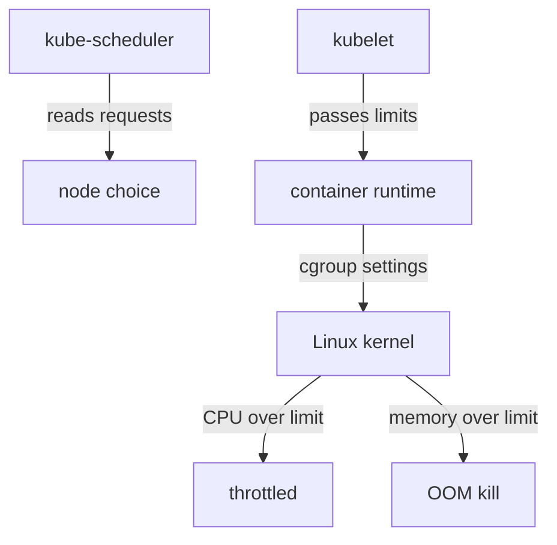

# Requests, Limits, Throttling And OOM Kills

A container in the `starfleet` namespace runs fine on a quiet node and gets killed on a busy one. The cause is almost always a resource setting that does not match what the program needs. This part explains what a request and a limit are, which component reads each one, and how a container behaves when it reaches a limit. CPU and memory behave very differently, and the exam expects you to know both.

## Requests and limits are read by different components

A **resource request** is the amount of CPU or memory that a container asks for. The scheduler (`kube-scheduler`) adds up the requests of the pods already on a node and places a new pod only on a node that still has enough unreserved capacity. The scheduler never looks at real usage. A node with a lot of idle CPU can still refuse a pod when the requests on the node already add up to its allocatable capacity.

A **resource limit** is the maximum that a container may use. The kubelet, which runs on each node, passes the limit to the container runtime, and the runtime asks the Linux kernel to enforce it with control groups (cgroups). The scheduler does not use limits for placement. The kubelet also uses the CPU request to set the container's CPU weight, so under contention a container with a larger request gets a larger share of CPU time.

CPU is written in cores or millicores: `500m` is half a core. Memory is written in bytes with a suffix: `128Mi` is 128 mebibytes. Both are set per container under `resources`.



The diagram shows that requests end at the scheduler and limits end at the kernel, and that the kernel reacts differently to the two resources.

## Look at a container's resources

The playground has a Deployment `scout` in `starfleet`. Read the resources of its first container:

<!-- astrona:playground:renew -->

```sh
kubectl -n starfleet get deployment scout -o jsonpath='{.spec.template.spec.containers[0].resources}{"\n"}'
```

The playground starts the workloads without resource settings, so the command prints an empty object. A container with no request counts as zero for the scheduler, which is why it is easy to place and easy to starve.

## CPU is throttled

CPU is a **compressible** resource: the kernel can slow a container down without harming it. When a container tries to use more CPU than its limit, the kernel throttles it. The container is paused until the next scheduling period and then runs again. The container is not restarted and no event appears in the cluster. The visible effect is higher latency.

A CPU limit therefore trades speed for fairness. A container with a limit of `200m` never uses more than 20 percent of one core, even when the node is idle. Many teams set a CPU request but no CPU limit for latency-sensitive services for this reason.

## Memory is killed

Memory is **not compressible**: the kernel cannot take memory back from a running process. When a container tries to use more memory than its limit, the kernel out-of-memory (OOM) killer ends a process in that container, usually the main process. The kubelet sees the container exit and records the reason `OOMKilled` with exit code 137. Then it restarts the container if the pod's `restartPolicy` allows it. A container that keeps exceeding its limit moves through `OOMKilled` and `CrashLoopBackOff`.

Save this as `pod-memory-hog.yaml`. The container tries to allocate about 200 MiB with a limit of 64 MiB:

```yaml
apiVersion: v1
kind: Pod
metadata:
  name: memory-hog
  namespace: starfleet
spec:
  restartPolicy: Never
  containers:
    - name: hog
      image: docker.io/library/python:3.13-alpine
      command: ["python", "-c", "data = bytearray(200 * 1024 * 1024); print('allocated')"]
      resources:
        requests:
          cpu: 50m
          memory: 32Mi
        limits:
          cpu: 100m
          memory: 64Mi
```

Apply it:

```sh
kubectl apply -f pod-memory-hog.yaml
```

Then check why the container ended. Allow a few seconds for the pod to run:

```sh
kubectl -n starfleet get pod memory-hog -o jsonpath='{.status.containerStatuses[0].state.terminated.reason}{"\n"}'
```

The command prints `OOMKilled`. The `bytearray` call touches every page it allocates, so the memory is really used and the kernel enforces the limit. A program that only reserves address space without using it would not be killed.

## Why the exit code and the event matter

Exit code 137 is 128 plus signal 9, which is `SIGKILL`. It tells you the process did not exit on its own. `kubectl describe pod memory-hog` shows the same reason in the `Last State` or `State` block of the container. When a pod restarts, the old reason moves to `Last State`, so read both blocks before you decide what failed.

An OOM kill is not an eviction. The kubelet evicts pods only when the whole node runs low on a resource. An OOM kill at the container limit happens even on an idle node. The fix is a larger limit, or a program that uses less memory, not a different node.

## Requests above limits are invalid

A request must be less than or equal to the limit for the same resource. The API server rejects a pod where it is not. When you set only a limit, Kubernetes copies the limit into the request for that resource, so the pod asks for as much as it may use. When you set only a request, the container has no limit and may use all free memory on the node, which makes it a candidate for the OOM killer when the node runs short.

You now know that the scheduler uses requests, the kernel enforces limits, CPU over the limit is slowed and memory over the limit is killed. The open question is how a cluster administrator makes every team set these values, and caps what a namespace may use in total.

## Common pitfalls

> [!WARNING]
> - **Reading a limit as a reservation.** The scheduler reserves only the request. A node can run out of memory while every pod stays under its limit, because limits may add up to more than the node has.
> - **Blaming the scheduler for an OOM kill.** An `OOMKilled` reason is set by the kernel at the container limit. Raise the limit or reduce the usage.
> - **Setting a very low CPU limit.** The container is throttled without any event or error, and the only sign is slow responses.
> - **Setting only a limit.** The request is copied from the limit, so the pod reserves more than you may have intended.
