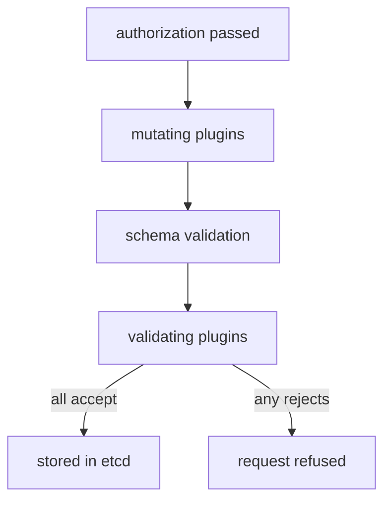

# The Admission Chain And Built-In Controllers

A developer applies a Deployment with a priority class that does not exist, and the request fails even though the developer has every permission needed. The failure comes from an admission plugin. This part shows where admission sits, which built-in plugins act on pods, and how to find out what is enabled in a cluster.

## Where admission sits

Every request to the API server passes the same stages. Authentication finds out who sent it. Authorization (usually RBAC, role-based access control) decides whether that identity may do the action. Admission then runs for requests that create, update or delete objects. Admission does not run for reads. After admission the API server writes the object to etcd, the cluster database.

Admission has two phases. In the **mutating** phase, plugins may change the object, for example by adding default values. In the **validating** phase, plugins only accept or reject. Between the two phases the API server checks the object against its schema. All mutations are finished before validation starts, so a validating plugin always sees the final object.



The diagram shows that one rejection in the validating phase refuses the whole request, and that nothing is stored.

## Built-in plugins that act on pods

The API server has a list of compiled-in admission plugins. Some are on by default. These are the ones that matter for pods:

- `LimitRanger`: adds default requests and limits from a LimitRange and rejects values outside its rules (mutating and validating).
- `ResourceQuota`: rejects a request that would exceed a ResourceQuota (validating).
- `Priority`: turns `priorityClassName` into the integer `spec.priority`, and rejects a pod that names a missing class (mutating and validating).
- `PodSecurity`: enforces the Pod Security Standards set by namespace labels (validating).
- `ServiceAccount`: sets the default service account and mounts its token (mutating).
- `DefaultTolerationSeconds`: adds the default tolerations for not-ready and unreachable nodes (mutating).
- `NamespaceLifecycle`: refuses new objects in a namespace that is being deleted or does not exist.
- `NodeRestriction`: limits a kubelet to changing only its own node and the pods on it. It is not on by default in the API server, but the tool that builds the cluster usually turns it on.

The flag `--enable-admission-plugins` adds plugins and `--disable-admission-plugins` removes default ones. You can read the flags of the API server in the static pod manifest on the control plane node, or from the pod object.

<!-- astrona:playground:renew -->

```sh
kubectl -n kube-system get pod -l component=kube-apiserver -o jsonpath='{.items[0].spec.containers[0].command}' | tr ',' '\n' | grep admission
```

On a cluster built with `kubeadm`, which `kind` uses, the output includes `--enable-admission-plugins=NodeRestriction`. The default plugins are not listed, because they are on without a flag.

## Rejections name the plugin

Create a pod that names a priority class that does not exist. Save this as `pod-bad-priority.yaml`:

```yaml
apiVersion: v1
kind: Pod
metadata:
  name: bad-priority
  namespace: starfleet
spec:
  priorityClassName: not-a-class
  containers:
    - name: probe
      image: docker.io/library/busybox:1.37.0
      command: ["sleep", "3600"]
```

Apply it:

```sh
kubectl apply -f pod-bad-priority.yaml
```

The request fails with a `Forbidden` error. The text says the pod is forbidden and that no PriorityClass with the name `not-a-class` was found. The error comes from the `Priority` plugin, not from RBAC: a `Forbidden` error from authorization says the user cannot do the verb, while this one names a missing class. Read the text after `forbidden:` to tell the two apart.

## Dynamic admission webhooks

Built-in plugins cover common rules. For anything else, a cluster can call a service over HTTPS. A **ValidatingWebhookConfiguration** or **MutatingWebhookConfiguration** lists the resources and operations to match, the service to call and a `failurePolicy`. The API server sends an `AdmissionReview` request with the object, and the service answers with allowed or denied, and for mutating webhooks a patch.

`failurePolicy` decides what happens when the call fails or times out. `Fail` rejects the request. `Ignore` lets it through. A webhook with `Fail` that matches pods in `kube-system` and runs as a pod in the cluster can block the creation of its own pod, so such webhooks exclude system namespaces with a `namespaceSelector`. List the webhooks of a cluster:

```sh
kubectl get validatingwebhookconfigurations,mutatingwebhookconfigurations
```

A fresh `kind` cluster has none, so the command reports that no resources were found. When a webhook rejects a request, the message names the webhook, in the form `admission webhook "<name>" denied the request`, followed by the message from the service.

## Reading any rejection

A rejection text has three useful parts. The first names the object and the verb. The second names the source: a plugin such as `exceeded quota`, a webhook name, or a policy name. The third gives the reason. Start with the source, because it tells you which object to inspect. Then run the same request again with `--dry-run=server`, which runs authentication, authorization and admission without storing the object, to test a fix safely.

You now know the order of the chain, the plugins that act on pods and how to read their rejections. The open question is how to write your own rule without building and running a webhook service.

## Common pitfalls

> [!WARNING]
> - **Confusing `Forbidden` from RBAC with `Forbidden` from admission.** Read the text after the colon. RBAC names the user and the verb. Admission names a plugin, a quota or a policy.
> - **Using `--dry-run=client` to test admission.** Only `--dry-run=server` runs the admission chain.
> - **Setting `failurePolicy: Fail` on a webhook that runs inside the cluster it guards.** When the webhook pod is down, requests that match are refused, including the ones that would restart it.
> - **Expecting admission to change existing objects.** Plugins act on a request. Objects that are already stored stay as they are until the next update.
