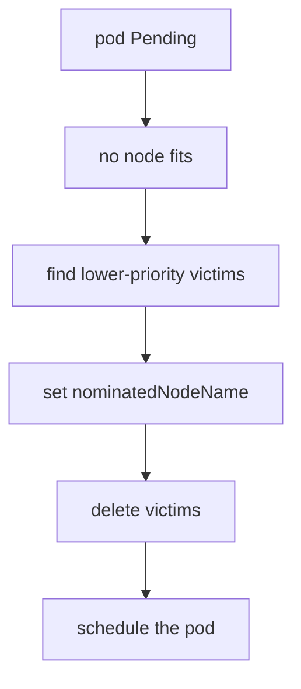

# Priority Classes And Preemption

The `scout` workload in `starfleet` must always run. A batch workload fills the only worker node, and the new `scout` pod stays in `Pending`. Adding nodes is one answer, but the cluster can also make room itself: it can remove the less important pods. Kubernetes does this with priority and preemption.

## A PriorityClass is a name for a number

A **PriorityClass** is a cluster-wide object (it has no namespace) that maps a name to an integer `value`. Pods name a class with `spec.priorityClassName`. The `Priority` admission plugin looks up the class when the pod is created and writes the number into `spec.priority`. After that, the scheduler uses only the number. A pod that names a class that does not exist is rejected.

The fields of a PriorityClass are:

- `value`: required. A user class may use any 32-bit integer up to 1,000,000,000. Larger values are reserved for system classes.
- `globalDefault`: optional. When true, pods that name no class get this class. Only one class may be the global default. Without one, such pods have priority 0.
- `preemptionPolicy`: `PreemptLowerPriority` (the default) or `Never`.
- `description`: free text for people.

The names `system-cluster-critical` and `system-node-critical` exist in every cluster for components that the cluster cannot run without. Class names that start with `system-` are reserved.

Save this as `priorityclass-critical.yaml`:

```yaml
apiVersion: scheduling.k8s.io/v1
kind: PriorityClass
metadata:
  name: critical-service
value: 100000
globalDefault: false
description: "Services that must keep running when the cluster is full."
```

<!-- astrona:playground:renew -->

Apply it and list the classes:

```sh
kubectl apply -f priorityclass-critical.yaml
kubectl get priorityclass
```

The list shows the two system classes with their large values and `critical-service` with `100000`. Setting `globalDefault: true` or creating a class never changes pods that already exist. Their `spec.priority` was written at creation.

## Use the class in a workload

Set `priorityClassName` in the pod template of the Deployment, not in the Deployment itself. A change to the template starts a rollout, and the new pods get the number:

```sh
kubectl -n starfleet patch deployment scout --type=merge -p '{"spec":{"template":{"spec":{"priorityClassName":"critical-service"}}}}'
kubectl -n starfleet rollout status deployment/scout
kubectl -n starfleet get pod -l app=scout -o jsonpath='{.items[0].spec.priority}{"\n"}'
```

The last command prints `100000`. In a cluster with free capacity nothing else changes, because priority matters only when pods compete.

## The scheduling queue and the preemption flow

The scheduler keeps pending pods in a queue ordered by priority, so a pod with a higher number is tried first. When no node fits a pod, the scheduler runs **preemption** for it. The steps are:

1. For each node, the scheduler checks whether removing pods of lower priority would let the pod fit. A pod is never a victim for a pod of equal or higher priority.
2. It picks the node where the fewest and least important pods must go. It prefers victims whose PodDisruptionBudget (PDB) allows the removal, but it can break a PDB when no other node works.
3. It sets `status.nominatedNodeName` on the waiting pod and deletes the victims. The victims follow their normal graceful termination.
4. When the space is free, the next scheduling attempt places the pod on that node.



The diagram shows that the scheduler deletes pods first and schedules afterwards. The node is only nominated, not reserved for certain: a pod with a still higher priority may take the space.

## Preemption can be turned off for a class

A class with `preemptionPolicy: Never` gives its pods an early place in the queue, but those pods never delete other pods. They wait until space is free. Use it for important batch jobs that should go first without disturbing running services. Such a pod can still be preempted by pods of higher priority.

Save this as `priorityclass-batch.yaml`:

```yaml
apiVersion: scheduling.k8s.io/v1
kind: PriorityClass
metadata:
  name: batch-first
value: 50000
preemptionPolicy: Never
description: "Goes first in the queue but never removes other pods."
```

Apply it:

```sh
kubectl apply -f priorityclass-batch.yaml
```

## Limits of the mechanism

Preemption considers resource requests, node selectors, taints and affinity, so removing a victim must make the pod schedulable for all of them. A pod that needs a node label that no node has stays `Pending` no matter how many pods it could remove. A pod that preempts also does not skip graceful termination, so the replacement may wait for the full grace period of the victims.

A cluster where any user can create pods with a high priority lets that user evict the work of others. Restrict this with a ResourceQuota that has a `PriorityClass` scope, and with admission rules.

You now know how priority is written into a pod, how the scheduler queue uses it and how preemption removes victims. Priority decides who gets a place, but it does not decide who is killed when a node runs out of memory. That is decided by the quality of service class.

## Common pitfalls

> [!WARNING]
> - **Expecting a new `globalDefault` class to change running pods.** It applies only to pods created after the class exists.
> - **Putting `priorityClassName` on the Deployment object.** It belongs in `spec.template.spec`. Otherwise the field is rejected or ignored.
> - **Using a very high value.** Anything above one billion is refused for user classes, and values close to the limit leave no room for a more important class later.
> - **Assuming a preempted pod comes back at once.** The Deployment creates a replacement, which stays `Pending` while the higher-priority pod holds the space.
